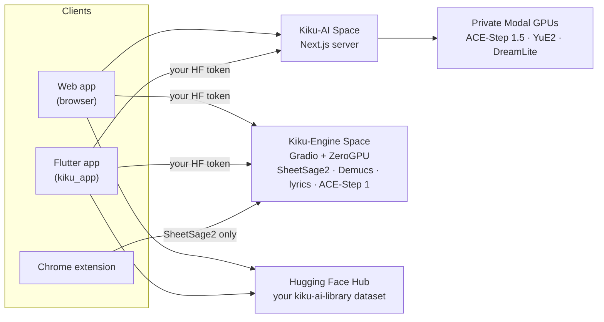
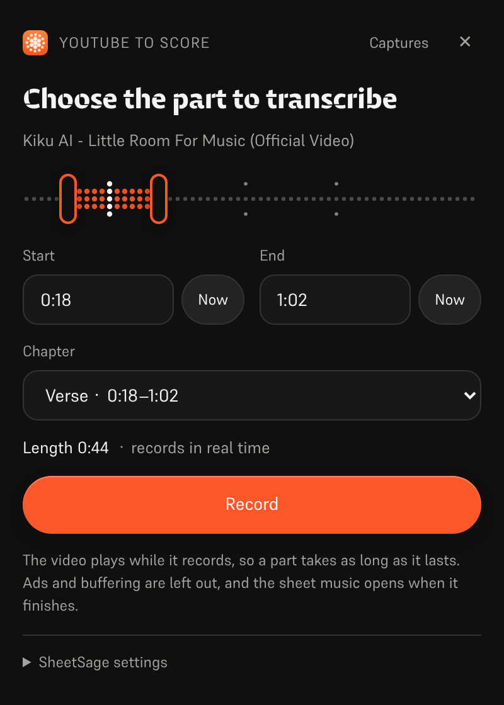
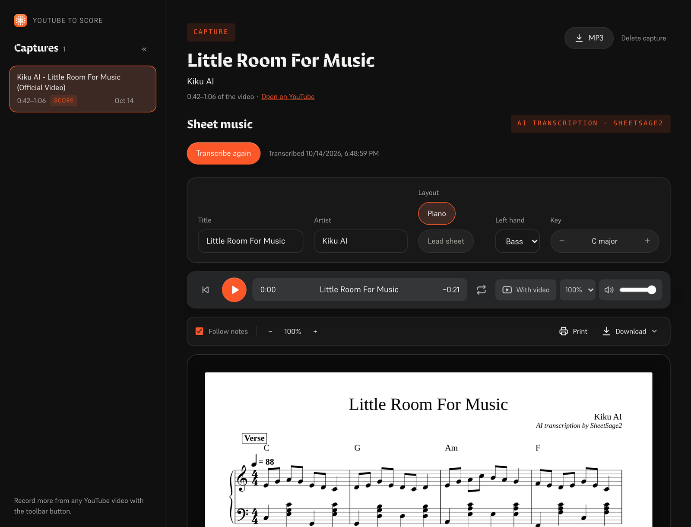
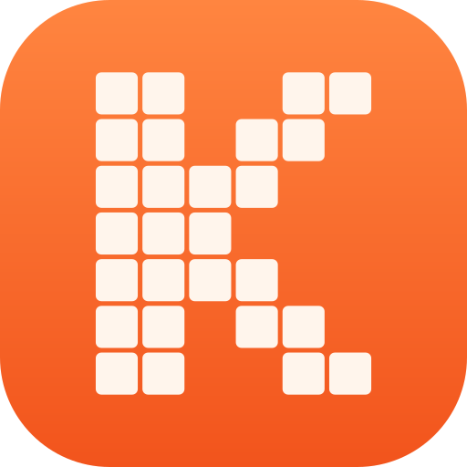

<p align="center"></p>

<h1 align="center">Kiku AI</h1>

<p align="center">Write songs from a sentence, reshape your own recordings, and turn any recording into sheet music.</p>

<p align="center">
  <a href="https://huggingface.co/spaces/Reubencf/Kiku-AI"><b>Web app</b></a> ·
  <a href="#flutter-app"><b>Phone and Mac app</b></a> ·
  <a href="#chrome-extension-youtube-to-score"><b>Chrome extension</b></a>
</p>

Kiku AI is a music studio built around open models: **ACE-Step** and **YuE2** write and edit
songs, **SheetSage2** writes sheet music from audio, and **Demucs** splits a mix into stems. It
comes in three forms that share one set of engines and one library in your Hugging Face account:

| | What it is | Where |
| --- | --- | --- |
| **Web app** | The full studio, live on the Hugging Face Space [Reubencf/Kiku-AI](https://huggingface.co/spaces/Reubencf/Kiku-AI) | [`outputs/kiku-ai`](outputs/kiku-ai) |
| **Flutter app** | The same app for Android, iPhone, iPad and Mac | [`kiku_app`](kiku_app) |
| **Chrome extension** | YouTube to Score: record part of a video and get sheet music | [`outputs/youtube-to-score-extension`](outputs/youtube-to-score-extension) |
| Engines | Gradio ZeroGPU Spaces and private Modal GPUs | [`outputs/kiku-engine-space`](outputs/kiku-engine-space), [`outputs/kiku-acestep15-space`](outputs/kiku-acestep15-space), [`outputs/kiku-modal`](outputs/kiku-modal) |
| On-device experiment | YuE2 and SheetSage2 as GGUF, running inside a Flutter app | [`flutter_app`](flutter_app) |
| Branding | The logo and the script that draws every icon | [`branding`](branding) |

## How it fits together



Everyone signs in with Hugging Face. ACE-Step 1.5 and YuE2 run on Kiku's private Modal GPUs
through the Kiku-AI server. Transcription, stems, lyrics and ACE-Step 1 run on the Kiku-Engine
Space against each user's own ZeroGPU allowance. Songs, studio projects and scores are saved to a
private dataset in each user's own account, so work moves between browser and phone.

## Web app

Open it at [huggingface.co/spaces/Reubencf/Kiku-AI](https://huggingface.co/spaces/Reubencf/Kiku-AI).
It has a home page, **Generate** (songs from an idea or from your own style and lyrics),
**Studio** (a multitrack editor where selections can be restyled, rewritten, extended, split
into stems or covered by YuE2, and instruments added), **Score** (SheetSage2 lead sheets you can
play, edit and download) and **Library**.

To run it locally you need Node.js 24 and FFmpeg/ffprobe. From `outputs/kiku-ai`, run `npm ci`,
copy `env.example` to `.env.local`, set a private `SESSION_SECRET` and the API and OAuth
settings, then run `npm run dev`. Never commit credentials. Details:
[outputs/kiku-ai/README.md](outputs/kiku-ai/README.md).

## Flutter app

[`kiku_app`](kiku_app) is Kiku AI as a native app for **Android, iPhone, iPad and Mac**, written
in Flutter. It has the same five sections as the web app:

- **Home**: type an idea and tap **Create**.
- **Generate**: Simple or Custom mode, ACE-Step 1.5 or YuE2, Enhance, and cover art for every song.
- **Studio**: a multitrack editor with recording, a mixer, split, undo and WAV export. AI actions
  (Restyle, Rewrite, Extend, YuE2 Cover, Demucs stems, Lyrics, Add instrument) arrive as takes you
  can switch on and off.
- **Score**: SheetSage2 lead sheets, engraved like the web app's, that follow the recording bar
  by bar. Share them as PDF, MIDI, MusicXML or ABC.
- **Library**: the same private dataset the web app uses, so songs, projects and scores move
  between phone and browser.

It signs in with Hugging Face (OAuth with PKCE, or a pasted access token) and calls the deployed
services directly with the user's own token. It has no server of its own.

**Try it on Android**: open the latest successful
[Kiku AI app workflow run](https://github.com/Reubencfernandes/musical/actions/workflows/kiku-app.yml)
and download the `kiku-ai-android` artifact (a test APK signed with a debug key).

**Build it yourself** with Flutter 3.44.7:

```sh
cd kiku_app
flutter pub get
flutter run            # pick an Android phone, an iPhone, a simulator or macOS
```

> [!NOTE]
> The app needs two things from the Kiku-AI server: bearer-token sign-in and the
> `kikuai://oauth/callback` redirect in its OAuth client. Both are in `outputs/kiku-ai` in this
> repository. If the deployed Space predates them, redeploy it with `work/deploy_kiku_app.py`.

Requirements, sign-in, the library layout, development notes and troubleshooting are in
**[kiku_app/README.md](kiku_app/README.md)**.

## Chrome extension: YouTube to Score

Record part of a YouTube video and get it back as sheet music: SheetSage2 writes the melody and
chords, and the extension engraves them as a piano score or a lead sheet that plays along with the
recording.

<p align="center">
  
  &nbsp;
  
</p>
<p align="center"><sub>Left: choosing the part to record. Right: the capture page with the engraved score (example transcription).</sub></p>

### Install

The extension is not on the Chrome Web Store; you load it into Chrome yourself. It needs Chrome 116
or newer (other Chromium browsers such as Edge work too).

1. **Get the files**, either way:
   - Download **`kiku-youtube-to-score.zip`** from the
     [`extension-latest` release](https://github.com/Reubencfernandes/musical/releases/tag/extension-latest)
     and unzip it. (GitHub Actions rebuilds it from `main` whenever the extension changes.)
   - Or download this repository (**Code → Download ZIP**, or `git clone https://github.com/Reubencfernandes/musical.git`)
     and use the folder `outputs/youtube-to-score-extension`.
2. Open `chrome://extensions` and switch on **Developer mode** (top right).
3. Click **Load unpacked** and choose the unzipped folder (the one with `manifest.json` in it).
4. Click the puzzle-piece icon in the toolbar and pin **YouTube to Score**.

To update, replace the folder with the new files and click the reload arrow on the extension's
card in `chrome://extensions`.

### Set up (recommended)

Transcription runs on a Hugging Face ZeroGPU Space. Without a token it uses the Space's shared
anonymous allowance, which runs out after a few clips.

1. Create a **read** token at [huggingface.co/settings/tokens](https://huggingface.co/settings/tokens).
2. Click the toolbar button, open **SheetSage settings** at the bottom of the panel, paste the token
   and press **Save**. It stays in this browser only.
3. **Space** defaults to `Reubencf/Score-Studio-API`. Any Space with the same
   `/transcribe(audio, start, duration, melody_only, piano)` endpoint works, such as
   `Reubencf/Kiku-Engine`; enter it as `owner/name` or a full `https://….hf.space` address.

### Use it

1. **Open a song** on YouTube or YouTube Music and click the **YouTube to Score** button. A side
   panel opens next to the video.
2. **Choose the part.** Drag the two handles on the dotted timeline, type **Start** and **End**
   (minutes:seconds), press **Now** to use where the video is, or pick a **Chapter**. A part is
   5 seconds to 10 minutes.
3. **Press Record.** The video jumps to the start and plays while the extension records the tab's
   sound. It records in real time, so a one-minute part takes a minute; ads, pauses and buffering are
   left out. **Stop and keep** ends early, **Discard** throws it away.
4. **Get the score.** When the recording finishes, the capture page opens and sends the clip to
   SheetSage2. It usually takes under a minute (longer when the Space has to wake up). The result is
   saved with the capture, so it outlives the Space's 24-hour file cache.
5. **Read, play and download.**
   - **Layout**: **Piano** (melody in the right hand over a left hand built from the chords) or
     **Lead sheet** (melody with chord symbols). **Key** transposes up to six semitones; title and
     artist come from the video and can be edited.
   - **Play** follows the recording bar by bar; click any bar to play from there. **With video**
     plays the YouTube video muted, in time with the sheet.
   - **Download** has the engraved score as PDF and MusicXML (for MuseScore, Finale, Sibelius or
     Dorico), plus SheetSage2's own MIDI, ABC and PDF. **Print** prints just the pages, and **MP3**
     saves the recording.
6. **Find captures again** with **Captures** in the panel. Each can be transcribed again or deleted.

### Optional: get audio in seconds (Windows, yt-dlp)

On your own PC the extension can fetch the part with [yt-dlp](https://github.com/yt-dlp/yt-dlp)
instead of recording it in real time. Install Python, `pip install -U yt-dlp` and ffmpeg, then run
`powershell -ExecutionPolicy Bypass -File native\install.ps1` from the extension folder (pass
`-ExtensionId <id>` with the ID `chrome://extensions` shows for your copy). Reload the extension and
the panel shows **Get audio now**. This helper is left out of the release ZIP; see the
[extension README](outputs/youtube-to-score-extension/README.md#get-audio-now-optional-yt-dlp-on-your-own-pc).

### If something goes wrong

- *"The Space turned the request away"*: the anonymous GPU allowance is used up. Add a token (above)
  or try later.
- *Nothing was recorded*: the video has to play after you press Record. Make sure it starts playing,
  then record again.
- Only record music you have the right to use; downloading YouTube content may be against YouTube's
  Terms of Service. SheetSage2's weights are CC BY-NC 4.0 (non-commercial).

More detail, including how each file works: [extension README](outputs/youtube-to-score-extension/README.md).

## On-device experiment (`flutter_app`)

Separate from the Kiku AI app above, `flutter_app` explores running the models on the device
itself: on-device generation and transcription, audio editing and export, with the same orange
dot-matrix musicians and visual style. See the [mobile feasibility notes](docs/mobile-inference.md).

It calls the pinned audio.cpp C API for YuE2 and SheetSage2 GGUF execution, with verified model
downloads, style and lyrics generation, recording transcription, local playback and file export.
Follow [Flutter setup](flutter_app/README.md) and the
[Apple native build instructions](flutter_app/native/README.md); a normal Flutter build alone
does not bundle the audio runtime, and browser builds show a native-app notice.

Its current limits: actual inference with model weights and Apple device builds still need
validation; incremental generated audio and the editor are not implemented; Android native
packaging is pending (the integration prioritises iOS and macOS). No phone performance,
generation speed or low-end phone support is claimed.

## Deployed architecture

ZeroGPU only supports the Gradio SDK, so inference lives in Gradio Spaces and the interface is
a separate CPU Docker Space. ACE-Step 1.5 needs Python 3.11 and Gradio 6, which cannot share the
engine's stack, so it has its own Space with the same endpoint names:

| Space | SDK | Holds |
| --- | --- | --- |
| [Kiku-Engine](https://huggingface.co/spaces/Reubencf/Kiku-Engine) | Gradio + ZeroGPU | SheetSage2, YuE2, ACE-Step, Demucs, and the OAuth client |
| [Kiku-ACE-Step-15](https://huggingface.co/spaces/Reubencf/Kiku-ACE-Step-15) | Gradio 6 + ZeroGPU | ACE-Step 1.5 (turbo, base and the 1.7B planner) and Demucs |
| [Kiku-AI](https://huggingface.co/spaces/Reubencf/Kiku-AI) | Docker (CPU) | The Next.js interface and server |
| [Score-Studio-API](https://huggingface.co/spaces/Reubencf/Score-Studio-API) | Gradio + ZeroGPU | The original transcription API, still the extension's default |

Sources: `outputs/kiku-engine-space`, `outputs/kiku-acestep15-space` and `outputs/kiku-ai`. Deploy with
`work/deploy_kiku_spaces.py` and `work/deploy_kiku_app.py` (both read `HF_TOKEN`). Each deploy of
the Kiku-AI Space restarts it, which ends any job running at the time.

The ACE-Step 1.5 Modal backend is deployed in the active `konkanillm`
workspace. Source, setup commands, and measured cold/warm timings are in
[the Modal deployment notes](outputs/kiku-modal/README.md) and
[the trial report](outputs/kiku-modal/TEST_RESULTS.md). It uses one L40S worker with private
API access, CPU memory snapshots, and scale-to-zero. The web app routes ACE-Step
1.5 generation and planning through authenticated server routes to Modal.
YuE2 runs on its own private Modal L40S worker (`kiku-yue2`), using the native
PyTorch runtime and CPU import snapshots. Generate allows choosing YuE2 or
ACE-Step 1.5 in both Simple and Custom mode. SheetSage2, ACE-Step 1 and
standalone stem/lyrics jobs still use Hugging Face.

`outputs/score-studio-api`, `outputs/kiku-yue2-space` and `outputs/kiku-acestep-space` are the
superseded single-model Spaces, kept until the merged engine has run in earnest.
`outputs/sheetsage2-space` is the original Gradio implementation. `work` holds deployment and
verification scripts. Hosting more than two ZeroGPU Spaces on one account requires PRO.

### How three models share one Space

They pin conflicting versions — transformers 4.45.2 (SheetSage2), 4.50.0 (ACE-Step) and 4.57.6
(YuE2) — so pip cannot satisfy all three. The YuE2 wheel's stack wins and the other two run on
it; `acestep` installs with `--no-deps` at startup and its real inference imports are listed in
`requirements.txt`. `torchaudio` and `torchvision` must stay pinned to the torch 2.10.0 pair, or
pip takes CUDA 13 builds that cannot load against CUDA 12 torch.

Each model loads on first use, not at import: YuE2 reaches low-level CUDA init while
constructing, which ZeroGPU refuses outside a `@spaces.GPU` function. SheetSage2 additionally
merges LoRA adapters during load and accepts only CPU float32, so it is cast on the way to
the GPU.

### Keeping a tune

YuE2 keeps a tune by working from a score, not the sound: SheetSage2 reads a stretch's melody,
chords and bar lines, the user can edit that score, and YuE2 performs it (a cover, sung or on an
instrument). The render is time-warped bar by bar onto the recording's own bar lines, so it
stays in sync with the rest of the project.

The engine also has endpoints that build a band under a kept vocal (`/accompany` and
`/band_score`): they lift the voice off any backing with Demucs, measure the beat grid and
per-bar chords, and have ACE-Step or YuE2 play a band on them before mixing it under the voice.
The studio no longer offers this, but the endpoints remain.

## Development

| Part | Check it | Run it |
| --- | --- | --- |
| Web app (`outputs/kiku-ai`) | `npm run typecheck` | `npm ci`, then `npm run dev` |
| Flutter app (`kiku_app`) | `flutter analyze`, `flutter test` | `flutter pub get`, then `flutter run` |
| On-device experiment (`flutter_app`) | `flutter analyze`, `flutter test` | see [its README](flutter_app/README.md) |
| Extension | load it unpacked | see [its README](outputs/youtube-to-score-extension/README.md) |

Both Flutter projects are validated with Flutter 3.44.7 / Dart 3.12.2. iPhone builds need macOS,
Xcode and signing set up for your account.

GitHub Actions:

- [`kiku-app.yml`](.github/workflows/kiku-app.yml), on changes to `kiku_app/`: analyzer and
  tests (including a FLAC check against libFLAC), an Android APK artifact, and iOS and macOS builds.
- [`extension.yml`](.github/workflows/extension.yml), on changes to the extension: checks the
  manifest, packages the ZIP and, on `main`, updates the `extension-latest` release.

Development scripts in `work` may still contain Windows-specific paths, so review them before
use. Credentials, build caches and private test recordings are kept out of the repository.

## The logo

The mark is a chrysanthemum of dots (*kiku*, 菊) that swirls like sound (*kiku*, 聞く, "to listen"),
drawn like the dot-matrix musicians. It replaces the earlier dotted "K" with an accent dot, which
looked too much like Kimi's logo. [`branding/generate.py`](branding/generate.py) draws it and
writes every icon: the extension's, the web app's favicon, and the Flutter app's launcher icons.

<p align="center"> &nbsp; </p>

## Licences and credits

Model weights are downloaded separately and keep their own licences; this repository does not
relicense them. YuE2, SheetSage2 and DreamLite-base are CC BY-NC 4.0 (non-commercial); ACE-Step
is Apache 2.0 and Demucs is MIT. Soundfont attribution is in
`outputs/kiku-ai/public/soundfonts/ATTRIBUTION.md`, font notices are in
`outputs/kiku-ai/public/fonts/README.md`, and the bundled abcjs notices travel with its copies.

Kiku AI was formerly called Score Studio; notation remains one of its modes. This repository is
named `musical`. Original project folder: `E:\ScoreStudio`.
