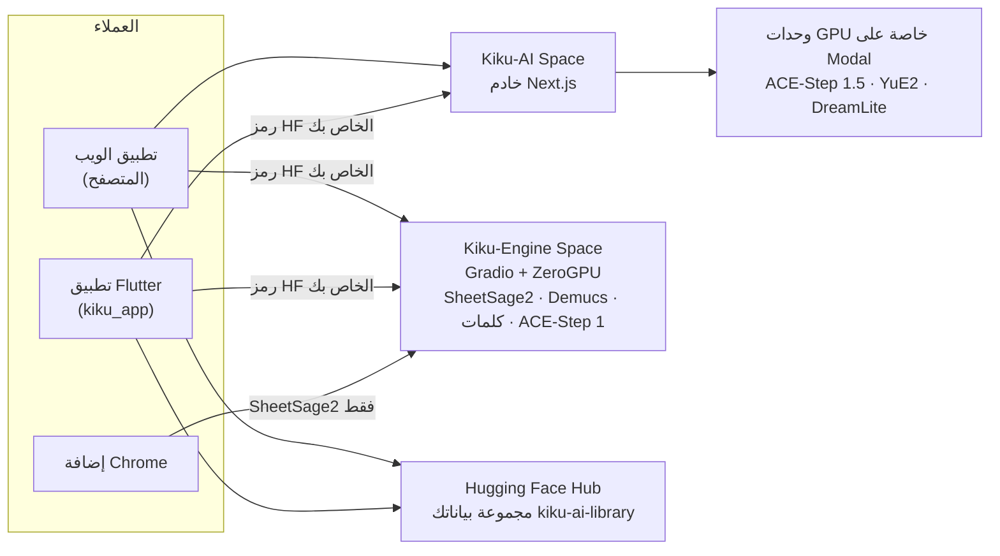

<p align="center">
  <a href="../../README.md">English</a> ·
  <a href="README.zh-CN.md">简体中文</a> ·
  <a href="README.es.md">Español</a> ·
  <a href="README.hi.md">हिन्दी</a> ·
  <b>العربية</b> ·
  <a href="README.pt-BR.md">Português</a> ·
  <a href="README.fr.md">Français</a> ·
  <a href="README.ru.md">Русский</a> ·
  <a href="README.ja.md">日本語</a> ·
  <a href="README.de.md">Deutsch</a> ·
  <a href="README.ko.md">한국어</a>
</p>

<p align="center"></p>

<h1 align="center">Kiku AI</h1>

<p align="center" dir="rtl">اكتب أغنية من جملة واحدة، وأعد تشكيل تسجيلاتك، وحوّل أي تسجيل إلى نوتة موسيقية.</p>

<p align="center" dir="rtl">
  <a href="https://huggingface.co/spaces/Reubencf/Kiku-AI"><b>تطبيق الويب</b></a> ·
  <a href="#flutter-app"><b>تطبيق الهاتف وMac</b></a> ·
  <a href="#chrome-extension-youtube-to-score"><b>إضافة Chrome</b></a>
</p>

> هذه الصفحة ترجمة لملف [README الإنجليزي](../../README.md)، وهو المرجع الأصلي وقد يكون أحدث. التطبيقات
> باللغة الإنجليزية، لذلك تُركت أسماء الأزرار والقوائم بالإنجليزية.

Kiku AI استوديو موسيقى مبني على نماذج مفتوحة: يكتب **ACE-Step** و**YuE2** الأغاني ويعدّلانها، ويكتب
**SheetSage2** النوتة الموسيقية من الصوت، ويفصل **Demucs** المزيج إلى مسارات منفصلة (stems). يأتي بثلاثة
أشكال تتشارك المحركات نفسها ومكتبة واحدة في حسابك على Hugging Face:

| | ما هو | أين |
| --- | --- | --- |
| **تطبيق الويب** | الاستوديو الكامل، يعمل على Space في Hugging Face باسم [Reubencf/Kiku-AI](https://huggingface.co/spaces/Reubencf/Kiku-AI) | [`outputs/kiku-ai`](../../outputs/kiku-ai) |
| **تطبيق Flutter** | التطبيق نفسه لأجهزة Android وiPhone وiPad وMac | [`kiku_app`](../../kiku_app) |
| **إضافة Chrome** | YouTube to Score: سجّل جزءًا من فيديو واحصل على النوتة | [`outputs/youtube-to-score-extension`](../../outputs/youtube-to-score-extension) |
| المحركات | Spaces من نوع Gradio مع ZeroGPU، ووحدات GPU خاصة على Modal | [`outputs/kiku-engine-space`](../../outputs/kiku-engine-space)، [`outputs/kiku-acestep15-space`](../../outputs/kiku-acestep15-space)، [`outputs/kiku-modal`](../../outputs/kiku-modal) |
| تجربة على الجهاز | YuE2 وSheetSage2 بصيغة GGUF يعملان داخل تطبيق Flutter | [`flutter_app`](../../flutter_app) |
| الهوية البصرية | الشعار والسكربت الذي يرسم كل الأيقونات | [`branding`](../../branding) |

## كيف تترابط الأجزاء



يسجّل الجميع الدخول عبر Hugging Face. يعمل ACE-Step 1.5 وYuE2 على وحدات GPU الخاصة بـ Kiku على Modal
من خلال خادم Kiku-AI. أما التفريغ الموسيقي والمسارات المنفصلة والكلمات وACE-Step 1 فتعمل على Kiku-Engine
Space من حصة ZeroGPU الخاصة بكل مستخدم. تُحفظ الأغاني ومشاريع الاستوديو والنوتات في مجموعة بيانات خاصة
داخل حساب كل مستخدم، فينتقل العمل بين المتصفح والهاتف.

## تطبيق الويب

افتحه على [huggingface.co/spaces/Reubencf/Kiku-AI](https://huggingface.co/spaces/Reubencf/Kiku-AI). فيه
صفحة رئيسية، و**Generate** (أغانٍ من فكرة أو من أسلوبك وكلماتك)، و**Studio** (محرر متعدد المسارات يمكن
فيه تغيير أسلوب الأجزاء المحددة أو إعادة كتابتها أو تمديدها أو فصلها إلى مسارات أو أداؤها بصوت YuE2،
وإضافة آلات)، و**Score** (نوتات لحن وكوردات من SheetSage2 يمكنك تشغيلها وتعديلها وتنزيلها)، و**Library**.

لتشغيله محليًا تحتاج إلى Node.js 24 وFFmpeg/ffprobe. من داخل `outputs/kiku-ai` شغّل `npm ci`، وانسخ
`env.example` إلى `.env.local`، واضبط قيمة خاصة لـ `SESSION_SECRET` وإعدادات API وOAuth، ثم شغّل
`npm run dev`. لا ترفع بيانات الاعتماد إلى المستودع أبدًا. التفاصيل:
[outputs/kiku-ai/README.md](../../outputs/kiku-ai/README.md).

<a name="flutter-app"></a>
## تطبيق Flutter

[`kiku_app`](../../kiku_app) هو Kiku AI كتطبيق أصلي لأجهزة **Android وiPhone وiPad وMac**، مكتوب بـ
Flutter. فيه الأقسام الخمسة نفسها الموجودة في تطبيق الويب:

- **Home**: اكتب فكرة واضغط **Create**.
- **Generate**: وضع Simple أو Custom، وACE-Step 1.5 أو YuE2، وEnhance، وصورة غلاف لكل أغنية.
- **Studio**: محرر متعدد المسارات فيه تسجيل ومازج وتقسيم وتراجع وتصدير WAV. إجراءات الذكاء الاصطناعي
  (Restyle وRewrite وExtend وYuE2 Cover ومسارات Demucs وLyrics وAdd instrument) تصل كنسخ (takes) يمكنك
  تشغيلها وإيقافها.
- **Score**: نوتات SheetSage2 بالتنسيق نفسه الذي في تطبيق الويب، تتبع التسجيل مازورةً مازورة. شاركها بصيغة
  PDF أو MIDI أو MusicXML أو ABC.
- **Library**: مجموعة البيانات الخاصة نفسها التي يستخدمها تطبيق الويب، فتنتقل الأغاني والمشاريع والنوتات
  بين الهاتف والمتصفح.

يسجّل الدخول عبر Hugging Face (OAuth مع PKCE، أو رمز وصول تلصقه) ويستدعي الخدمات المنشورة مباشرةً برمز
المستخدم نفسه. ليس له خادم خاص به.

**جرّبه على Android**: افتح آخر تشغيل ناجح لـ
[سير عمل تطبيق Kiku AI](https://github.com/Reubencfernandes/musical/actions/workflows/kiku-app.yml)
ونزّل الملف `kiku-ai-android` (ملف APK تجريبي موقّع بمفتاح تصحيح).

**ابنِه بنفسك** باستخدام Flutter 3.44.7:

```sh
cd kiku_app
flutter pub get
flutter run            # pick an Android phone, an iPhone, a simulator or macOS
```

> [!NOTE]
> يحتاج التطبيق إلى أمرين من خادم Kiku-AI: تسجيل الدخول برمز bearer، وإعادة التوجيه
> `kikuai://oauth/callback` في عميل OAuth الخاص به. كلاهما موجود في `outputs/kiku-ai` في هذا المستودع.
> إذا كان الـ Space المنشور أقدم منهما، فأعد نشره باستخدام `work/deploy_kiku_app.py`.

المتطلبات وتسجيل الدخول وبنية المكتبة وملاحظات التطوير وحل المشكلات موجودة في
**[kiku_app/README.md](../../kiku_app/README.md)**.

<a name="chrome-extension-youtube-to-score"></a>
## إضافة Chrome: YouTube to Score

سجّل جزءًا من فيديو على YouTube واحصل عليه نوتةً موسيقية، أو أسماءَ نوتات بالحروف (C D E…) لمن لا يقرأ
المدرج الموسيقي: يكتب SheetSage2 اللحن والكوردات، وترتّبها الإضافة كنوتة بيانو أو نوتة لحن وكوردات (lead
sheet) أو حروف تُعزف مع الفيديو.

<p align="center">
  
  &nbsp;
  
</p>
<p align="center" dir="rtl"><sub>يسارًا: اختيار الجزء المراد تسجيله. يمينًا: صفحة التسجيل مع النوتة المنسّقة (مثال على التفريغ).</sub></p>

### التنزيل والتثبيت

الإضافة ليست على Chrome Web Store بعد، لذلك تضيفها إلى Chrome بنفسك. يستغرق ذلك دقيقة تقريبًا. تحتاج
إلى Chrome 116 أو أحدث؛ وتعمل Edge وBrave وغيرها من متصفحات Chromium بالطريقة نفسها.

1. **نزّل** [**`kiku-youtube-to-score.zip`**](https://github.com/Reubencfernandes/musical/releases/download/extension-latest/kiku-youtube-to-score.zip)
   من [إصدار `extension-latest`](https://github.com/Reubencfernandes/musical/releases/tag/extension-latest).
   يعيد GitHub Actions بناءه من `main` كلما تغيّرت الإضافة.
2. **فك الضغط** في مجلد ستحتفظ به، مثل `Documents\YouTube to Score`. يحمّل Chrome الإضافة من هذا المجلد
   في كل مرة يبدأ فيها، فلا تحذفه بعد ذلك.
3. افتح **`chrome://extensions`** (اكتبه في شريط العنوان) وفعّل **Developer mode** (أعلى اليمين).
4. اضغط **Load unpacked** واختر المجلد الذي فككت ضغطه: المجلد الذي يحتوي `manifest.json` مباشرةً.
5. اضغط أيقونة قطعة الأحجية في شريط الأدوات و**ثبّت YouTube to Score** ليبقى زره ظاهرًا.
6. اضغط الزر ثم **Sign in with Hugging Face** (يكفي حساب مجاني). عندها تعمل عمليات التفريغ من حصة ZeroGPU
   الخاصة بك؛ ومن دون تسجيل الدخول تتشارك حصة مجهولة تنفد بعد بضعة مقاطع.

**التحديث:** نزّل ملف ZIP الجديد، وفك ضغطه فوق المجلد نفسه، ثم اضغط سهم إعادة التحميل على بطاقة الإضافة في
`chrome://extensions`. تبقى تسجيلاتك وتسجيل دخولك كما هي.

**من الشيفرة المصدرية بدلًا من ذلك:** انسخ المستودع
(`git clone https://github.com/Reubencfernandes/musical.git`) وحمّل المجلد
`outputs/youtube-to-score-extension` في الخطوة 4.

### طريقة الاستخدام

1. **افتح أغنية** على YouTube أو YouTube Music واضغط زر **YouTube to Score**. تُفتح لوحة جانبية بجانب
   الفيديو.
2. **اختر الجزء.** اسحب المقبضين على الخط الزمني المنقّط، أو اكتب **Start** و**End** (دقائق:ثوانٍ)، أو
   اضغط **Now** لاستخدام موضع الفيديو الحالي، أو اختر **Chapter**. يتراوح الجزء بين 5 ثوانٍ و10 دقائق.
3. **اضغط Record.** يقفز الفيديو إلى البداية ويُشغَّل بينما تسجّل الإضافة صوت التبويب. التسجيل يجري في
   الوقت الفعلي، فالجزء الذي مدته دقيقة يستغرق دقيقة؛ وتُستبعد الإعلانات والتوقفات والتحميل المؤقت.
   **Stop and keep** ينهيه مبكرًا، و**Discard** يتخلص منه.
4. **احصل على النوتة.** عند انتهاء التسجيل تُفتح صفحة التسجيل وترسل المقطع إلى SheetSage2. يستغرق ذلك عادةً
   أقل من دقيقة (وأطول إذا كان الـ Space بحاجة إلى الاستيقاظ). تُحفظ النتيجة مع التسجيل، فتبقى بعد انتهاء
   ذاكرة الملفات المؤقتة للـ Space التي تدوم 24 ساعة.
5. **اقرأ واعزف ونزّل.**
   - **Sheet music أو Letters**: المفتاح فوق النوتة. يكتب **Letters** اللحن بأسماء النوتات مازورةً مازورة،
     مع الكوردات فوقها، وخط تحت كل نوتة يبيّن مدة إمساكها، ونقطة فوقها أو تحتها لأوكتاف أعلى أو أدنى.
     تتذكر الإضافة اختيارك للتسجيلات الجديدة.
   - **Score settings → Layout**: **Piano** (اللحن لليد اليمنى فوق يد يسرى مبنية من الكوردات) أو
     **Lead sheet** (اللحن مع رموز الكوردات). **Key** ينقل المقام حتى ستة أنصاف درجات؛ ويُؤخذ العنوان
     والفنان من الفيديو ويمكن تعديلهما.
   - **Play** يتبع التسجيل مازورةً مازورة، وفي الحروف نوتةً نوتة؛ اضغط أي مازورة للعزف منها. **With video**
     يشغّل فيديو YouTube متزامنًا مع النوتة، و**Hear** يختار ما تسمعه: **Piano** (الفيديو مكتوم)، أو
     **Both**، أو **Song** (الفيديو وحده، مع استمرار إضاءة المازورات).
   - **Download** فيه النوتة المنسّقة بصيغتي PDF وMusicXML (لـ MuseScore أو Finale أو Sibelius أو Dorico)،
     والنوتات بالحروف كنص، وملفات MIDI وABC وPDF الخاصة بـ SheetSage2. **Print** يطبع الصفحات وحدها (أو
     الحروف)، و**MP3** يحفظ التسجيل.
6. **اعثر على تسجيلاتك مجددًا** عبر **Captures** في الشريط العلوي للوحة، أو افتح أحدها بالحجم الكامل بالسهم
   المجاور له. يمكن إعادة تفريغ كل تسجيل أو حذفه.

### اختياري: الصوت في ثوانٍ (Windows، yt-dlp)

على حاسوبك الخاص يمكن للإضافة جلب الجزء باستخدام [yt-dlp](https://github.com/yt-dlp/yt-dlp) بدلًا من
تسجيله في الوقت الفعلي. ثبّت Python و`pip install -U yt-dlp` وffmpeg، ثم شغّل
`powershell -ExecutionPolicy Bypass -File native\install.ps1` من مجلد الإضافة (مرّر `-ExtensionId <id>`
مع المعرّف الذي يظهره `chrome://extensions` لنسختك). أعد تحميل الإضافة فتظهر في اللوحة **Get audio now**.
هذا المساعد غير موجود في ملف ZIP الخاص بالإصدار؛ راجع
[README الإضافة](../../outputs/youtube-to-score-extension/README.md#get-audio-now-optional-yt-dlp-on-your-own-pc).

### إذا حدث خطأ

- *"The Space turned the request away"*: نفدت حصة GPU. سجّل الدخول عبر Hugging Face (انظر أعلاه) أو حاول
  لاحقًا.
- *الزر لا يفعل شيئًا على الفيديو*: أعد تحميل تبويب YouTube مرة واحدة بعد تثبيت الإضافة أو تحديثها.
- *لم يُسجَّل شيء*: يجب أن يُشغَّل الفيديو بعد ضغط Record. تأكد من أنه يبدأ بالتشغيل، ثم سجّل مرة أخرى.
- لا تسجّل إلا موسيقى يحق لك استخدامها؛ فتنزيل محتوى YouTube قد يخالف شروط خدمة YouTube. أوزان SheetSage2
  مرخّصة بـ CC BY-NC 4.0 (غير تجاري).

ما تخزّنه الإضافة وترسله: [سياسة الخصوصية](../../outputs/youtube-to-score-extension/PRIVACY.md).
مزيد من التفاصيل، بما في ذلك عمل كل ملف: [README الإضافة](../../outputs/youtube-to-score-extension/README.md).

## تجربة على الجهاز (`flutter_app`)

بعيدًا عن تطبيق Kiku AI أعلاه، يستكشف `flutter_app` تشغيل النماذج على الجهاز نفسه: التوليد والتفريغ على
الجهاز، وتحرير الصوت وتصديره، مع الموسيقيين البرتقاليين أنفسهم المرسومين بمصفوفة نقاط والأسلوب البصري
نفسه. راجع [ملاحظات جدوى التشغيل على الهاتف](../mobile-inference.md).

يستدعي واجهة C المثبّتة الإصدار من audio.cpp لتشغيل YuE2 وSheetSage2 بصيغة GGUF، مع تنزيلات نماذج موثّقة،
وتوليد الأسلوب والكلمات، وتفريغ التسجيلات، والتشغيل المحلي، وتصدير الملفات. اتبع
[إعداد Flutter](../../flutter_app/README.md) و[تعليمات البناء الأصلي لأجهزة Apple](../../flutter_app/native/README.md)؛
فبناء Flutter العادي وحده لا يضم بيئة تشغيل الصوت، وتعرض نسخ المتصفح تنبيهًا بأن هذا تطبيق أصلي.

حدوده الحالية: ما زال الاستدلال الفعلي بأوزان النماذج والبناء لأجهزة Apple بحاجة إلى تحقق؛ ولم يُنفَّذ بعد
الصوت المولَّد تدريجيًا ولا المحرر؛ وما زالت الحزمة الأصلية لـ Android معلّقة (يعطي التكامل الأولوية لـ iOS
وmacOS). لا يُدّعى أي أداء على الهاتف أو سرعة توليد أو دعم للهواتف الضعيفة.

## البنية المنشورة

لا يدعم ZeroGPU إلا Gradio SDK، لذلك يجري الاستدلال في Spaces من نوع Gradio، والواجهة Space منفصل من نوع
Docker يعمل على المعالج. يحتاج ACE-Step 1.5 إلى Python 3.11 وGradio 6، ولا يمكنهما مشاركة بيئة المحرك،
لذلك له Space خاص بأسماء نقاط الوصول نفسها:

| Space | SDK | يحتوي |
| --- | --- | --- |
| [Kiku-Engine](https://huggingface.co/spaces/Reubencf/Kiku-Engine) | Gradio + ZeroGPU | SheetSage2 وYuE2 وACE-Step وDemucs وعميل OAuth |
| [Kiku-ACE-Step-15](https://huggingface.co/spaces/Reubencf/Kiku-ACE-Step-15) | Gradio 6 + ZeroGPU | ACE-Step 1.5 (turbo وbase والمخطِّط 1.7B) وDemucs |
| [Kiku-AI](https://huggingface.co/spaces/Reubencf/Kiku-AI) | Docker (CPU) | واجهة Next.js وخادمها |
| [Score-Studio-API](https://huggingface.co/spaces/Reubencf/Score-Studio-API) | Gradio + ZeroGPU | واجهة التفريغ الأصلية، وما زالت الافتراضية للإضافة |

الشيفرة المصدرية: `outputs/kiku-engine-space` و`outputs/kiku-acestep15-space` و`outputs/kiku-ai`. انشر
باستخدام `work/deploy_kiku_spaces.py` و`work/deploy_kiku_app.py` (كلاهما يقرأ `HF_TOKEN`). كل نشر لـ
Kiku-AI Space يعيد تشغيله، فينهي أي مهمة جارية في ذلك الوقت.

الواجهة الخلفية لـ ACE-Step 1.5 على Modal منشورة في مساحة العمل النشطة `konkanillm`. الشيفرة وأوامر الإعداد
والأزمنة المقيسة للتشغيل البارد والدافئ موجودة في [ملاحظات النشر على Modal](../../outputs/kiku-modal/README.md)
و[تقرير التجربة](../../outputs/kiku-modal/TEST_RESULTS.md). تستخدم عاملًا واحدًا من نوع L40S مع وصول خاص إلى
API، ولقطات لذاكرة المعالج، وتقليص الحجم إلى الصفر. يوجّه تطبيق الويب توليد ACE-Step 1.5 وتخطيطه إلى Modal
عبر مسارات خادم موثّقة. يعمل YuE2 على عامل L40S خاص به على Modal (`kiku-yue2`)، باستخدام بيئة تشغيل PyTorch
الأصلية ولقطات استيراد على المعالج. يتيح Generate اختيار YuE2 أو ACE-Step 1.5 في وضعي Simple وCustom.
أما SheetSage2 وACE-Step 1 ومهام المسارات والكلمات المستقلة فما زالت تستخدم Hugging Face.

`outputs/score-studio-api` و`outputs/kiku-yue2-space` و`outputs/kiku-acestep-space` هي Spaces قديمة
بنموذج واحد حلّ محلها غيرها، وتُحفظ إلى أن يُستخدم المحرك المدمج استخدامًا فعليًا. `outputs/sheetsage2-space`
هو تطبيق Gradio الأصلي. يحتوي `work` على سكربتات النشر والتحقق. استضافة أكثر من Space اثنين بـ ZeroGPU
على حساب واحد تتطلب PRO.

### كيف تتشارك ثلاثة نماذج Space واحدًا

تثبّت هذه النماذج إصدارات متعارضة — transformers 4.45.2 (SheetSage2) و4.50.0 (ACE-Step) و4.57.6 (YuE2) —
فلا يستطيع pip إرضاءها جميعًا. تفوز بيئة wheel الخاصة بـ YuE2 ويعمل النموذجان الآخران فوقها؛ يُثبَّت
`acestep` بالخيار `--no-deps` عند الإقلاع، وتُدرج الواردات التي يحتاجها فعلًا للاستدلال في
`requirements.txt`. يجب أن يبقى `torchaudio` و`torchvision` مثبّتين على الإصدارين المرافقين لـ torch 2.10.0،
وإلا اختار pip نسخًا مبنية لـ CUDA 13 لا يمكن تحميلها مع torch المبني لـ CUDA 12.

يُحمَّل كل نموذج عند أول استخدام لا عند الاستيراد: يصل YuE2 أثناء إنشائه إلى تهيئة CUDA منخفضة المستوى،
وهو ما يرفضه ZeroGPU خارج دالة `@spaces.GPU`. ويدمج SheetSage2 أيضًا محوّلات LoRA أثناء التحميل ولا يقبل إلا
float32 على المعالج، لذلك يُحوَّل نوعه في الطريق إلى GPU.

### الحفاظ على اللحن

يحافظ YuE2 على اللحن بالعمل من نوتة لا من الصوت: يقرأ SheetSage2 لحن مقطعٍ وكورداته وخطوط موازيره، ويمكن
للمستخدم تعديل تلك النوتة، ثم يؤديها YuE2 (نسخة جديدة، غناءً أو على آلة). يُمَطّ الناتج زمنيًا مازورةً مازورة
ليطابق خطوط موازير التسجيل نفسه، فيبقى متزامنًا مع بقية المشروع.

لدى المحرك أيضًا نقاط وصول تبني فرقة موسيقية تحت صوت محفوظ (`/accompany` و`/band_score`): تفصل الصوت عن أي
مرافقة باستخدام Demucs، وتقيس شبكة الإيقاع وكوردات كل مازورة، وتجعل ACE-Step أو YuE2 يعزف فرقة عليها قبل
مزجها تحت الصوت. لم يعد الاستوديو يقدّم هذه الميزة، لكن نقاط الوصول باقية.

## التطوير

| الجزء | الفحص | التشغيل |
| --- | --- | --- |
| تطبيق الويب (`outputs/kiku-ai`) | `npm run typecheck` | `npm ci` ثم `npm run dev` |
| تطبيق Flutter (`kiku_app`) | `flutter analyze` و`flutter test` | `flutter pub get` ثم `flutter run` |
| التجربة على الجهاز (`flutter_app`) | `flutter analyze` و`flutter test` | راجع [ملف README الخاص به](../../flutter_app/README.md) |
| الإضافة | حمّلها غير مضغوطة | راجع [ملف README الخاص بها](../../outputs/youtube-to-score-extension/README.md) |

مشروعا Flutter كلاهما مُتحقَّق منهما مع Flutter 3.44.7 / Dart 3.12.2. يحتاج البناء لـ iPhone إلى macOS وXcode
وتوقيع مُعَدّ لحسابك.

GitHub Actions:

- [`kiku-app.yml`](../../.github/workflows/kiku-app.yml)، عند تغيير `kiku_app/`: المحلّل والاختبارات (بما
  فيها فحص FLAC مقابل libFLAC)، وملف APK لـ Android، وبناء لـ iOS وmacOS.
- [`extension.yml`](../../.github/workflows/extension.yml)، عند تغيير الإضافة: يفحص ملف manifest، ويحزم ملف
  ZIP، ويحدّث إصدار `extension-latest` على `main`.

قد تحتوي سكربتات التطوير في `work` على مسارات خاصة بـ Windows، فراجعها قبل الاستخدام. بيانات الاعتماد وذاكرة
البناء المؤقتة والتسجيلات الخاصة بالاختبار تبقى خارج المستودع.

## الشعار

حرف K المُصغي يجمع بين مستقبِل منحنٍ وشريطين صوتيين ممتدين ونقطة في المركز المفتوح. يظهر وحده باللون
البرتقالي داخل التطبيقات، ويوضع على لون فحمي دافئ في أيقونات التطبيقات. ينفتح الشريطان عند الظهور، ثم
يستجيبان لفترة قصيرة لإشارة عابرة كل خمس ثوانٍ؛ وتُبقي إعدادات تقليل الحركة الشعار ثابتًا.
يشارك [`branding/generate.py`](../../branding/generate.py) الهندسة المتجهية بين React وFlutter وأيقونات
الإضافة وكل أيقونات التشغيل.

<p align="center"> &nbsp; </p>

## التراخيص والشكر

تُنزَّل أوزان النماذج بشكل منفصل وتحتفظ بتراخيصها الخاصة؛ ولا يعيد هذا المستودع ترخيصها. YuE2 وSheetSage2
وDreamLite-base مرخّصة بـ CC BY-NC 4.0 (غير تجاري)؛ وACE-Step مرخّص بـ Apache 2.0 وDemucs بـ MIT. نسبة
الخطوط الصوتية (soundfonts) في `outputs/kiku-ai/public/soundfonts/ATTRIBUTION.md`، وإشعارات الخطوط في
`outputs/kiku-ai/public/fonts/README.md`، وإشعارات abcjs المرفقة ترافق نسخها.

كان اسم Kiku AI سابقًا Score Studio؛ وما زال تدوين النوتة أحد أوضاعه. اسم هذا المستودع `musical`. مجلد المشروع
الأصلي: `E:\ScoreStudio`.
