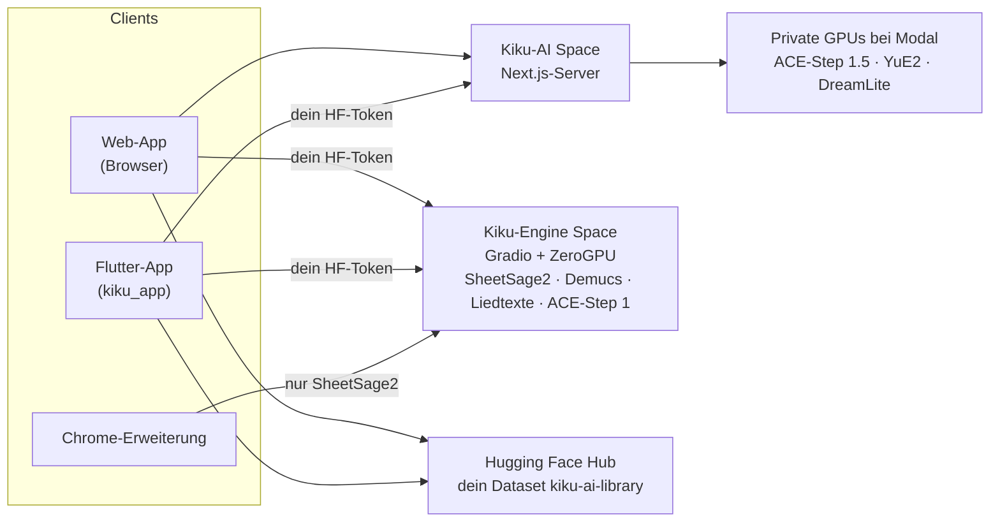

<p align="center">
  <a href="../../README.md">English</a> ·
  <a href="README.zh-CN.md">简体中文</a> ·
  <a href="README.es.md">Español</a> ·
  <a href="README.hi.md">हिन्दी</a> ·
  <a href="README.ar.md">العربية</a> ·
  <a href="README.pt-BR.md">Português</a> ·
  <a href="README.fr.md">Français</a> ·
  <a href="README.ru.md">Русский</a> ·
  <a href="README.ja.md">日本語</a> ·
  <b>Deutsch</b> ·
  <a href="README.ko.md">한국어</a>
</p>

<p align="center"></p>

<h1 align="center">Kiku AI</h1>

<p align="center">Schreib Songs aus einem einzigen Satz, verwandle deine eigenen Aufnahmen und mach aus jeder Aufnahme Noten.</p>

<p align="center">
  <a href="https://huggingface.co/spaces/Reubencf/Kiku-AI"><b>Web-App</b></a> ·
  <a href="#flutter-app"><b>App für Handy und Mac</b></a> ·
  <a href="#chrome-extension-youtube-to-score"><b>Chrome-Erweiterung</b></a>
</p>

> Diese Seite ist eine Übersetzung der [englischen README](../../README.md). Maßgeblich ist die englische
> Fassung, und sie kann neuer sein. Die Apps sind auf Englisch, daher bleiben Schaltflächen und Menüs auf
> Englisch.

Kiku AI ist ein Musikstudio auf Basis offener Modelle: **ACE-Step** und **YuE2** schreiben und bearbeiten
Songs, **SheetSage2** schreibt Noten aus Audio, und **Demucs** zerlegt einen Mix in Einzelspuren (Stems).
Es gibt Kiku AI in drei Formen, die dieselben Engines und eine gemeinsame Bibliothek in deinem
Hugging-Face-Konto nutzen:

| | Was es ist | Wo |
| --- | --- | --- |
| **Web-App** | Das komplette Studio, live im Hugging Face Space [Reubencf/Kiku-AI](https://huggingface.co/spaces/Reubencf/Kiku-AI) | [`outputs/kiku-ai`](../../outputs/kiku-ai) |
| **Flutter-App** | Dieselbe App für Android, iPhone, iPad und Mac | [`kiku_app`](../../kiku_app) |
| **Chrome-Erweiterung** | YouTube to Score: einen Teil eines Videos aufnehmen und Noten bekommen | [`outputs/youtube-to-score-extension`](../../outputs/youtube-to-score-extension) |
| Engines | Gradio-ZeroGPU-Spaces und private GPUs bei Modal | [`outputs/kiku-engine-space`](../../outputs/kiku-engine-space), [`outputs/kiku-acestep15-space`](../../outputs/kiku-acestep15-space), [`outputs/kiku-modal`](../../outputs/kiku-modal) |
| Experiment auf dem Gerät | YuE2 und SheetSage2 als GGUF, direkt in einer Flutter-App | [`flutter_app`](../../flutter_app) |
| Branding | Das Logo und das Skript, das alle Icons zeichnet | [`branding`](../../branding) |

## Wie alles zusammenhängt



Alle melden sich mit Hugging Face an. ACE-Step 1.5 und YuE2 laufen über den Kiku-AI-Server auf Kikus
privaten GPUs bei Modal. Transkription, Stems, Liedtexte und ACE-Step 1 laufen im Kiku-Engine Space auf
dem eigenen ZeroGPU-Kontingent jeder Person. Songs, Studio-Projekte und Noten werden in einem privaten
Dataset im eigenen Konto gespeichert, sodass die Arbeit zwischen Browser und Handy mitwandert.

## Web-App

Öffne sie unter [huggingface.co/spaces/Reubencf/Kiku-AI](https://huggingface.co/spaces/Reubencf/Kiku-AI).
Sie hat eine Startseite, **Generate** (Songs aus einer Idee oder aus deinem eigenen Stil und Text),
**Studio** (ein Mehrspur-Editor, in dem sich Auswahlen umstilen, umschreiben, verlängern, in Stems zerlegen
oder von YuE2 covern lassen und Instrumente hinzukommen), **Score** (Leadsheets von SheetSage2 zum
Abspielen, Bearbeiten und Herunterladen) und **Library**.

Um sie lokal zu starten, brauchst du Node.js 24 und FFmpeg/ffprobe. Führe in `outputs/kiku-ai` den Befehl
`npm ci` aus, kopiere `env.example` nach `.env.local`, setze ein privates `SESSION_SECRET` sowie die API-
und OAuth-Einstellungen und starte dann `npm run dev`. Committe niemals Zugangsdaten. Details:
[outputs/kiku-ai/README.md](../../outputs/kiku-ai/README.md).

<a name="flutter-app"></a>
## Flutter-App

[`kiku_app`](../../kiku_app) ist Kiku AI als native App für **Android, iPhone, iPad und Mac**,
geschrieben in Flutter. Sie hat dieselben fünf Bereiche wie die Web-App:

- **Home**: eine Idee eintippen und auf **Create** tippen.
- **Generate**: Modus Simple oder Custom, ACE-Step 1.5 oder YuE2, Enhance und ein Cover für jeden Song.
- **Studio**: ein Mehrspur-Editor mit Aufnahme, Mischpult, Schneiden, Rückgängig und WAV-Export.
  KI-Aktionen (Restyle, Rewrite, Extend, YuE2 Cover, Demucs-Stems, Lyrics, Add instrument) kommen als
  Takes, die du ein- und ausschalten kannst.
- **Score**: Leadsheets von SheetSage2, gesetzt wie in der Web-App, die der Aufnahme Takt für Takt folgen.
  Teile sie als PDF, MIDI, MusicXML oder ABC.
- **Library**: dasselbe private Dataset wie in der Web-App, sodass Songs, Projekte und Noten zwischen
  Handy und Browser mitwandern.

Die Anmeldung läuft über Hugging Face (OAuth mit PKCE oder ein eingefügtes Zugriffstoken), und die App
ruft die bereitgestellten Dienste direkt mit dem eigenen Token auf. Einen eigenen Server hat sie nicht.

**Auf Android ausprobieren**: Öffne den neuesten erfolgreichen Lauf des
[Kiku-AI-App-Workflows](https://github.com/Reubencfernandes/musical/actions/workflows/kiku-app.yml) und
lade das Artefakt `kiku-ai-android` herunter (eine Test-APK, signiert mit einem Debug-Schlüssel).

**Selbst bauen** mit Flutter 3.44.7:

```sh
cd kiku_app
flutter pub get
flutter run            # ein Android-Handy, ein iPhone, einen Simulator oder macOS auswählen
```

> [!NOTE]
> Die App braucht zwei Dinge vom Kiku-AI-Server: die Anmeldung per Bearer-Token und die Weiterleitung
> `kikuai://oauth/callback` in seinem OAuth-Client. Beides liegt in diesem Repository unter
> `outputs/kiku-ai`. Ist der bereitgestellte Space älter, stelle ihn mit `work/deploy_kiku_app.py` neu bereit.

Voraussetzungen, Anmeldung, der Aufbau der Bibliothek, Entwicklungshinweise und Fehlerbehebung stehen in
**[kiku_app/README.md](../../kiku_app/README.md)**.

<a name="chrome-extension-youtube-to-score"></a>
## Chrome-Erweiterung: YouTube to Score

Nimm einen Teil eines YouTube-Videos auf und bekomm ihn als Noten zurück, oder als Notennamen in Buchstaben
(C D E…) für alle, die keine Notenlinien lesen: SheetSage2 schreibt Melodie und Akkorde, und die
Erweiterung setzt sie als Klaviersatz, Leadsheet oder Buchstaben, die zum Video mitlaufen.

<p align="center">
  
  &nbsp;
  
</p>
<p align="center"><sub>Links: den aufzunehmenden Teil wählen. Rechts: die Aufnahmeseite mit den gesetzten Noten (Beispieltranskription).</sub></p>

### Herunterladen und installieren

Die Erweiterung ist noch nicht im Chrome Web Store, deshalb fügst du sie selbst zu Chrome hinzu. Das dauert
etwa eine Minute. Du brauchst Chrome 116 oder neuer; Edge, Brave und andere Chromium-Browser funktionieren
genauso.

1. **Lade** [**`kiku-youtube-to-score.zip`**](https://github.com/Reubencfernandes/musical/releases/download/extension-latest/kiku-youtube-to-score.zip)
   aus dem [Release `extension-latest`](https://github.com/Reubencfernandes/musical/releases/tag/extension-latest)
   **herunter**. GitHub Actions baut es aus `main` neu, sobald sich die Erweiterung ändert.
2. **Entpacke es** in einen Ordner, den du behältst, etwa `Documents\YouTube to Score`. Chrome lädt die
   Erweiterung bei jedem Start aus diesem Ordner, also lösch ihn danach nicht.
3. Öffne **`chrome://extensions`** (in die Adressleiste tippen) und schalte oben rechts den
   **Developer mode** (Entwicklermodus) ein.
4. Klick auf **Load unpacked** (Entpackte Erweiterung laden) und wähle den entpackten Ordner: den, in dem
   `manifest.json` direkt liegt.
5. Klick in der Symbolleiste auf das Puzzleteil-Symbol und **pinne YouTube to Score an**, damit seine
   Schaltfläche sichtbar bleibt.
6. Klick auf die Schaltfläche und auf **Sign in with Hugging Face** (ein kostenloses Konto reicht). Dann
   laufen Transkriptionen auf deinem eigenen ZeroGPU-Kontingent; ohne Anmeldung teilen sie sich ein anonymes
   Kontingent, das nach wenigen Clips aufgebraucht ist.

**Aktualisieren:** Lade die neue ZIP herunter, entpacke sie über denselben Ordner und klick dann auf der
Karte der Erweiterung in `chrome://extensions` auf den Neu-laden-Pfeil. Deine Aufnahmen und deine Anmeldung
bleiben erhalten.

**Stattdessen aus dem Quellcode:** Klone das Repository
(`git clone https://github.com/Reubencfernandes/musical.git`) und lade in Schritt 4 den Ordner
`outputs/youtube-to-score-extension`.

### So geht's

1. **Öffne einen Song** auf YouTube oder YouTube Music und klick auf die Schaltfläche **YouTube to Score**.
   Neben dem Video öffnet sich eine Seitenleiste.
2. **Wähle den Teil.** Zieh die beiden Griffe auf der gepunkteten Zeitleiste, tipp **Start** und **End**
   ein (Minuten:Sekunden), drück **Now**, um die aktuelle Stelle des Videos zu nehmen, oder wähle ein
   **Chapter**. Ein Teil dauert 5 Sekunden bis 10 Minuten.
3. **Drück Record.** Das Video springt zum Anfang und spielt, während die Erweiterung den Ton des Tabs
   aufnimmt. Die Aufnahme läuft in Echtzeit, ein einminütiger Teil dauert also eine Minute; Werbung, Pausen
   und Puffern werden ausgelassen. **Stop and keep** beendet früher, **Discard** verwirft die Aufnahme.
4. **Hol dir die Noten.** Wenn die Aufnahme fertig ist, öffnet sich die Aufnahmeseite und schickt den Clip
   an SheetSage2. Das dauert meist unter einer Minute (länger, wenn der Space erst aufwachen muss). Das
   Ergebnis wird mit der Aufnahme gespeichert und übersteht so den 24-Stunden-Dateicache des Space.
5. **Lesen, abspielen und herunterladen.**
   - **Sheet music oder Letters**: der Schalter über den Noten. **Letters** schreibt die Melodie Takt für
     Takt als Notennamen, mit den Akkorden darüber, einer Linie unter jeder Note für ihre Dauer und einem
     Punkt darüber oder darunter für eine höhere oder tiefere Oktave. Die Erweiterung merkt sich deine Wahl
     für neue Aufnahmen.
   - **Score settings → Layout**: **Piano** (die Melodie in der rechten Hand über einer linken Hand aus den
     Akkorden) oder **Lead sheet** (Melodie mit Akkordsymbolen). **Key** transponiert um bis zu sechs
     Halbtöne; Titel und Interpret stammen aus dem Video und lassen sich bearbeiten.
   - **Play** folgt der Aufnahme Takt für Takt, bei den Buchstaben Note für Note; klick auf einen beliebigen
     Takt, um von dort zu spielen. **With video** spielt das YouTube-Video im Takt mit den Noten ab, und
     **Hear** wählt, was du hörst: **Piano** (Video stumm), **Both** oder **Song** (nur das Video, die Takte
     leuchten trotzdem auf).
   - **Download** bietet die gesetzten Noten als PDF und MusicXML (für MuseScore, Finale, Sibelius oder
     Dorico), die Buchstaben-Noten als Text sowie MIDI, ABC und PDF von SheetSage2 selbst. **Print** druckt
     nur die Seiten (oder die Buchstaben), und **MP3** speichert die Aufnahme.
6. **Finde Aufnahmen wieder** über **Captures** in der oberen Leiste der Seitenleiste, oder öffne eine mit
   dem Pfeil daneben in voller Größe. Jede lässt sich neu transkribieren oder löschen.

### Optional: Audio in Sekunden (Windows, yt-dlp)

Auf deinem eigenen PC kann die Erweiterung den Teil mit [yt-dlp](https://github.com/yt-dlp/yt-dlp) holen,
statt ihn in Echtzeit aufzunehmen. Installiere Python, `pip install -U yt-dlp` und ffmpeg und führe dann im
Ordner der Erweiterung `powershell -ExecutionPolicy Bypass -File native\install.ps1` aus (gib mit
`-ExtensionId <id>` die ID an, die `chrome://extensions` für deine Kopie anzeigt). Lade die Erweiterung neu,
dann zeigt die Seitenleiste **Get audio now**. Dieses Hilfsprogramm ist nicht im Release-ZIP enthalten;
siehe die [README der Erweiterung](../../outputs/youtube-to-score-extension/README.md#get-audio-now-optional-yt-dlp-on-your-own-pc).

### Wenn etwas schiefgeht

- *"The Space turned the request away"*: Das GPU-Kontingent ist aufgebraucht. Melde dich mit Hugging Face
  an (siehe oben) oder versuch es später.
- *Die Schaltfläche tut bei einem Video nichts*: Lade den YouTube-Tab nach dem Installieren oder
  Aktualisieren der Erweiterung einmal neu.
- *Es wurde nichts aufgenommen*: Das Video muss nach dem Drücken von Record spielen. Sorg dafür, dass es
  startet, und nimm noch einmal auf.
- Nimm nur Musik auf, die du verwenden darfst; das Herunterladen von YouTube-Inhalten kann gegen die
  Nutzungsbedingungen von YouTube verstoßen. Die Gewichte von SheetSage2 stehen unter CC BY-NC 4.0
  (nicht kommerziell).

Was die Erweiterung speichert und sendet: [Datenschutzerklärung](../../outputs/youtube-to-score-extension/PRIVACY.md).
Mehr Details, auch dazu, wie jede Datei funktioniert: [README der Erweiterung](../../outputs/youtube-to-score-extension/README.md).

## Experiment auf dem Gerät (`flutter_app`)

Getrennt von der Kiku-AI-App oben erkundet `flutter_app`, die Modelle direkt auf dem Gerät laufen zu
lassen: Generierung und Transkription auf dem Gerät, Audiobearbeitung und Export, mit denselben orangen
Punktmatrix-Musikern und demselben Look. Siehe die [Notizen zur Machbarkeit auf Mobilgeräten](../mobile-inference.md).

Es ruft die fest versionierte C-API von audio.cpp auf, um YuE2 und SheetSage2 als GGUF auszuführen, mit
geprüften Modell-Downloads, Stil- und Textgenerierung, Transkription von Aufnahmen, lokaler Wiedergabe und
Dateiexport. Folge der [Flutter-Einrichtung](../../flutter_app/README.md) und der
[Anleitung für native Apple-Builds](../../flutter_app/native/README.md); ein normaler Flutter-Build bringt
die Audio-Laufzeit nicht mit, und Browser-Builds zeigen einen Hinweis auf die native App.

Aktuelle Grenzen: Echte Inferenz mit Modellgewichten und Builds für Apple-Geräte müssen noch geprüft
werden; schrittweise erzeugtes Audio und der Editor sind nicht umgesetzt; natives Packaging für Android
steht noch aus (die Integration priorisiert iOS und macOS). Über Leistung auf dem Handy, Generierungstempo
oder Unterstützung schwacher Handys wird nichts behauptet.

## Bereitgestellte Architektur

ZeroGPU unterstützt nur das Gradio SDK, deshalb läuft die Inferenz in Gradio-Spaces, und die Oberfläche
ist ein eigener CPU-Docker-Space. ACE-Step 1.5 braucht Python 3.11 und Gradio 6, die sich nicht mit dem
Stack der Engine vertragen, deshalb hat es einen eigenen Space mit denselben Endpunktnamen:

| Space | SDK | Enthält |
| --- | --- | --- |
| [Kiku-Engine](https://huggingface.co/spaces/Reubencf/Kiku-Engine) | Gradio + ZeroGPU | SheetSage2, YuE2, ACE-Step, Demucs und den OAuth-Client |
| [Kiku-ACE-Step-15](https://huggingface.co/spaces/Reubencf/Kiku-ACE-Step-15) | Gradio 6 + ZeroGPU | ACE-Step 1.5 (turbo, base und der 1.7B-Planer) und Demucs |
| [Kiku-AI](https://huggingface.co/spaces/Reubencf/Kiku-AI) | Docker (CPU) | Die Next.js-Oberfläche und der Server |
| [Score-Studio-API](https://huggingface.co/spaces/Reubencf/Score-Studio-API) | Gradio + ZeroGPU | Die ursprüngliche Transkriptions-API, weiterhin der Standard der Erweiterung |

Quellen: `outputs/kiku-engine-space`, `outputs/kiku-acestep15-space` und `outputs/kiku-ai`. Bereitstellen
mit `work/deploy_kiku_spaces.py` und `work/deploy_kiku_app.py` (beide lesen `HF_TOKEN`). Jede
Bereitstellung des Kiku-AI Space startet ihn neu, was jeden gerade laufenden Job beendet.

Das ACE-Step-1.5-Backend bei Modal ist im aktiven Workspace `konkanillm` bereitgestellt. Quellcode,
Einrichtungsbefehle und gemessene Kalt- und Warmstartzeiten stehen in
[den Modal-Bereitstellungsnotizen](../../outputs/kiku-modal/README.md) und
[dem Testbericht](../../outputs/kiku-modal/TEST_RESULTS.md). Es nutzt einen L40S-Worker mit privatem
API-Zugang, CPU-Speicher-Snapshots und Skalierung auf null. Die Web-App leitet Generierung und Planung von
ACE-Step 1.5 über authentifizierte Server-Routen an Modal weiter. YuE2 läuft auf einem eigenen privaten
L40S-Worker bei Modal (`kiku-yue2`), mit der nativen PyTorch-Laufzeit und CPU-Import-Snapshots. In
Generate lässt sich sowohl im Modus Simple als auch Custom zwischen YuE2 und ACE-Step 1.5 wählen.
SheetSage2, ACE-Step 1 und einzelne Stem- und Liedtext-Jobs laufen weiterhin über Hugging Face.

`outputs/score-studio-api`, `outputs/kiku-yue2-space` und `outputs/kiku-acestep-space` sind die
abgelösten Ein-Modell-Spaces, die bleiben, bis die zusammengeführte Engine im Ernstbetrieb gelaufen ist.
`outputs/sheetsage2-space` ist die ursprüngliche Gradio-Umsetzung. `work` enthält Skripte für
Bereitstellung und Prüfung. Mehr als zwei ZeroGPU-Spaces in einem Konto zu hosten, erfordert PRO.

### Wie sich drei Modelle einen Space teilen

Sie legen widersprüchliche Versionen fest – transformers 4.45.2 (SheetSage2), 4.50.0 (ACE-Step) und
4.57.6 (YuE2) –, sodass pip nicht alle drei erfüllen kann. Der Stack des YuE2-Wheels gewinnt, und die
anderen beiden laufen darauf; `acestep` wird beim Start mit `--no-deps` installiert, und die Imports, die es
für die Inferenz wirklich braucht, stehen in `requirements.txt`. `torchaudio` und `torchvision` müssen auf
das Paar zu torch 2.10.0 festgelegt bleiben, sonst nimmt pip CUDA-13-Builds, die sich nicht mit dem
CUDA-12-torch laden lassen.

Jedes Modell wird erst bei der ersten Nutzung geladen, nicht beim Import: YuE2 erreicht beim Erzeugen die
Low-Level-Initialisierung von CUDA, die ZeroGPU außerhalb einer `@spaces.GPU`-Funktion verweigert.
SheetSage2 führt beim Laden außerdem LoRA-Adapter zusammen und akzeptiert nur CPU-float32, deshalb wird es
auf dem Weg zur GPU umgewandelt.

### Eine Melodie erhalten

YuE2 erhält eine Melodie, indem es von Noten statt vom Klang ausgeht: SheetSage2 liest Melodie, Akkorde
und Taktstriche eines Abschnitts, man kann diese Noten bearbeiten, und YuE2 spielt sie (ein Cover,
gesungen oder auf einem Instrument). Das Ergebnis wird Takt für Takt zeitlich auf die Taktstriche der
Aufnahme selbst gestreckt und bleibt so synchron mit dem Rest des Projekts.

Die Engine hat außerdem Endpunkte, die eine Band unter einen erhaltenen Gesang legen (`/accompany` und
`/band_score`): Sie lösen die Stimme mit Demucs aus jeder Begleitung, messen das Beat-Raster und die
Akkorde pro Takt und lassen ACE-Step oder YuE2 darauf eine Band spielen, bevor sie unter die Stimme
gemischt wird. Das Studio bietet das nicht mehr an, aber die Endpunkte bleiben.

## Entwicklung

| Teil | Prüfen | Starten |
| --- | --- | --- |
| Web-App (`outputs/kiku-ai`) | `npm run typecheck` | `npm ci`, dann `npm run dev` |
| Flutter-App (`kiku_app`) | `flutter analyze`, `flutter test` | `flutter pub get`, dann `flutter run` |
| Experiment auf dem Gerät (`flutter_app`) | `flutter analyze`, `flutter test` | siehe [seine README](../../flutter_app/README.md) |
| Erweiterung | entpackt laden | siehe [ihre README](../../outputs/youtube-to-score-extension/README.md) |

Beide Flutter-Projekte sind mit Flutter 3.44.7 / Dart 3.12.2 geprüft. iPhone-Builds brauchen macOS, Xcode
und eine für dein Konto eingerichtete Signierung.

GitHub Actions:

- [`kiku-app.yml`](../../.github/workflows/kiku-app.yml), bei Änderungen in `kiku_app/`: Analyzer und Tests
  (darunter eine FLAC-Prüfung gegen libFLAC), ein Android-APK-Artefakt sowie iOS- und macOS-Builds.
- [`extension.yml`](../../.github/workflows/extension.yml), bei Änderungen an der Erweiterung: prüft das
  Manifest, packt die ZIP und aktualisiert auf `main` das Release `extension-latest`.

Entwicklungsskripte in `work` können noch Windows-spezifische Pfade enthalten, also sieh sie vor dem
Einsatz durch. Zugangsdaten, Build-Caches und private Testaufnahmen bleiben außerhalb des Repositorys.

## Das Logo

Das lauschende K verbindet einen gebogenen Empfänger, zwei geschwungene Klangbänder und einen Punkt in der
offenen Mitte. In den Apps steht es allein in Orange, auf App-Icons sitzt es auf warmem Anthrazit. Die
Bänder entfalten sich beim Erscheinen und reagieren danach alle fünf Sekunden kurz auf ein vorbeiziehendes
Signal; mit der Einstellung für reduzierte Bewegung bleibt das Logo ruhig.
[`branding/generate.py`](../../branding/generate.py) teilt die Vektorgeometrie zwischen React, Flutter,
den Icons der Erweiterung und jedem Launcher-Icon.

<p align="center"> &nbsp; </p>

## Lizenzen und Danksagungen

Modellgewichte werden separat heruntergeladen und behalten ihre eigenen Lizenzen; dieses Repository
lizenziert sie nicht neu. YuE2, SheetSage2 und DreamLite-base stehen unter CC BY-NC 4.0 (nicht
kommerziell); ACE-Step steht unter Apache 2.0 und Demucs unter MIT. Die Quellenangaben zu den Soundfonts
stehen in `outputs/kiku-ai/public/soundfonts/ATTRIBUTION.md`, die Schrift-Hinweise in
`outputs/kiku-ai/public/fonts/README.md`, und die Hinweise zum mitgelieferten abcjs liegen bei seinen Kopien.

Kiku AI hieß früher Score Studio; Notensatz ist weiterhin einer seiner Modi. Dieses Repository heißt
`musical`. Ursprünglicher Projektordner: `E:\ScoreStudio`.
