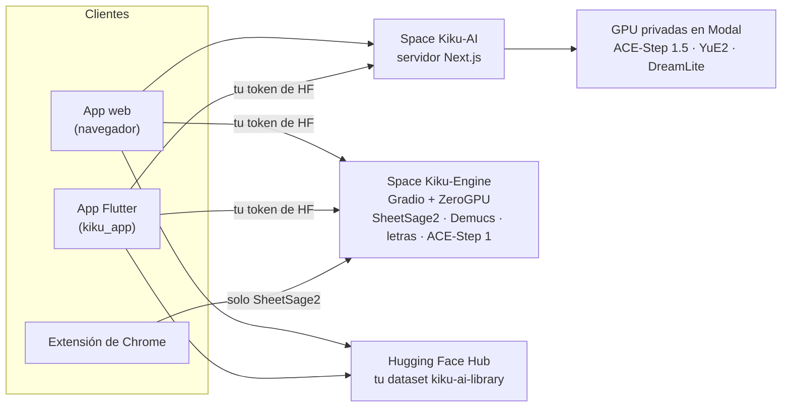

<p align="center">
  <a href="../../README.md">English</a> ·
  <a href="README.zh-CN.md">简体中文</a> ·
  <b>Español</b> ·
  <a href="README.hi.md">हिन्दी</a> ·
  <a href="README.ar.md">العربية</a> ·
  <a href="README.pt-BR.md">Português</a> ·
  <a href="README.fr.md">Français</a> ·
  <a href="README.ru.md">Русский</a> ·
  <a href="README.ja.md">日本語</a> ·
  <a href="README.de.md">Deutsch</a> ·
  <a href="README.ko.md">한국어</a>
</p>

<p align="center"></p>

<h1 align="center">Kiku AI</h1>

<p align="center">Escribe canciones a partir de una frase, transforma tus propias grabaciones y convierte cualquier grabación en partitura.</p>

<p align="center">
  <a href="https://huggingface.co/spaces/Reubencf/Kiku-AI"><b>App web</b></a> ·
  <a href="#flutter-app"><b>App para móvil y Mac</b></a> ·
  <a href="#chrome-extension-youtube-to-score"><b>Extensión de Chrome</b></a>
</p>

> Esta página es una traducción del [README en inglés](../../README.md), que es la versión de
> referencia y puede estar más actualizada. Las apps están en inglés, así que los nombres de botones y
> menús se dejan en inglés.

Kiku AI es un estudio de música construido sobre modelos abiertos: **ACE-Step** y **YuE2** escriben y
editan canciones, **SheetSage2** escribe partituras a partir del audio y **Demucs** separa una mezcla en
pistas (stems). Viene en tres formas que comparten los mismos motores y una misma biblioteca en tu cuenta
de Hugging Face:

| | Qué es | Dónde |
| --- | --- | --- |
| **App web** | El estudio completo, en marcha en el Space de Hugging Face [Reubencf/Kiku-AI](https://huggingface.co/spaces/Reubencf/Kiku-AI) | [`outputs/kiku-ai`](../../outputs/kiku-ai) |
| **App Flutter** | La misma app para Android, iPhone, iPad y Mac | [`kiku_app`](../../kiku_app) |
| **Extensión de Chrome** | YouTube to Score: graba parte de un vídeo y obtén la partitura | [`outputs/youtube-to-score-extension`](../../outputs/youtube-to-score-extension) |
| Motores | Spaces de Gradio con ZeroGPU y GPU privadas en Modal | [`outputs/kiku-engine-space`](../../outputs/kiku-engine-space), [`outputs/kiku-acestep15-space`](../../outputs/kiku-acestep15-space), [`outputs/kiku-modal`](../../outputs/kiku-modal) |
| Experimento en el dispositivo | YuE2 y SheetSage2 en formato GGUF, ejecutándose dentro de una app Flutter | [`flutter_app`](../../flutter_app) |
| Marca | El logotipo y el script que dibuja todos los iconos | [`branding`](../../branding) |

## Cómo encaja todo



Todo el mundo inicia sesión con Hugging Face. ACE-Step 1.5 y YuE2 se ejecutan en las GPU privadas de
Kiku en Modal, a través del servidor de Kiku-AI. La transcripción, las pistas, las letras y ACE-Step 1
se ejecutan en el Space Kiku-Engine con la cuota de ZeroGPU de cada usuario. Las canciones, los
proyectos del estudio y las partituras se guardan en un dataset privado en la cuenta de cada usuario,
así que el trabajo pasa del navegador al móvil y viceversa.

## App web

Ábrela en [huggingface.co/spaces/Reubencf/Kiku-AI](https://huggingface.co/spaces/Reubencf/Kiku-AI).
Tiene una página de inicio, **Generate** (canciones a partir de una idea o de tu propio estilo y letra),
**Studio** (un editor multipista donde las selecciones se pueden cambiar de estilo, reescribir,
alargar, separar en pistas o versionar con YuE2, y donde se pueden añadir instrumentos), **Score**
(partituras de melodía y acordes de SheetSage2 que puedes reproducir, editar y descargar) y **Library**.

Para ejecutarla en local necesitas Node.js 24 y FFmpeg/ffprobe. Desde `outputs/kiku-ai`, ejecuta
`npm ci`, copia `env.example` a `.env.local`, define un `SESSION_SECRET` privado y los ajustes de la API
y de OAuth, y luego ejecuta `npm run dev`. Nunca subas credenciales al repositorio. Detalles:
[outputs/kiku-ai/README.md](../../outputs/kiku-ai/README.md).

<a name="flutter-app"></a>
## App Flutter

[`kiku_app`](../../kiku_app) es Kiku AI como app nativa para **Android, iPhone, iPad y Mac**, escrita en
Flutter. Tiene las mismas cinco secciones que la app web:

- **Home**: escribe una idea y toca **Create**.
- **Generate**: modo Simple o Custom, ACE-Step 1.5 o YuE2, Enhance y portada para cada canción.
- **Studio**: un editor multipista con grabación, mezclador, corte, deshacer y exportación a WAV. Las
  acciones de IA (Restyle, Rewrite, Extend, YuE2 Cover, pistas con Demucs, Lyrics, Add instrument)
  llegan como tomas que puedes activar y desactivar.
- **Score**: partituras de SheetSage2, maquetadas igual que en la app web, que siguen la grabación compás a
  compás. Compártelas en PDF, MIDI, MusicXML o ABC.
- **Library**: el mismo dataset privado que usa la app web, así que canciones, proyectos y partituras
  pasan del móvil al navegador.

Inicia sesión con Hugging Face (OAuth con PKCE, o pegando un token de acceso) y llama directamente a los
servicios desplegados con el token del propio usuario. No tiene servidor propio.

**Pruébala en Android**: abre la última ejecución correcta del
[flujo de trabajo de la app Kiku AI](https://github.com/Reubencfernandes/musical/actions/workflows/kiku-app.yml)
y descarga el artefacto `kiku-ai-android` (un APK de prueba firmado con una clave de depuración).

**Compílala tú mismo** con Flutter 3.44.7:

```sh
cd kiku_app
flutter pub get
flutter run            # elige un móvil Android, un iPhone, un simulador o macOS
```

> [!NOTE]
> La app necesita dos cosas del servidor de Kiku-AI: inicio de sesión con token bearer y la redirección
> `kikuai://oauth/callback` en su cliente OAuth. Ambas están en `outputs/kiku-ai` en este repositorio.
> Si el Space desplegado es anterior a ellas, vuelve a desplegarlo con `work/deploy_kiku_app.py`.

Los requisitos, el inicio de sesión, la estructura de la biblioteca, las notas de desarrollo y la
solución de problemas están en **[kiku_app/README.md](../../kiku_app/README.md)**.

<a name="chrome-extension-youtube-to-score"></a>
## Extensión de Chrome: YouTube to Score

Graba parte de un vídeo de YouTube y recíbelo como partitura, o como notas con letras (C D E…) para
quien no lee pentagrama: SheetSage2 escribe la melodía y los acordes, y la extensión los presenta como
partitura de piano, partitura de melodía y acordes (lead sheet) o letras que suenan a la vez que el vídeo.

<p align="center">
  
  &nbsp;
  
</p>
<p align="center"><sub>Izquierda: elegir la parte que se graba. Derecha: la página de la captura con la partitura (transcripción de ejemplo).</sub></p>

### Descargar e instalar

La extensión aún no está en la Chrome Web Store, así que la añades a Chrome tú mismo. Se tarda más o
menos un minuto. Necesitas Chrome 116 o posterior; Edge, Brave y otros navegadores Chromium funcionan
igual.

1. **Descarga** [**`kiku-youtube-to-score.zip`**](https://github.com/Reubencfernandes/musical/releases/download/extension-latest/kiku-youtube-to-score.zip)
   desde la [versión `extension-latest`](https://github.com/Reubencfernandes/musical/releases/tag/extension-latest).
   GitHub Actions la vuelve a generar desde `main` cada vez que cambia la extensión.
2. **Descomprímelo** en una carpeta que vayas a conservar, como `Documents\YouTube to Score`. Chrome
   carga la extensión desde esa carpeta cada vez que se inicia, así que no la borres después.
3. Abre **`chrome://extensions`** (escríbelo en la barra de direcciones) y activa el **Developer mode**
   (modo de desarrollador, arriba a la derecha).
4. Haz clic en **Load unpacked** (cargar descomprimida) y elige la carpeta descomprimida: la que tiene
   `manifest.json` directamente dentro.
5. Haz clic en el icono de la pieza de puzle de la barra de herramientas y **fija YouTube to Score**,
   para que su botón quede siempre a la vista.
6. Haz clic en el botón y en **Sign in with Hugging Face** (sirve una cuenta gratuita). Así las
   transcripciones usan tu propia cuota de ZeroGPU; sin sesión, comparten una cuota anónima que se agota
   tras unos pocos clips.

**Para actualizar:** descarga el ZIP nuevo, descomprímelo sobre la misma carpeta y pulsa la flecha de
recarga en la tarjeta de la extensión en `chrome://extensions`. Tus capturas y tu sesión se conservan.

**Desde el código fuente:** clona el repositorio
(`git clone https://github.com/Reubencfernandes/musical.git`) y carga la carpeta
`outputs/youtube-to-score-extension` en el paso 4.

### Cómo se usa

1. **Abre una canción** en YouTube o YouTube Music y haz clic en el botón **YouTube to Score**. Se abre
   un panel lateral junto al vídeo.
2. **Elige la parte.** Arrastra los dos tiradores de la línea de tiempo de puntos, escribe **Start** y
   **End** (minutos:segundos), pulsa **Now** para usar el punto en que está el vídeo o elige un
   **Chapter**. Una parte dura de 5 segundos a 10 minutos.
3. **Pulsa Record.** El vídeo salta al inicio y se reproduce mientras la extensión graba el sonido de la
   pestaña. Graba en tiempo real, así que una parte de un minuto tarda un minuto; los anuncios, las
   pausas y la carga se dejan fuera. **Stop and keep** termina antes, **Discard** la descarta.
4. **Obtén la partitura.** Cuando termina la grabación, se abre la página de la captura y envía el clip a
   SheetSage2. Suele tardar menos de un minuto (más si el Space tiene que despertarse). El resultado se
   guarda con la captura, así que sobrevive a la caché de archivos de 24 horas del Space.
5. **Lee, reproduce y descarga.**
   - **Sheet music o Letters**: el interruptor sobre la partitura. **Letters** escribe la melodía con los
     nombres de las notas compás a compás, con los acordes encima, una línea bajo cada nota que indica
     cuánto mantenerla y un punto encima o debajo para una octava más alta o más baja. La extensión
     recuerda tu elección para las capturas nuevas.
   - **Score settings → Layout**: **Piano** (la melodía en la mano derecha sobre una mano izquierda hecha
     con los acordes) o **Lead sheet** (melodía con cifrado de acordes). **Key** transporta hasta seis
     semitonos; el título y el artista salen del vídeo y se pueden editar.
   - **Play** sigue la grabación compás a compás, y en las letras nota a nota; haz clic en cualquier
     compás para reproducir desde ahí. **With video** reproduce el vídeo de YouTube a la vez que la
     partitura, y **Hear** elige qué escuchas: **Piano** (el vídeo en silencio), **Both**, o **Song**
     (solo el vídeo, con los compases iluminándose igualmente).
   - **Download** ofrece la partitura en PDF y MusicXML (para MuseScore, Finale, Sibelius o Dorico), las
     notas con letras en texto, y el MIDI, el ABC y el PDF del propio SheetSage2. **Print** imprime solo
     las páginas (o las letras) y **MP3** guarda la grabación.
6. **Vuelve a encontrar las capturas** con **Captures** en la barra superior del panel, o abre una a
   tamaño completo con la flecha que tiene al lado. Cada una se puede volver a transcribir o borrar.

### Opcional: audio en segundos (Windows, yt-dlp)

En tu propio PC, la extensión puede obtener la parte con [yt-dlp](https://github.com/yt-dlp/yt-dlp) en
lugar de grabarla en tiempo real. Instala Python, `pip install -U yt-dlp` y ffmpeg, y luego ejecuta
`powershell -ExecutionPolicy Bypass -File native\install.ps1` desde la carpeta de la extensión (pasa
`-ExtensionId <id>` con el ID que `chrome://extensions` muestra para tu copia). Recarga la extensión y el
panel mostrará **Get audio now**. Este ayudante no va en el ZIP de la versión; consulta el
[README de la extensión](../../outputs/youtube-to-score-extension/README.md#get-audio-now-optional-yt-dlp-on-your-own-pc).

### Si algo falla

- *"The Space turned the request away"*: se ha agotado la cuota de GPU. Inicia sesión con Hugging Face
  (ver arriba) o inténtalo más tarde.
- *El botón no hace nada en un vídeo*: recarga una vez la pestaña de YouTube después de instalar o
  actualizar la extensión.
- *No se grabó nada*: el vídeo tiene que reproducirse después de pulsar Record. Asegúrate de que empiece
  a sonar y vuelve a grabar.
- Graba solo música que tengas derecho a usar; descargar contenido de YouTube puede ir contra sus
  Condiciones del servicio. Los pesos de SheetSage2 son CC BY-NC 4.0 (no comercial).

Qué guarda y envía la extensión: [política de privacidad](../../outputs/youtube-to-score-extension/PRIVACY.md).
Más detalles, incluido cómo funciona cada archivo: [README de la extensión](../../outputs/youtube-to-score-extension/README.md).

## Experimento en el dispositivo (`flutter_app`)

Aparte de la app Kiku AI de arriba, `flutter_app` explora ejecutar los modelos en el propio
dispositivo: generación y transcripción en el dispositivo, edición y exportación de audio, con los
mismos músicos naranjas de matriz de puntos y el mismo estilo visual. Consulta las
[notas de viabilidad en móvil](../mobile-inference.md).

Llama a la API en C fijada de audio.cpp para ejecutar YuE2 y SheetSage2 en GGUF, con descargas de
modelos verificadas, generación de estilo y letra, transcripción de grabaciones, reproducción local y
exportación de archivos. Sigue la [configuración de Flutter](../../flutter_app/README.md) y las
[instrucciones de compilación nativa para Apple](../../flutter_app/native/README.md); una compilación
normal de Flutter no incluye el motor de audio, y las compilaciones para navegador muestran un aviso de
app nativa.

Sus límites actuales: la inferencia real con los pesos de los modelos y las compilaciones para
dispositivos Apple aún deben validarse; el audio generado de forma incremental y el editor no están
implementados; el empaquetado nativo para Android está pendiente (la integración prioriza iOS y macOS).
No se afirma nada sobre rendimiento en móviles, velocidad de generación ni compatibilidad con móviles de
gama baja.

## Arquitectura desplegada

ZeroGPU solo admite el SDK de Gradio, así que la inferencia vive en Spaces de Gradio y la interfaz es un
Space Docker aparte, en CPU. ACE-Step 1.5 necesita Python 3.11 y Gradio 6, que no pueden compartir el
entorno del motor, así que tiene su propio Space con los mismos nombres de endpoint:

| Space | SDK | Contiene |
| --- | --- | --- |
| [Kiku-Engine](https://huggingface.co/spaces/Reubencf/Kiku-Engine) | Gradio + ZeroGPU | SheetSage2, YuE2, ACE-Step, Demucs y el cliente OAuth |
| [Kiku-ACE-Step-15](https://huggingface.co/spaces/Reubencf/Kiku-ACE-Step-15) | Gradio 6 + ZeroGPU | ACE-Step 1.5 (turbo, base y el planificador de 1.7B) y Demucs |
| [Kiku-AI](https://huggingface.co/spaces/Reubencf/Kiku-AI) | Docker (CPU) | La interfaz y el servidor de Next.js |
| [Score-Studio-API](https://huggingface.co/spaces/Reubencf/Score-Studio-API) | Gradio + ZeroGPU | La API de transcripción original, que sigue siendo la predeterminada de la extensión |

Código fuente: `outputs/kiku-engine-space`, `outputs/kiku-acestep15-space` y `outputs/kiku-ai`. Despliega
con `work/deploy_kiku_spaces.py` y `work/deploy_kiku_app.py` (ambos leen `HF_TOKEN`). Cada despliegue
del Space Kiku-AI lo reinicia, lo que corta cualquier trabajo que esté en marcha en ese momento.

El backend de ACE-Step 1.5 en Modal está desplegado en el espacio de trabajo activo `konkanillm`. El
código, los comandos de configuración y los tiempos medidos en frío y en caliente están en
[las notas de despliegue en Modal](../../outputs/kiku-modal/README.md) y
[el informe de prueba](../../outputs/kiku-modal/TEST_RESULTS.md). Usa un worker L40S con acceso privado a
la API, instantáneas de memoria de CPU y escalado a cero. La app web envía la generación y la
planificación de ACE-Step 1.5 a Modal mediante rutas autenticadas del servidor. YuE2 se ejecuta en su
propio worker L40S privado en Modal (`kiku-yue2`), con el runtime nativo de PyTorch e instantáneas de
importación en CPU. Generate permite elegir YuE2 o ACE-Step 1.5 tanto en modo Simple como Custom.
SheetSage2, ACE-Step 1 y los trabajos sueltos de pistas y letras siguen usando Hugging Face.

`outputs/score-studio-api`, `outputs/kiku-yue2-space` y `outputs/kiku-acestep-space` son los Spaces
antiguos de un solo modelo, que se conservan hasta que el motor unificado se haya usado a fondo.
`outputs/sheetsage2-space` es la implementación original en Gradio. `work` contiene scripts de
despliegue y verificación. Alojar más de dos Spaces con ZeroGPU en una cuenta requiere PRO.

### Cómo comparten tres modelos un mismo Space

Fijan versiones incompatibles —transformers 4.45.2 (SheetSage2), 4.50.0 (ACE-Step) y 4.57.6 (YuE2)—, así
que pip no puede satisfacer a los tres. Gana el entorno del wheel de YuE2 y los otros dos funcionan sobre
él; `acestep` se instala con `--no-deps` al arrancar y las importaciones que de verdad usa para la
inferencia están en `requirements.txt`. `torchaudio` y `torchvision` deben quedarse fijados a la pareja
de torch 2.10.0, o pip instala compilaciones para CUDA 13 que no cargan con el torch de CUDA 12.

Cada modelo se carga la primera vez que se usa, no al importarlo: YuE2 inicializa CUDA a bajo nivel al
construirse, algo que ZeroGPU rechaza fuera de una función `@spaces.GPU`. Además, SheetSage2 fusiona
adaptadores LoRA durante la carga y solo acepta float32 en CPU, así que se convierte de camino a la GPU.

### Conservar una melodía

YuE2 conserva una melodía trabajando a partir de una partitura, no del sonido: SheetSage2 lee la melodía,
los acordes y las barras de compás de un fragmento, el usuario puede editar esa partitura y YuE2 la
interpreta (una versión, cantada o con un instrumento). El resultado se ajusta en el tiempo compás a
compás a las barras de compás de la propia grabación, así que queda sincronizado con el resto del
proyecto.

El motor también tiene endpoints que construyen una banda bajo una voz conservada (`/accompany` y
`/band_score`): separan la voz de cualquier acompañamiento con Demucs, miden la rejilla de pulsos y los
acordes de cada compás, y hacen que ACE-Step o YuE2 toquen una banda sobre ellos antes de mezclarla bajo
la voz. El estudio ya no ofrece esta función, pero los endpoints siguen ahí.

## Desarrollo

| Parte | Comprobarla | Ejecutarla |
| --- | --- | --- |
| App web (`outputs/kiku-ai`) | `npm run typecheck` | `npm ci` y luego `npm run dev` |
| App Flutter (`kiku_app`) | `flutter analyze`, `flutter test` | `flutter pub get` y luego `flutter run` |
| Experimento en el dispositivo (`flutter_app`) | `flutter analyze`, `flutter test` | ver [su README](../../flutter_app/README.md) |
| Extensión | cargarla descomprimida | ver [su README](../../outputs/youtube-to-score-extension/README.md) |

Los dos proyectos Flutter están validados con Flutter 3.44.7 / Dart 3.12.2. Las compilaciones para
iPhone necesitan macOS, Xcode y la firma configurada para tu cuenta.

GitHub Actions:

- [`kiku-app.yml`](../../.github/workflows/kiku-app.yml), con cambios en `kiku_app/`: analizador y
  pruebas (incluida una comprobación de FLAC contra libFLAC), un artefacto APK para Android y
  compilaciones para iOS y macOS.
- [`extension.yml`](../../.github/workflows/extension.yml), con cambios en la extensión: comprueba el
  manifiesto, empaqueta el ZIP y, en `main`, actualiza la versión `extension-latest`.

Los scripts de desarrollo de `work` pueden contener todavía rutas propias de Windows, así que revísalos
antes de usarlos. Las credenciales, las cachés de compilación y las grabaciones privadas de prueba se
mantienen fuera del repositorio.

## El logotipo

La K que escucha combina un receptor curvo, dos cintas de sonido en barrido y un punto en el centro
abierto. Aparece sola en naranja dentro de las apps y sobre un carbón cálido en los iconos de las apps.
Las cintas se despliegan al entrar y luego responden brevemente a una señal que pasa cada cinco segundos;
los ajustes de movimiento reducido mantienen el logotipo quieto.
[`branding/generate.py`](../../branding/generate.py) comparte la geometría vectorial entre React,
Flutter, los iconos de la extensión y cada icono de lanzador.

<p align="center"> &nbsp; </p>

## Licencias y créditos

Los pesos de los modelos se descargan por separado y mantienen sus propias licencias; este repositorio
no les cambia la licencia. YuE2, SheetSage2 y DreamLite-base son CC BY-NC 4.0 (no comercial); ACE-Step
es Apache 2.0 y Demucs es MIT. La atribución de los soundfonts está en
`outputs/kiku-ai/public/soundfonts/ATTRIBUTION.md`, los avisos de las fuentes tipográficas en
`outputs/kiku-ai/public/fonts/README.md`, y los avisos de abcjs acompañan a sus copias.

Kiku AI se llamaba antes Score Studio; la notación sigue siendo uno de sus modos. Este repositorio se
llama `musical`. Carpeta original del proyecto: `E:\ScoreStudio`.
