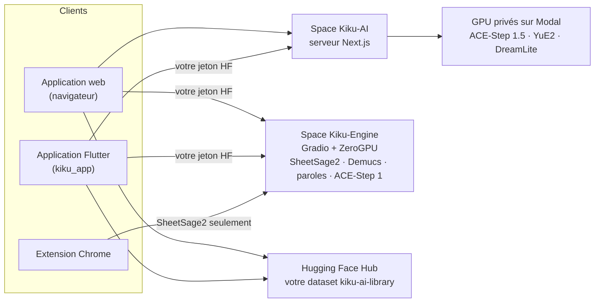

<p align="center">
  <a href="../../README.md">English</a> ·
  <a href="README.zh-CN.md">简体中文</a> ·
  <a href="README.es.md">Español</a> ·
  <a href="README.hi.md">हिन्दी</a> ·
  <a href="README.ar.md">العربية</a> ·
  <a href="README.pt-BR.md">Português</a> ·
  <b>Français</b> ·
  <a href="README.ru.md">Русский</a> ·
  <a href="README.ja.md">日本語</a> ·
  <a href="README.de.md">Deutsch</a> ·
  <a href="README.ko.md">한국어</a>
</p>

<p align="center"></p>

<h1 align="center">Kiku AI</h1>

<p align="center">Écrivez une chanson à partir d'une phrase, transformez vos propres enregistrements et changez n'importe quel enregistrement en partition.</p>

<p align="center">
  <a href="https://huggingface.co/spaces/Reubencf/Kiku-AI"><b>Application web</b></a> ·
  <a href="#flutter-app"><b>Application mobile et Mac</b></a> ·
  <a href="#chrome-extension-youtube-to-score"><b>Extension Chrome</b></a>
</p>

> Cette page est une traduction du [README anglais](../../README.md), qui fait référence et peut être
> plus récent. Les applications sont en anglais : les noms des boutons et des menus restent donc en
> anglais.

Kiku AI est un studio de musique construit autour de modèles ouverts : **ACE-Step** et **YuE2** écrivent
et modifient des chansons, **SheetSage2** écrit une partition à partir de l'audio et **Demucs** sépare un
mixage en pistes (stems). Il existe sous trois formes qui partagent les mêmes moteurs et une seule
bibliothèque dans votre compte Hugging Face :

| | Ce que c'est | Où |
| --- | --- | --- |
| **Application web** | Le studio complet, en ligne sur le Space Hugging Face [Reubencf/Kiku-AI](https://huggingface.co/spaces/Reubencf/Kiku-AI) | [`outputs/kiku-ai`](../../outputs/kiku-ai) |
| **Application Flutter** | La même application pour Android, iPhone, iPad et Mac | [`kiku_app`](../../kiku_app) |
| **Extension Chrome** | YouTube to Score : enregistrez une partie d'une vidéo et obtenez la partition | [`outputs/youtube-to-score-extension`](../../outputs/youtube-to-score-extension) |
| Moteurs | Spaces Gradio ZeroGPU et GPU privés sur Modal | [`outputs/kiku-engine-space`](../../outputs/kiku-engine-space), [`outputs/kiku-acestep15-space`](../../outputs/kiku-acestep15-space), [`outputs/kiku-modal`](../../outputs/kiku-modal) |
| Expérience sur l'appareil | YuE2 et SheetSage2 au format GGUF, dans une application Flutter | [`flutter_app`](../../flutter_app) |
| Identité visuelle | Le logo et le script qui dessine toutes les icônes | [`branding`](../../branding) |

## Comment tout s'assemble



Tout le monde se connecte avec Hugging Face. ACE-Step 1.5 et YuE2 tournent sur les GPU privés de Kiku
chez Modal, via le serveur Kiku-AI. La transcription, les pistes, les paroles et ACE-Step 1 tournent sur
le Space Kiku-Engine, sur le quota ZeroGPU de chaque utilisateur. Les chansons, les projets du studio et
les partitions sont enregistrés dans un dataset privé du compte de chaque utilisateur, si bien que le
travail passe du navigateur au téléphone.

## Application web

Ouvrez-la sur [huggingface.co/spaces/Reubencf/Kiku-AI](https://huggingface.co/spaces/Reubencf/Kiku-AI).
Elle comprend une page d'accueil, **Generate** (des chansons à partir d'une idée ou de votre propre style
et de vos paroles), **Studio** (un éditeur multipiste où l'on peut changer le style d'une sélection, la
réécrire, la prolonger, la séparer en pistes ou la faire reprendre par YuE2, et ajouter des instruments),
**Score** (des partitions mélodie et accords de SheetSage2 à jouer, modifier et télécharger) et
**Library**.

Pour la lancer en local, il vous faut Node.js 24 et FFmpeg/ffprobe. Depuis `outputs/kiku-ai`, lancez
`npm ci`, copiez `env.example` vers `.env.local`, définissez un `SESSION_SECRET` privé ainsi que les
réglages d'API et d'OAuth, puis lancez `npm run dev`. Ne commitez jamais d'identifiants. Détails :
[outputs/kiku-ai/README.md](../../outputs/kiku-ai/README.md).

<a name="flutter-app"></a>
## Application Flutter

[`kiku_app`](../../kiku_app) est Kiku AI en application native pour **Android, iPhone, iPad et Mac**,
écrite en Flutter. Elle a les mêmes cinq sections que l'application web :

- **Home** : tapez une idée et touchez **Create**.
- **Generate** : mode Simple ou Custom, ACE-Step 1.5 ou YuE2, Enhance, et une pochette pour chaque chanson.
- **Studio** : un éditeur multipiste avec enregistrement, table de mixage, découpe, annulation et export
  WAV. Les actions d'IA (Restyle, Rewrite, Extend, YuE2 Cover, pistes Demucs, Lyrics, Add instrument)
  arrivent sous forme de prises que l'on peut activer ou désactiver.
- **Score** : des partitions SheetSage2, gravées comme dans l'application web, qui suivent
  l'enregistrement mesure par mesure. Partagez-les en PDF, MIDI, MusicXML ou ABC.
- **Library** : le même dataset privé que l'application web, si bien que chansons, projets et partitions
  passent du téléphone au navigateur.

Elle se connecte avec Hugging Face (OAuth avec PKCE, ou un jeton d'accès collé) et appelle directement
les services déployés avec le jeton de l'utilisateur. Elle n'a pas de serveur à elle.

**Essayez-la sur Android** : ouvrez la dernière exécution réussie du
[workflow de l'application Kiku AI](https://github.com/Reubencfernandes/musical/actions/workflows/kiku-app.yml)
et téléchargez l'artefact `kiku-ai-android` (un APK de test signé avec une clé de débogage).

**Compilez-la vous-même** avec Flutter 3.44.7 :

```sh
cd kiku_app
flutter pub get
flutter run            # choisissez un téléphone Android, un iPhone, un simulateur ou macOS
```

> [!NOTE]
> L'application a besoin de deux choses du serveur Kiku-AI : la connexion par jeton bearer et la
> redirection `kikuai://oauth/callback` dans son client OAuth. Les deux sont dans `outputs/kiku-ai` dans
> ce dépôt. Si le Space déployé est antérieur, redéployez-le avec `work/deploy_kiku_app.py`.

La configuration requise, la connexion, l'organisation de la bibliothèque, les notes de développement et
le dépannage se trouvent dans **[kiku_app/README.md](../../kiku_app/README.md)**.

<a name="chrome-extension-youtube-to-score"></a>
## Extension Chrome : YouTube to Score

Enregistrez une partie d'une vidéo YouTube et récupérez-la en partition, ou en notes écrites en lettres
(C D E…) pour ceux qui ne lisent pas la portée : SheetSage2 écrit la mélodie et les accords, et
l'extension les met en page en partition de piano, en grille mélodie et accords (lead sheet) ou en lettres
qui se jouent en même temps que la vidéo.

<p align="center">
  
  &nbsp;
  
</p>
<p align="center"><sub>À gauche : choisir la partie à enregistrer. À droite : la page de la capture avec la partition gravée (exemple de transcription).</sub></p>

### Télécharger et installer

L'extension n'est pas encore sur le Chrome Web Store, vous l'ajoutez donc vous-même à Chrome. Cela prend
environ une minute. Il vous faut Chrome 116 ou plus récent ; Edge, Brave et les autres navigateurs
Chromium fonctionnent de la même façon.

1. **Téléchargez** [**`kiku-youtube-to-score.zip`**](https://github.com/Reubencfernandes/musical/releases/download/extension-latest/kiku-youtube-to-score.zip)
   depuis la [version `extension-latest`](https://github.com/Reubencfernandes/musical/releases/tag/extension-latest).
   GitHub Actions la reconstruit à partir de `main` chaque fois que l'extension change.
2. **Décompressez-le** dans un dossier que vous garderez, par exemple `Documents\YouTube to Score`. Chrome
   charge l'extension depuis ce dossier à chaque démarrage, ne le supprimez donc pas ensuite.
3. Ouvrez **`chrome://extensions`** (tapez-le dans la barre d'adresse) et activez le **Developer mode**
   (mode développeur, en haut à droite).
4. Cliquez sur **Load unpacked** (charger l'extension non empaquetée) et choisissez le dossier décompressé :
   celui qui contient directement `manifest.json`.
5. Cliquez sur l'icône en forme de pièce de puzzle dans la barre d'outils et **épinglez YouTube to Score**,
   pour que son bouton reste visible.
6. Cliquez sur le bouton puis sur **Sign in with Hugging Face** (un compte gratuit suffit). Les
   transcriptions utilisent alors votre propre quota ZeroGPU ; sans connexion, elles partagent un quota
   anonyme qui s'épuise après quelques extraits.

**Mise à jour :** téléchargez le nouveau ZIP, décompressez-le par-dessus le même dossier, puis cliquez sur
la flèche de rechargement de la carte de l'extension dans `chrome://extensions`. Vos captures et votre
connexion sont conservées.

**Depuis les sources :** clonez le dépôt
(`git clone https://github.com/Reubencfernandes/musical.git`) et chargez le dossier
`outputs/youtube-to-score-extension` à l'étape 4.

### Utilisation

1. **Ouvrez une chanson** sur YouTube ou YouTube Music et cliquez sur le bouton **YouTube to Score**. Un
   panneau latéral s'ouvre à côté de la vidéo.
2. **Choisissez la partie.** Faites glisser les deux poignées de la frise pointillée, tapez **Start** et
   **End** (minutes:secondes), appuyez sur **Now** pour partir de la position actuelle de la vidéo, ou
   choisissez un **Chapter**. Une partie dure de 5 secondes à 10 minutes.
3. **Appuyez sur Record.** La vidéo saute au début et se lance pendant que l'extension enregistre le son
   de l'onglet. L'enregistrement se fait en temps réel : une partie d'une minute prend une minute ; les
   publicités, les pauses et la mise en mémoire tampon sont laissées de côté. **Stop and keep** arrête
   plus tôt, **Discard** abandonne.
4. **Obtenez la partition.** À la fin de l'enregistrement, la page de la capture s'ouvre et envoie
   l'extrait à SheetSage2. Cela prend en général moins d'une minute (plus si le Space doit se réveiller).
   Le résultat est enregistré avec la capture : il survit donc au cache de fichiers de 24 heures du Space.
5. **Lisez, jouez et téléchargez.**
   - **Sheet music ou Letters** : l'interrupteur au-dessus de la partition. **Letters** écrit l'air en noms
     de notes mesure par mesure, avec les accords au-dessus, un trait sous chaque note pour indiquer sa
     durée, et un point au-dessus ou en dessous pour l'octave supérieure ou inférieure. L'extension
     retient votre choix pour les nouvelles captures.
   - **Score settings → Layout** : **Piano** (la mélodie à la main droite au-dessus d'une main gauche
     construite à partir des accords) ou **Lead sheet** (mélodie avec symboles d'accords). **Key** transpose
     jusqu'à six demi-tons ; le titre et l'artiste viennent de la vidéo et sont modifiables.
   - **Play** suit l'enregistrement mesure par mesure, et note par note en lettres ; cliquez sur n'importe
     quelle mesure pour jouer à partir de là. **With video** lit la vidéo YouTube en mesure avec la
     partition, et **Hear** choisit ce que vous entendez : **Piano** (vidéo coupée), **Both**, ou **Song**
     (la vidéo seule, les mesures s'allumant toujours).
   - **Download** propose la partition gravée en PDF et en MusicXML (pour MuseScore, Finale, Sibelius ou
     Dorico), les notes en lettres en texte, et les MIDI, ABC et PDF de SheetSage2 lui-même. **Print**
     imprime seulement les pages (ou les lettres), et **MP3** enregistre l'audio.
6. **Retrouvez vos captures** avec **Captures** dans la barre du haut du panneau, ou ouvrez-en une en
   grand avec la flèche à côté. Chacune peut être transcrite à nouveau ou supprimée.

### Facultatif : l'audio en quelques secondes (Windows, yt-dlp)

Sur votre propre PC, l'extension peut récupérer la partie avec [yt-dlp](https://github.com/yt-dlp/yt-dlp)
au lieu de l'enregistrer en temps réel. Installez Python, `pip install -U yt-dlp` et ffmpeg, puis lancez
`powershell -ExecutionPolicy Bypass -File native\install.ps1` depuis le dossier de l'extension (passez
`-ExtensionId <id>` avec l'ID que `chrome://extensions` affiche pour votre copie). Rechargez l'extension et
le panneau affiche **Get audio now**. Cet assistant n'est pas inclus dans le ZIP de la version ; voir le
[README de l'extension](../../outputs/youtube-to-score-extension/README.md#get-audio-now-optional-yt-dlp-on-your-own-pc).

### En cas de problème

- *"The Space turned the request away"* : le quota GPU est épuisé. Connectez-vous avec Hugging Face (voir
  plus haut) ou réessayez plus tard.
- *Le bouton ne fait rien sur une vidéo* : rechargez une fois l'onglet YouTube après avoir installé ou
  mis à jour l'extension.
- *Rien n'a été enregistré* : la vidéo doit se lancer après l'appui sur Record. Vérifiez qu'elle démarre,
  puis enregistrez à nouveau.
- N'enregistrez que de la musique que vous avez le droit d'utiliser ; télécharger du contenu YouTube peut
  enfreindre les conditions d'utilisation de YouTube. Les poids de SheetSage2 sont sous CC BY-NC 4.0 (non
  commercial).

Ce que l'extension stocke et envoie : [politique de confidentialité](../../outputs/youtube-to-score-extension/PRIVACY.md).
Plus de détails, dont le rôle de chaque fichier : [README de l'extension](../../outputs/youtube-to-score-extension/README.md).

## Expérience sur l'appareil (`flutter_app`)

Distincte de l'application Kiku AI ci-dessus, `flutter_app` explore l'exécution des modèles sur l'appareil
lui-même : génération et transcription en local, édition et export audio, avec les mêmes musiciens orange
en matrice de points et le même style visuel. Voir les
[notes de faisabilité sur mobile](../mobile-inference.md).

Elle appelle l'API C épinglée d'audio.cpp pour exécuter YuE2 et SheetSage2 en GGUF, avec des
téléchargements de modèles vérifiés, la génération de style et de paroles, la transcription
d'enregistrements, la lecture locale et l'export de fichiers. Suivez la
[configuration Flutter](../../flutter_app/README.md) et les
[instructions de compilation native Apple](../../flutter_app/native/README.md) ; une compilation Flutter
normale n'embarque pas le moteur audio, et les versions navigateur affichent un avis d'application native.

Ses limites actuelles : l'inférence réelle avec les poids des modèles et les compilations pour appareils
Apple restent à valider ; l'audio généré progressivement et l'éditeur ne sont pas implémentés ; le
packaging natif Android est en attente (l'intégration donne la priorité à iOS et macOS). Aucune
performance sur téléphone, vitesse de génération ou prise en charge des téléphones d'entrée de gamme
n'est revendiquée.

## Architecture déployée

ZeroGPU ne prend en charge que le SDK Gradio : l'inférence se trouve donc dans des Spaces Gradio et
l'interface est un Space Docker distinct sur CPU. ACE-Step 1.5 nécessite Python 3.11 et Gradio 6, qui ne
peuvent pas partager l'environnement du moteur ; il a donc son propre Space, avec les mêmes noms de
points d'accès :

| Space | SDK | Contient |
| --- | --- | --- |
| [Kiku-Engine](https://huggingface.co/spaces/Reubencf/Kiku-Engine) | Gradio + ZeroGPU | SheetSage2, YuE2, ACE-Step, Demucs et le client OAuth |
| [Kiku-ACE-Step-15](https://huggingface.co/spaces/Reubencf/Kiku-ACE-Step-15) | Gradio 6 + ZeroGPU | ACE-Step 1.5 (turbo, base et le planificateur 1.7B) et Demucs |
| [Kiku-AI](https://huggingface.co/spaces/Reubencf/Kiku-AI) | Docker (CPU) | L'interface et le serveur Next.js |
| [Score-Studio-API](https://huggingface.co/spaces/Reubencf/Score-Studio-API) | Gradio + ZeroGPU | L'API de transcription d'origine, toujours celle par défaut de l'extension |

Sources : `outputs/kiku-engine-space`, `outputs/kiku-acestep15-space` et `outputs/kiku-ai`. Déployez avec
`work/deploy_kiku_spaces.py` et `work/deploy_kiku_app.py` (tous deux lisent `HF_TOKEN`). Chaque
déploiement du Space Kiku-AI le redémarre, ce qui interrompt toute tâche en cours à ce moment-là.

Le backend ACE-Step 1.5 sur Modal est déployé dans l'espace de travail actif `konkanillm`. Les sources, les
commandes d'installation et les temps mesurés à froid et à chaud se trouvent dans
[les notes de déploiement Modal](../../outputs/kiku-modal/README.md) et
[le rapport d'essai](../../outputs/kiku-modal/TEST_RESULTS.md). Il utilise un worker L40S avec un accès
privé à l'API, des instantanés de la mémoire CPU et une mise à l'échelle jusqu'à zéro. L'application web
envoie la génération et la planification ACE-Step 1.5 vers Modal par des routes serveur authentifiées.
YuE2 tourne sur son propre worker L40S privé chez Modal (`kiku-yue2`), avec le runtime PyTorch natif et
des instantanés d'import sur CPU. Generate permet de choisir YuE2 ou ACE-Step 1.5 en mode Simple comme en
mode Custom. SheetSage2, ACE-Step 1 et les tâches isolées de pistes et de paroles passent toujours par
Hugging Face.

`outputs/score-studio-api`, `outputs/kiku-yue2-space` et `outputs/kiku-acestep-space` sont les anciens
Spaces à modèle unique, conservés jusqu'à ce que le moteur fusionné ait vraiment fait ses preuves.
`outputs/sheetsage2-space` est l'implémentation Gradio d'origine. `work` contient les scripts de
déploiement et de vérification. Héberger plus de deux Spaces ZeroGPU sur un même compte nécessite PRO.

### Comment trois modèles partagent un Space

Ils épinglent des versions incompatibles — transformers 4.45.2 (SheetSage2), 4.50.0 (ACE-Step) et
4.57.6 (YuE2) —, si bien que pip ne peut pas satisfaire les trois. L'environnement du wheel YuE2 l'emporte
et les deux autres tournent dessus ; `acestep` s'installe avec `--no-deps` au démarrage, et les imports
dont il a réellement besoin pour l'inférence sont listés dans `requirements.txt`. `torchaudio` et
`torchvision` doivent rester épinglés sur la paire de torch 2.10.0, sinon pip prend des builds CUDA 13
qui ne se chargent pas avec le torch CUDA 12.

Chaque modèle se charge à sa première utilisation, pas à l'import : YuE2 atteint l'initialisation CUDA de
bas niveau pendant sa construction, ce que ZeroGPU refuse hors d'une fonction `@spaces.GPU`. SheetSage2
fusionne en plus des adaptateurs LoRA au chargement et n'accepte que du float32 sur CPU ; il est donc
converti en chemin vers le GPU.

### Garder un air

YuE2 garde un air en travaillant à partir d'une partition, pas du son : SheetSage2 lit la mélodie, les
accords et les barres de mesure d'un passage, l'utilisateur peut modifier cette partition, et YuE2 la
joue (une reprise, chantée ou à l'instrument). Le rendu est recalé dans le temps mesure par mesure sur les
barres de mesure de l'enregistrement lui-même, et reste ainsi synchronisé avec le reste du projet.

Le moteur a aussi des points d'accès qui construisent un groupe sous une voix conservée (`/accompany` et
`/band_score`) : ils isolent la voix de n'importe quel accompagnement avec Demucs, mesurent la grille des
temps et les accords de chaque mesure, et font jouer un groupe dessus par ACE-Step ou YuE2 avant de le
mixer sous la voix. Le studio ne le propose plus, mais les points d'accès restent.

## Développement

| Partie | La vérifier | La lancer |
| --- | --- | --- |
| Application web (`outputs/kiku-ai`) | `npm run typecheck` | `npm ci`, puis `npm run dev` |
| Application Flutter (`kiku_app`) | `flutter analyze`, `flutter test` | `flutter pub get`, puis `flutter run` |
| Expérience sur l'appareil (`flutter_app`) | `flutter analyze`, `flutter test` | voir [son README](../../flutter_app/README.md) |
| Extension | la charger non empaquetée | voir [son README](../../outputs/youtube-to-score-extension/README.md) |

Les deux projets Flutter sont validés avec Flutter 3.44.7 / Dart 3.12.2. Les compilations iPhone
nécessitent macOS, Xcode et une signature configurée pour votre compte.

GitHub Actions :

- [`kiku-app.yml`](../../.github/workflows/kiku-app.yml), à chaque changement dans `kiku_app/` : analyse et
  tests (dont une vérification FLAC face à libFLAC), un artefact APK Android, et des compilations iOS et
  macOS.
- [`extension.yml`](../../.github/workflows/extension.yml), à chaque changement de l'extension : vérifie le
  manifest, empaquette le ZIP et, sur `main`, met à jour la version `extension-latest`.

Les scripts de développement de `work` peuvent encore contenir des chemins propres à Windows : relisez-les
avant de les utiliser. Les identifiants, les caches de compilation et les enregistrements de test privés
restent hors du dépôt.

## Le logo

Le K qui écoute réunit un récepteur courbe, deux rubans sonores en balayage et un point au centre ouvert.
Il apparaît seul en orange dans les applications et sur un anthracite chaud dans les icônes
d'application. Les rubans se déploient à l'ouverture, puis réagissent brièvement à un signal qui passe
toutes les cinq secondes ; les réglages de réduction des animations gardent le logo immobile.
[`branding/generate.py`](../../branding/generate.py) partage la géométrie vectorielle entre React,
Flutter, les icônes de l'extension et toutes les icônes de lancement.

<p align="center"> &nbsp; </p>

## Licences et crédits

Les poids des modèles se téléchargent à part et gardent leurs propres licences ; ce dépôt ne les place pas
sous une autre licence. YuE2, SheetSage2 et DreamLite-base sont sous CC BY-NC 4.0 (non commercial) ;
ACE-Step est sous Apache 2.0 et Demucs sous MIT. L'attribution des soundfonts se trouve dans
`outputs/kiku-ai/public/soundfonts/ATTRIBUTION.md`, les mentions des polices dans
`outputs/kiku-ai/public/fonts/README.md`, et les mentions d'abcjs accompagnent ses copies.

Kiku AI s'appelait auparavant Score Studio ; la notation reste l'un de ses modes. Ce dépôt s'appelle
`musical`. Dossier d'origine du projet : `E:\ScoreStudio`.
