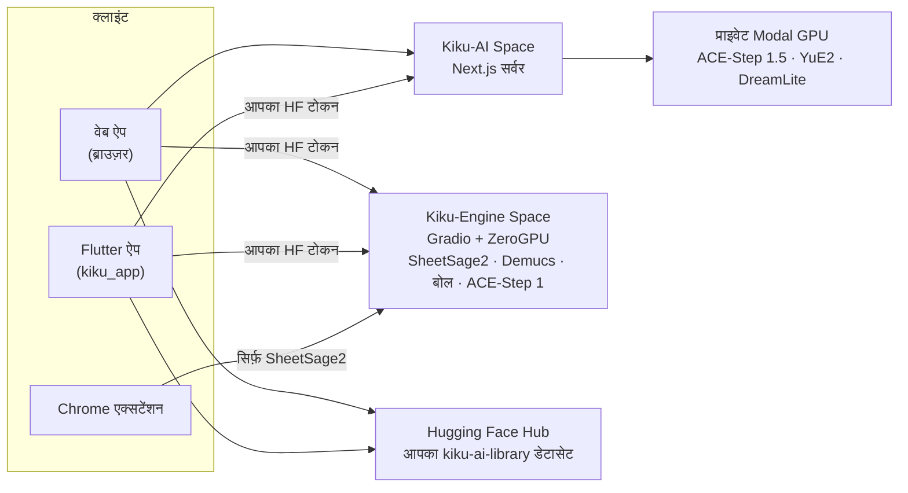
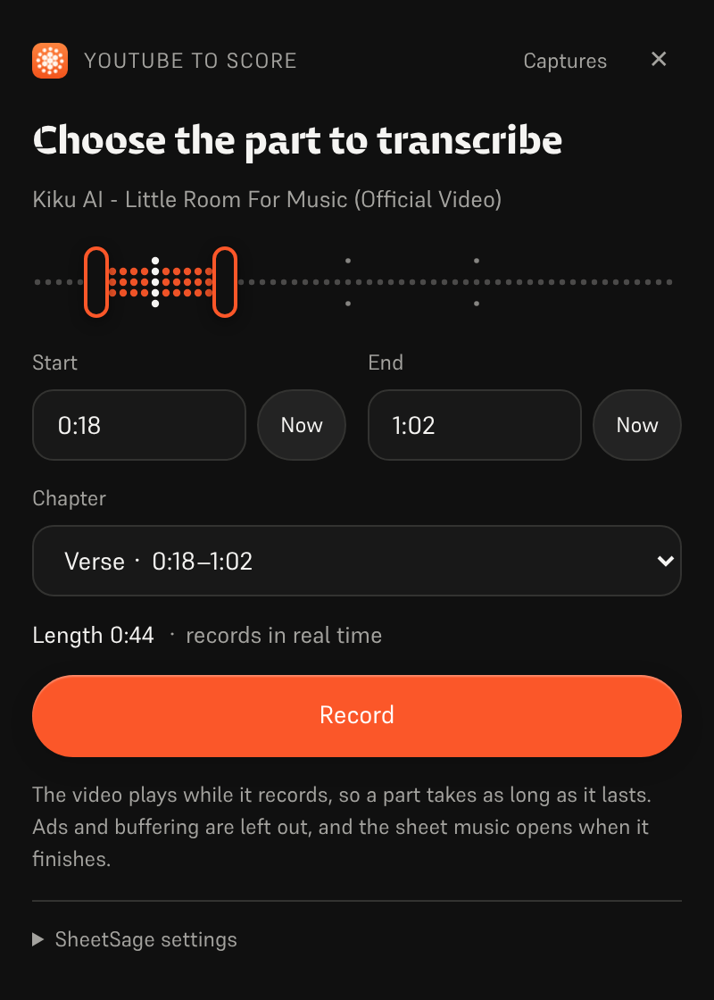
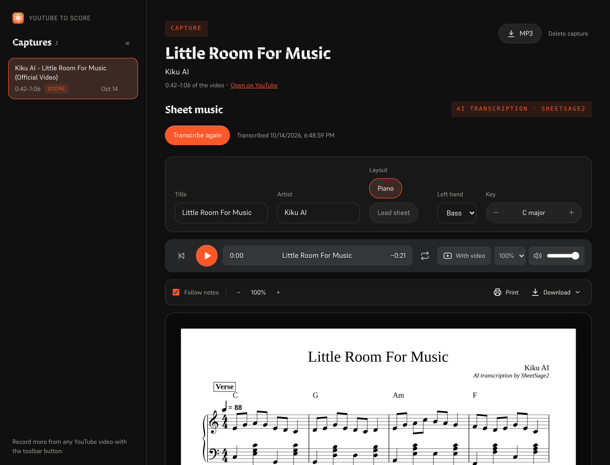
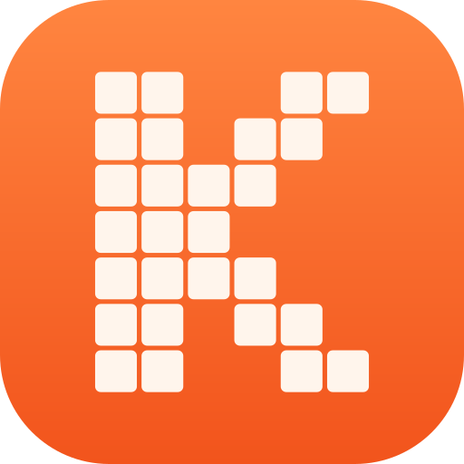

<p align="center">
  <a href="../../README.md">English</a> ·
  <a href="README.zh-CN.md">简体中文</a> ·
  <a href="README.es.md">Español</a> ·
  <b>हिन्दी</b> ·
  <a href="README.ar.md">العربية</a> ·
  <a href="README.pt-BR.md">Português</a> ·
  <a href="README.fr.md">Français</a> ·
  <a href="README.ru.md">Русский</a> ·
  <a href="README.ja.md">日本語</a> ·
  <a href="README.de.md">Deutsch</a> ·
  <a href="README.ko.md">한국어</a>
</p>

<p align="center"></p>

<h1 align="center">Kiku AI</h1>

<p align="center">एक वाक्य से गाना लिखें, अपनी रिकॉर्डिंग को नया रूप दें, और किसी भी रिकॉर्डिंग को शीट म्यूज़िक में बदलें।</p>

<p align="center">
  <a href="https://huggingface.co/spaces/Reubencf/Kiku-AI"><b>वेब ऐप</b></a> ·
  <a href="#flutter-app"><b>फ़ोन और Mac ऐप</b></a> ·
  <a href="#chrome-extension-youtube-to-score"><b>Chrome एक्सटेंशन</b></a>
</p>

> यह पेज [अंग्रेज़ी README](../../README.md) का अनुवाद है। मूल अंग्रेज़ी वाला ही है और वह ज़्यादा नया हो
> सकता है। ऐप अंग्रेज़ी में हैं, इसलिए बटन और मेनू के नाम अंग्रेज़ी में ही रखे गए हैं।

Kiku AI ओपन मॉडल पर बना एक म्यूज़िक स्टूडियो है: **ACE-Step** और **YuE2** गाने लिखते और बदलते हैं,
**SheetSage2** ऑडियो से शीट म्यूज़िक लिखता है, और **Demucs** एक मिक्स को अलग-अलग ट्रैक (स्टेम) में
बाँटता है। यह तीन रूपों में आता है, जो एक ही इंजन और आपके Hugging Face अकाउंट की एक ही लाइब्रेरी
इस्तेमाल करते हैं:

| | यह क्या है | कहाँ |
| --- | --- | --- |
| **वेब ऐप** | पूरा स्टूडियो, Hugging Face Space [Reubencf/Kiku-AI](https://huggingface.co/spaces/Reubencf/Kiku-AI) पर चालू | [`outputs/kiku-ai`](../../outputs/kiku-ai) |
| **Flutter ऐप** | वही ऐप Android, iPhone, iPad और Mac के लिए | [`kiku_app`](../../kiku_app) |
| **Chrome एक्सटेंशन** | YouTube to Score: वीडियो का एक हिस्सा रिकॉर्ड करें और शीट म्यूज़िक पाएँ | [`outputs/youtube-to-score-extension`](../../outputs/youtube-to-score-extension) |
| इंजन | Gradio ZeroGPU Spaces और प्राइवेट Modal GPU | [`outputs/kiku-engine-space`](../../outputs/kiku-engine-space), [`outputs/kiku-acestep15-space`](../../outputs/kiku-acestep15-space), [`outputs/kiku-modal`](../../outputs/kiku-modal) |
| डिवाइस पर प्रयोग | YuE2 और SheetSage2, GGUF के रूप में, एक Flutter ऐप के अंदर चलते हुए | [`flutter_app`](../../flutter_app) |
| ब्रांडिंग | लोगो और हर आइकन बनाने वाली स्क्रिप्ट | [`branding`](../../branding) |

## सब कुछ कैसे जुड़ता है



हर कोई Hugging Face से साइन इन करता है। ACE-Step 1.5 और YuE2, Kiku-AI सर्वर के ज़रिए Kiku के प्राइवेट
Modal GPU पर चलते हैं। ट्रांसक्रिप्शन, स्टेम, बोल और ACE-Step 1, Kiku-Engine Space पर हर यूज़र के अपने
ZeroGPU कोटे से चलते हैं। गाने, स्टूडियो प्रोजेक्ट और स्कोर हर यूज़र के अपने अकाउंट के एक प्राइवेट
डेटासेट में सेव होते हैं, इसलिए काम ब्राउज़र और फ़ोन के बीच साथ चलता है।

## वेब ऐप

इसे [huggingface.co/spaces/Reubencf/Kiku-AI](https://huggingface.co/spaces/Reubencf/Kiku-AI) पर
खोलें। इसमें एक होम पेज है, **Generate** (किसी आइडिया से या अपनी स्टाइल और बोल से गाने), **Studio**
(एक मल्टीट्रैक एडिटर, जहाँ चुने हुए हिस्से की स्टाइल बदली जा सकती है, उसे दोबारा लिखा, लंबा किया, स्टेम
में बाँटा या YuE2 से कवर किया जा सकता है, और इंस्ट्रूमेंट जोड़े जा सकते हैं), **Score** (SheetSage2 की
मेलोडी और कॉर्ड वाली शीट, जिन्हें आप बजा, बदल और डाउनलोड कर सकते हैं) और **Library**।

इसे लोकल चलाने के लिए Node.js 24 और FFmpeg/ffprobe चाहिए। `outputs/kiku-ai` में `npm ci` चलाएँ,
`env.example` को `.env.local` में कॉपी करें, एक प्राइवेट `SESSION_SECRET` और API व OAuth की सेटिंग
डालें, फिर `npm run dev` चलाएँ। क्रेडेंशियल कभी कमिट न करें। पूरी जानकारी:
[outputs/kiku-ai/README.md](../../outputs/kiku-ai/README.md)।

<a name="flutter-app"></a>
## Flutter ऐप

[`kiku_app`](../../kiku_app) Kiku AI का नेटिव ऐप है, **Android, iPhone, iPad और Mac** के लिए, जो
Flutter में लिखा है। इसमें वेब ऐप जैसे ही पाँच हिस्से हैं:

- **Home**: एक आइडिया लिखें और **Create** दबाएँ।
- **Generate**: Simple या Custom मोड, ACE-Step 1.5 या YuE2, Enhance, और हर गाने के लिए कवर आर्ट।
- **Studio**: रिकॉर्डिंग, मिक्सर, स्प्लिट, अनडू और WAV एक्सपोर्ट वाला मल्टीट्रैक एडिटर। AI ऐक्शन
  (Restyle, Rewrite, Extend, YuE2 Cover, Demucs स्टेम, Lyrics, Add instrument) टेक के रूप में आते हैं,
  जिन्हें आप चालू और बंद कर सकते हैं।
- **Score**: SheetSage2 की शीट, वेब ऐप जैसी ही छपाई में, जो रिकॉर्डिंग के साथ बार-दर-बार चलती है।
  इन्हें PDF, MIDI, MusicXML या ABC के रूप में शेयर करें।
- **Library**: वही प्राइवेट डेटासेट जो वेब ऐप इस्तेमाल करता है, इसलिए गाने, प्रोजेक्ट और स्कोर फ़ोन और
  ब्राउज़र के बीच साथ रहते हैं।

यह Hugging Face से साइन इन करता है (PKCE वाला OAuth, या पेस्ट किया गया ऐक्सेस टोकन) और यूज़र के अपने
टोकन से सीधे डिप्लॉय की गई सेवाओं को कॉल करता है। इसका अपना कोई सर्वर नहीं है।

**Android पर आज़माएँ**: [Kiku AI app वर्कफ़्लो](https://github.com/Reubencfernandes/musical/actions/workflows/kiku-app.yml)
का सबसे नया सफल रन खोलें और `kiku-ai-android` आर्टिफ़ैक्ट डाउनलोड करें (डीबग की से साइन किया गया टेस्ट APK)।

**ख़ुद बनाएँ**, Flutter 3.44.7 के साथ:

```sh
cd kiku_app
flutter pub get
flutter run            # Android फ़ोन, iPhone, सिम्युलेटर या macOS चुनें
```

> [!NOTE]
> ऐप को Kiku-AI सर्वर से दो चीज़ें चाहिए: bearer टोकन से साइन-इन, और उसके OAuth क्लाइंट में
> `kikuai://oauth/callback` रीडायरेक्ट। दोनों इस रिपॉज़िटरी के `outputs/kiku-ai` में हैं। अगर डिप्लॉय
> किया गया Space इनसे पुराना है, तो उसे `work/deploy_kiku_app.py` से फिर से डिप्लॉय करें।

ज़रूरी चीज़ें, साइन-इन, लाइब्रेरी की बनावट, डेवलपमेंट नोट्स और समस्याओं के हल
**[kiku_app/README.md](../../kiku_app/README.md)** में हैं।

<a name="chrome-extension-youtube-to-score"></a>
## Chrome एक्सटेंशन: YouTube to Score

YouTube वीडियो का एक हिस्सा रिकॉर्ड करें और उसे शीट म्यूज़िक के रूप में वापस पाएँ, या उन लोगों के लिए
अक्षरों वाले सुर (C D E…) में जो स्टाफ़ नोटेशन नहीं पढ़ते: SheetSage2 मेलोडी और कॉर्ड लिखता है, और
एक्सटेंशन उन्हें पियानो स्कोर, लीड शीट या अक्षरों में सजाता है, जो वीडियो के साथ बजते हैं।

<p align="center">
  
  &nbsp;
  
</p>
<p align="center"><sub>बाएँ: रिकॉर्ड करने वाला हिस्सा चुनना। दाएँ: छपे हुए स्कोर वाला कैप्चर पेज (उदाहरण ट्रांसक्रिप्शन)।</sub></p>

### डाउनलोड और इंस्टॉल

एक्सटेंशन अभी Chrome Web Store पर नहीं है, इसलिए आप इसे Chrome में ख़ुद जोड़ते हैं। इसमें लगभग एक
मिनट लगता है। Chrome 116 या नया चाहिए; Edge, Brave और दूसरे Chromium ब्राउज़र में भी यही तरीका है।

1. [`extension-latest` रिलीज़](https://github.com/Reubencfernandes/musical/releases/tag/extension-latest)
   से [**`kiku-youtube-to-score.zip`**](https://github.com/Reubencfernandes/musical/releases/download/extension-latest/kiku-youtube-to-score.zip)
   **डाउनलोड करें**। जब भी एक्सटेंशन बदलता है, GitHub Actions इसे `main` से फिर से बनाता है।
2. इसे किसी ऐसे फ़ोल्डर में **अनज़िप करें** जिसे आप रखेंगे, जैसे `Documents\YouTube to Score`। Chrome
   हर बार शुरू होने पर एक्सटेंशन उसी फ़ोल्डर से लोड करता है, इसलिए बाद में इसे डिलीट न करें।
3. **`chrome://extensions`** खोलें (एड्रेस बार में टाइप करें) और ऊपर दाईं ओर **Developer mode** चालू करें।
4. **Load unpacked** पर क्लिक करें और अनज़िप किया गया फ़ोल्डर चुनें: वह जिसमें सीधे `manifest.json` हो।
5. टूलबार में पज़ल-पीस आइकन पर क्लिक करें और **YouTube to Score को पिन करें**, ताकि उसका बटन दिखता रहे।
6. बटन पर क्लिक करें और **Sign in with Hugging Face** चुनें (फ़्री अकाउंट चलेगा)। तब ट्रांसक्रिप्शन आपके
   अपने ZeroGPU कोटे से चलते हैं; साइन इन न होने पर एक साझा अनाम कोटा इस्तेमाल होता है, जो कुछ क्लिप के
   बाद ख़त्म हो जाता है।

**अपडेट करना:** नई ZIP डाउनलोड करें, उसे उसी फ़ोल्डर पर अनज़िप करें, फिर `chrome://extensions` में
एक्सटेंशन के कार्ड पर रीलोड वाला तीर दबाएँ। आपके कैप्चर और साइन-इन बने रहते हैं।

**सोर्स से:** रिपॉज़िटरी क्लोन करें (`git clone https://github.com/Reubencfernandes/musical.git`) और
चौथे कदम में `outputs/youtube-to-score-extension` फ़ोल्डर लोड करें।

### इस्तेमाल कैसे करें

1. YouTube या YouTube Music पर **कोई गाना खोलें** और **YouTube to Score** बटन पर क्लिक करें। वीडियो
   के बगल में एक साइड पैनल खुलता है।
2. **हिस्सा चुनें।** बिंदुओं वाली टाइमलाइन पर दोनों हैंडल खींचें, **Start** और **End** (मिनट:सेकंड)
   टाइप करें, वीडियो जहाँ अभी है वहाँ से लेने के लिए **Now** दबाएँ, या कोई **Chapter** चुनें। एक हिस्सा
   5 सेकंड से 10 मिनट तक का होता है।
3. **Record दबाएँ।** वीडियो शुरू वाली जगह पर जाकर बजने लगता है और एक्सटेंशन टैब की आवाज़ रिकॉर्ड करता है।
   रिकॉर्डिंग असली समय में होती है, इसलिए एक मिनट के हिस्से में एक मिनट लगता है; विज्ञापन, पॉज़ और बफ़रिंग
   छोड़ दिए जाते हैं। **Stop and keep** पहले ख़त्म करता है, **Discard** उसे हटा देता है।
4. **स्कोर पाएँ।** रिकॉर्डिंग ख़त्म होने पर कैप्चर पेज खुलता है और क्लिप SheetSage2 को भेजता है। आमतौर
   पर एक मिनट से कम लगता है (अगर Space को जागना पड़े तो ज़्यादा)। नतीजा कैप्चर के साथ सेव होता है, इसलिए
   वह Space की 24 घंटे वाली फ़ाइल कैश के बाद भी बना रहता है।
5. **पढ़ें, बजाएँ और डाउनलोड करें।**
   - **Sheet music या Letters**: स्कोर के ऊपर का स्विच। **Letters** धुन को बार-दर-बार सुरों के नामों में
     लिखता है, ऊपर कॉर्ड, हर सुर के नीचे एक लाइन जो बताती है कि उसे कितनी देर रोकना है, और ऊँचे या
     नीचे सप्तक के लिए ऊपर या नीचे एक बिंदु। एक्सटेंशन नए कैप्चर के लिए आपकी पसंद याद रखता है।
   - **Score settings → Layout**: **Piano** (दाएँ हाथ में मेलोडी, कॉर्ड से बने बाएँ हाथ के ऊपर) या
     **Lead sheet** (कॉर्ड चिह्नों के साथ मेलोडी)। **Key** छह सेमीटोन तक ट्रांसपोज़ करता है; शीर्षक और
     कलाकार वीडियो से आते हैं और बदले जा सकते हैं।
   - **Play** रिकॉर्डिंग के साथ बार-दर-बार चलता है, और अक्षरों में सुर-दर-सुर; किसी भी बार पर क्लिक करके
     वहाँ से बजाएँ। **With video** YouTube वीडियो को शीट के साथ ताल में बजाता है, और **Hear** चुनता है कि
     आप क्या सुनें: **Piano** (वीडियो म्यूट), **Both**, या **Song** (सिर्फ़ वीडियो, बार फिर भी जगमगाते हैं)।
   - **Download** में छपा हुआ स्कोर PDF और MusicXML (MuseScore, Finale, Sibelius या Dorico के लिए) में,
     अक्षरों वाले सुर टेक्स्ट में, और SheetSage2 की अपनी MIDI, ABC और PDF मिलती हैं। **Print** सिर्फ़
     पेज (या अक्षर) प्रिंट करता है, और **MP3** रिकॉर्डिंग सेव करता है।
6. पैनल के ऊपर वाली पट्टी में **Captures** से **कैप्चर फिर से ढूँढें**, या बगल वाले तीर से किसी को पूरे
   आकार में खोलें। हर कैप्चर को फिर से ट्रांसक्राइब या डिलीट किया जा सकता है।

### वैकल्पिक: सेकंडों में ऑडियो (Windows, yt-dlp)

अपने पीसी पर एक्सटेंशन हिस्से को असली समय में रिकॉर्ड करने के बजाय [yt-dlp](https://github.com/yt-dlp/yt-dlp)
से ला सकता है। Python, `pip install -U yt-dlp` और ffmpeg इंस्टॉल करें, फिर एक्सटेंशन फ़ोल्डर से
`powershell -ExecutionPolicy Bypass -File native\install.ps1` चलाएँ (`chrome://extensions` में आपकी कॉपी
की जो ID दिखती है, उसे `-ExtensionId <id>` से दें)। एक्सटेंशन रीलोड करें, तो पैनल में **Get audio now**
दिखेगा। यह हेल्पर रिलीज़ ZIP में नहीं है; देखें
[एक्सटेंशन README](../../outputs/youtube-to-score-extension/README.md#get-audio-now-optional-yt-dlp-on-your-own-pc)।

### अगर कुछ गड़बड़ हो

- *"The Space turned the request away"*: GPU कोटा ख़त्म हो गया है। Hugging Face से साइन इन करें (ऊपर
  देखें) या बाद में कोशिश करें।
- *वीडियो पर बटन कुछ नहीं करता*: एक्सटेंशन इंस्टॉल या अपडेट करने के बाद YouTube टैब को एक बार रीलोड करें।
- *कुछ रिकॉर्ड नहीं हुआ*: Record दबाने के बाद वीडियो का बजना ज़रूरी है। पक्का करें कि वह बजने लगे, फिर
  दोबारा रिकॉर्ड करें।
- सिर्फ़ वही संगीत रिकॉर्ड करें जिसे इस्तेमाल करने का आपको अधिकार है; YouTube से सामग्री डाउनलोड करना
  YouTube की सेवा की शर्तों के ख़िलाफ़ हो सकता है। SheetSage2 के वेट CC BY-NC 4.0 (गैर-व्यावसायिक) हैं।

एक्सटेंशन क्या सेव करता और भेजता है: [प्राइवेसी पॉलिसी](../../outputs/youtube-to-score-extension/PRIVACY.md)।
और जानकारी, हर फ़ाइल कैसे काम करती है सहित: [एक्सटेंशन README](../../outputs/youtube-to-score-extension/README.md)।

## डिवाइस पर प्रयोग (`flutter_app`)

ऊपर वाले Kiku AI ऐप से अलग, `flutter_app` मॉडल को डिवाइस पर ही चलाने की कोशिश है: डिवाइस पर जनरेशन और
ट्रांसक्रिप्शन, ऑडियो एडिटिंग और एक्सपोर्ट, उन्हीं नारंगी डॉट-मैट्रिक्स संगीतकारों और उसी विज़ुअल स्टाइल
के साथ। [मोबाइल पर संभावना के नोट्स](../mobile-inference.md) देखें।

यह YuE2 और SheetSage2 GGUF चलाने के लिए audio.cpp का पिन किया हुआ C API कॉल करता है, साथ में जाँचे हुए
मॉडल डाउनलोड, स्टाइल और बोल बनाना, रिकॉर्डिंग का ट्रांसक्रिप्शन, लोकल प्लेबैक और फ़ाइल एक्सपोर्ट।
[Flutter सेटअप](../../flutter_app/README.md) और [Apple नेटिव बिल्ड निर्देश](../../flutter_app/native/README.md)
देखें; सामान्य Flutter बिल्ड में ऑडियो रनटाइम शामिल नहीं होता, और ब्राउज़र बिल्ड नेटिव ऐप वाला संदेश
दिखाते हैं।

अभी की सीमाएँ: मॉडल वेट के साथ असली इन्फ़रेंस और Apple डिवाइस बिल्ड की जाँच अभी बाक़ी है; धीरे-धीरे बनता
ऑडियो और एडिटर अभी बने नहीं हैं; Android नेटिव पैकेजिंग बाक़ी है (इंटीग्रेशन में iOS और macOS को
प्राथमिकता है)। फ़ोन पर परफ़ॉर्मेंस, जनरेशन की रफ़्तार या कम क्षमता वाले फ़ोन के सपोर्ट का कोई दावा नहीं
किया गया है।

## डिप्लॉय किया गया आर्किटेक्चर

ZeroGPU सिर्फ़ Gradio SDK सपोर्ट करता है, इसलिए इन्फ़रेंस Gradio Spaces में होता है और इंटरफ़ेस एक अलग
CPU Docker Space है। ACE-Step 1.5 को Python 3.11 और Gradio 6 चाहिए, जो इंजन के स्टैक के साथ नहीं चल
सकते, इसलिए उसका अपना Space है, उन्हीं एंडपॉइंट नामों के साथ:

| Space | SDK | इसमें क्या है |
| --- | --- | --- |
| [Kiku-Engine](https://huggingface.co/spaces/Reubencf/Kiku-Engine) | Gradio + ZeroGPU | SheetSage2, YuE2, ACE-Step, Demucs और OAuth क्लाइंट |
| [Kiku-ACE-Step-15](https://huggingface.co/spaces/Reubencf/Kiku-ACE-Step-15) | Gradio 6 + ZeroGPU | ACE-Step 1.5 (turbo, base और 1.7B प्लानर) और Demucs |
| [Kiku-AI](https://huggingface.co/spaces/Reubencf/Kiku-AI) | Docker (CPU) | Next.js इंटरफ़ेस और सर्वर |
| [Score-Studio-API](https://huggingface.co/spaces/Reubencf/Score-Studio-API) | Gradio + ZeroGPU | मूल ट्रांसक्रिप्शन API, जो अब भी एक्सटेंशन का डिफ़ॉल्ट है |

सोर्स: `outputs/kiku-engine-space`, `outputs/kiku-acestep15-space` और `outputs/kiku-ai`।
`work/deploy_kiku_spaces.py` और `work/deploy_kiku_app.py` से डिप्लॉय करें (दोनों `HF_TOKEN` पढ़ते हैं)।
Kiku-AI Space का हर डिप्लॉय उसे रीस्टार्ट करता है, जिससे उस समय चल रहा कोई भी जॉब रुक जाता है।

ACE-Step 1.5 का Modal बैकएंड सक्रिय `konkanillm` वर्कस्पेस में डिप्लॉय है। सोर्स, सेटअप कमांड और नापे गए
कोल्ड/वॉर्म समय [Modal डिप्लॉयमेंट नोट्स](../../outputs/kiku-modal/README.md) और
[ट्रायल रिपोर्ट](../../outputs/kiku-modal/TEST_RESULTS.md) में हैं। यह एक L40S वर्कर इस्तेमाल करता है,
प्राइवेट API ऐक्सेस, CPU मेमोरी स्नैपशॉट और ज़ीरो तक स्केल होने के साथ। वेब ऐप ACE-Step 1.5 की जनरेशन
और प्लानिंग को ऑथेंटिकेटेड सर्वर रूट से Modal तक भेजता है। YuE2 अपने अलग प्राइवेट Modal L40S वर्कर
(`kiku-yue2`) पर चलता है, नेटिव PyTorch रनटाइम और CPU इम्पोर्ट स्नैपशॉट के साथ। Generate में Simple और
Custom, दोनों मोड में YuE2 या ACE-Step 1.5 चुना जा सकता है। SheetSage2, ACE-Step 1 और अलग से चलने वाले
स्टेम/बोल जॉब अब भी Hugging Face इस्तेमाल करते हैं।

`outputs/score-studio-api`, `outputs/kiku-yue2-space` और `outputs/kiku-acestep-space` पुराने, एक-मॉडल
वाले Spaces हैं, जिन्हें तब तक रखा गया है जब तक मिला हुआ इंजन ठीक से चल न ले। `outputs/sheetsage2-space`
मूल Gradio इम्प्लीमेंटेशन है। `work` में डिप्लॉयमेंट और जाँच की स्क्रिप्ट हैं। एक अकाउंट पर दो से ज़्यादा
ZeroGPU Spaces होस्ट करने के लिए PRO चाहिए।

### तीन मॉडल एक Space कैसे बाँटते हैं

ये आपस में टकराने वाले वर्ज़न पिन करते हैं — transformers 4.45.2 (SheetSage2), 4.50.0 (ACE-Step) और
4.57.6 (YuE2) — इसलिए pip तीनों को एक साथ पूरा नहीं कर सकता। YuE2 wheel का स्टैक जीतता है और बाक़ी दो
उसी पर चलते हैं; `acestep` स्टार्टअप पर `--no-deps` के साथ इंस्टॉल होता है और उसके असली इन्फ़रेंस वाले
इम्पोर्ट `requirements.txt` में लिखे हैं। `torchaudio` और `torchvision` को torch 2.10.0 वाली जोड़ी पर
पिन रहना ज़रूरी है, वरना pip CUDA 13 वाले बिल्ड ले लेता है, जो CUDA 12 वाले torch के साथ लोड नहीं हो सकते।

हर मॉडल पहली बार इस्तेमाल होने पर लोड होता है, इम्पोर्ट के समय नहीं: YuE2 बनते समय लो-लेवल CUDA
इनिशियलाइज़ेशन तक पहुँचता है, जिसे ZeroGPU किसी `@spaces.GPU` फ़ंक्शन के बाहर मना करता है। SheetSage2
लोड होते समय LoRA अडैप्टर भी मिलाता है और सिर्फ़ CPU float32 लेता है, इसलिए GPU पर जाते हुए उसका टाइप
बदला जाता है।

### धुन को बनाए रखना

YuE2 धुन को आवाज़ से नहीं, स्कोर से काम करके बनाए रखता है: SheetSage2 किसी हिस्से की मेलोडी, कॉर्ड और
बार लाइनें पढ़ता है, यूज़र उस स्कोर को बदल सकता है, और YuE2 उसे परफ़ॉर्म करता है (एक कवर, गाकर या किसी
इंस्ट्रूमेंट पर)। नतीजे को बार-दर-बार समय में खींचकर रिकॉर्डिंग की अपनी बार लाइनों पर बैठाया जाता है,
इसलिए वह प्रोजेक्ट के बाक़ी हिस्से के साथ तालमेल में रहता है।

इंजन में ऐसे एंडपॉइंट भी हैं जो रखी गई आवाज़ के नीचे एक बैंड बनाते हैं (`/accompany` और `/band_score`):
वे Demucs से किसी भी बैकिंग से आवाज़ अलग करते हैं, बीट ग्रिड और हर बार के कॉर्ड नापते हैं, और ACE-Step या
YuE2 से उन पर बैंड बजवाकर उसे आवाज़ के नीचे मिलाते हैं। स्टूडियो अब यह सुविधा नहीं देता, लेकिन एंडपॉइंट
बने हुए हैं।

## डेवलपमेंट

| हिस्सा | जाँचें | चलाएँ |
| --- | --- | --- |
| वेब ऐप (`outputs/kiku-ai`) | `npm run typecheck` | `npm ci`, फिर `npm run dev` |
| Flutter ऐप (`kiku_app`) | `flutter analyze`, `flutter test` | `flutter pub get`, फिर `flutter run` |
| डिवाइस पर प्रयोग (`flutter_app`) | `flutter analyze`, `flutter test` | [इसका README](../../flutter_app/README.md) देखें |
| एक्सटेंशन | अनपैक्ड लोड करें | [इसका README](../../outputs/youtube-to-score-extension/README.md) देखें |

दोनों Flutter प्रोजेक्ट Flutter 3.44.7 / Dart 3.12.2 के साथ जाँचे गए हैं। iPhone बिल्ड के लिए macOS,
Xcode और आपके अकाउंट के लिए सेट की गई साइनिंग चाहिए।

GitHub Actions:

- [`kiku-app.yml`](../../.github/workflows/kiku-app.yml), `kiku_app/` में बदलाव पर: एनालाइज़र और टेस्ट
  (libFLAC के सामने FLAC जाँच सहित), Android APK आर्टिफ़ैक्ट, और iOS व macOS बिल्ड।
- [`extension.yml`](../../.github/workflows/extension.yml), एक्सटेंशन में बदलाव पर: manifest की जाँच, ZIP
  पैक करना और, `main` पर, `extension-latest` रिलीज़ अपडेट करना।

`work` की डेवलपमेंट स्क्रिप्ट में अब भी Windows वाले पाथ हो सकते हैं, इसलिए इस्तेमाल से पहले उन्हें देख
लें। क्रेडेंशियल, बिल्ड कैश और प्राइवेट टेस्ट रिकॉर्डिंग रिपॉज़िटरी से बाहर रखी जाती हैं।

## लोगो

सुनता हुआ K एक मुड़े हुए रिसीवर, आवाज़ की दो लहराती पट्टियों और खुले बीच में एक बिंदु से बना है। ऐप के
अंदर यह अकेला नारंगी रंग में दिखता है और ऐप आइकन में गर्म चारकोल रंग पर बैठता है। पट्टियाँ आते समय
खुलती हैं, फिर हर पाँच सेकंड में गुज़रते सिग्नल पर थोड़ी देर हिलती हैं; कम मोशन वाली सेटिंग में लोगो
स्थिर रहता है। [`branding/generate.py`](../../branding/generate.py) React, Flutter, एक्सटेंशन आइकन और
हर लॉन्चर आइकन के बीच एक ही वेक्टर ज्यामिति बाँटता है।

<p align="center"> &nbsp; </p>

## लाइसेंस और श्रेय

मॉडल वेट अलग से डाउनलोड होते हैं और अपने-अपने लाइसेंस रखते हैं; यह रिपॉज़िटरी उनका लाइसेंस नहीं बदलती।
YuE2, SheetSage2 और DreamLite-base CC BY-NC 4.0 (गैर-व्यावसायिक) हैं; ACE-Step Apache 2.0 है और Demucs
MIT है। साउंडफ़ॉन्ट का श्रेय `outputs/kiku-ai/public/soundfonts/ATTRIBUTION.md` में है, फ़ॉन्ट की सूचनाएँ
`outputs/kiku-ai/public/fonts/README.md` में हैं, और साथ आए abcjs की सूचनाएँ उसकी कॉपियों के साथ रहती हैं।

Kiku AI का नाम पहले Score Studio था; नोटेशन अब भी इसके मोड में से एक है। इस रिपॉज़िटरी का नाम `musical`
है। मूल प्रोजेक्ट फ़ोल्डर: `E:\ScoreStudio`।
