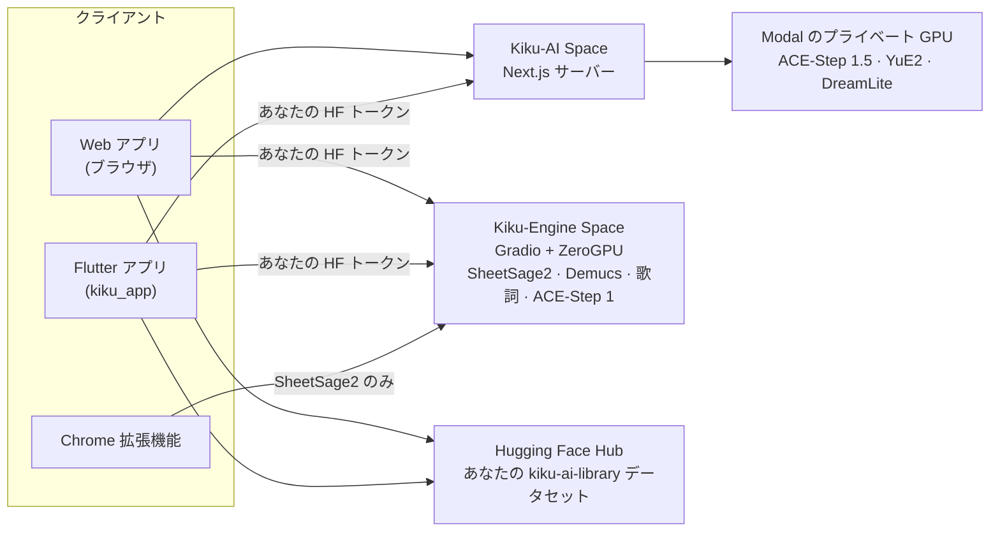

<p align="center">
  <a href="../../README.md">English</a> ·
  <a href="README.zh-CN.md">简体中文</a> ·
  <a href="README.es.md">Español</a> ·
  <a href="README.hi.md">हिन्दी</a> ·
  <a href="README.ar.md">العربية</a> ·
  <a href="README.pt-BR.md">Português</a> ·
  <a href="README.fr.md">Français</a> ·
  <a href="README.ru.md">Русский</a> ·
  <b>日本語</b> ·
  <a href="README.de.md">Deutsch</a> ·
  <a href="README.ko.md">한국어</a>
</p>

<p align="center"></p>

<h1 align="center">Kiku AI</h1>

<p align="center">ひとことから曲を作り、自分の録音を作り変え、どんな録音も楽譜にします。</p>

<p align="center">
  <a href="https://huggingface.co/spaces/Reubencf/Kiku-AI"><b>Web アプリ</b></a> ·
  <a href="#flutter-app"><b>スマホ・Mac アプリ</b></a> ·
  <a href="#chrome-extension-youtube-to-score"><b>Chrome 拡張機能</b></a>
</p>

> このページは[英語の README](../../README.md) の翻訳です。英語版が原本で、そちらのほうが新しい場合があります。
> アプリは英語表示なので、ボタンやメニューの名前は英語のままにしています。

Kiku AI はオープンモデルで作られた音楽スタジオです。**ACE-Step** と **YuE2** が曲を作って編集し、
**SheetSage2** が音声から楽譜を書き、**Demucs** がミックスをパートごとのトラック（ステム）に分けます。
3 つの形があり、どれも同じエンジンと、あなたの Hugging Face アカウントにある同じライブラリを使います。

| | 内容 | 場所 |
| --- | --- | --- |
| **Web アプリ** | フル機能のスタジオ。Hugging Face Space [Reubencf/Kiku-AI](https://huggingface.co/spaces/Reubencf/Kiku-AI) で公開中 | [`outputs/kiku-ai`](../../outputs/kiku-ai) |
| **Flutter アプリ** | 同じアプリの Android・iPhone・iPad・Mac 版 | [`kiku_app`](../../kiku_app) |
| **Chrome 拡張機能** | YouTube to Score：動画の一部を録音して楽譜にする | [`outputs/youtube-to-score-extension`](../../outputs/youtube-to-score-extension) |
| エンジン | Gradio の ZeroGPU Space と、Modal のプライベート GPU | [`outputs/kiku-engine-space`](../../outputs/kiku-engine-space)、[`outputs/kiku-acestep15-space`](../../outputs/kiku-acestep15-space)、[`outputs/kiku-modal`](../../outputs/kiku-modal) |
| 端末上での実験 | YuE2 と SheetSage2 を GGUF として Flutter アプリ内で動かす | [`flutter_app`](../../flutter_app) |
| ブランド | ロゴと、すべてのアイコンを描くスクリプト | [`branding`](../../branding) |

## 全体の構成



全員が Hugging Face でサインインします。ACE-Step 1.5 と YuE2 は Kiku-AI サーバーを通じて Kiku の
プライベートな Modal GPU で動きます。採譜、ステム分離、歌詞、ACE-Step 1 は Kiku-Engine Space 上で、
各ユーザー自身の ZeroGPU 枠を使って動きます。曲、スタジオのプロジェクト、楽譜は各ユーザーのアカウントの
プライベートなデータセットに保存されるので、ブラウザとスマホのあいだで作業を引き継げます。

## Web アプリ

[huggingface.co/spaces/Reubencf/Kiku-AI](https://huggingface.co/spaces/Reubencf/Kiku-AI) で開けます。
ホームページ、**Generate**（アイデアから、または自分のスタイルと歌詞から曲を作る）、**Studio**（選択範囲の
スタイル変更、書き直し、延長、ステム分離、YuE2 によるカバー、楽器の追加ができるマルチトラックエディター）、
**Score**（再生・編集・ダウンロードできる SheetSage2 のメロディー譜）、**Library** があります。

ローカルで動かすには Node.js 24 と FFmpeg/ffprobe が必要です。`outputs/kiku-ai` で `npm ci` を実行し、
`env.example` を `.env.local` にコピーして、非公開の `SESSION_SECRET` と API・OAuth の設定を入れてから
`npm run dev` を実行します。認証情報は絶対にコミットしないでください。詳しくは
[outputs/kiku-ai/README.md](../../outputs/kiku-ai/README.md) を参照してください。

<a name="flutter-app"></a>
## Flutter アプリ

[`kiku_app`](../../kiku_app) は Kiku AI の **Android・iPhone・iPad・Mac** 向けネイティブアプリで、
Flutter で書かれています。Web アプリと同じ 5 つのセクションがあります。

- **Home**：アイデアを入力して **Create** をタップ。
- **Generate**：Simple または Custom モード、ACE-Step 1.5 または YuE2、Enhance、そして曲ごとのカバーアート。
- **Studio**：録音、ミキサー、分割、元に戻す、WAV 書き出しを備えたマルチトラックエディター。AI の操作
  （Restyle、Rewrite、Extend、YuE2 Cover、Demucs のステム、Lyrics、Add instrument）は、オン・オフを切り替えられる
  テイクとして届きます。
- **Score**：Web アプリと同じ浄書の SheetSage2 の楽譜で、録音に合わせて小節ごとに進みます。PDF、MIDI、
  MusicXML、ABC で共有できます。
- **Library**：Web アプリと同じプライベートなデータセットなので、曲、プロジェクト、楽譜をスマホとブラウザの
  あいだで引き継げます。

Hugging Face でサインインし（PKCE 付きの OAuth、またはアクセストークンの貼り付け）、デプロイ済みの
サービスをユーザー自身のトークンで直接呼び出します。専用のサーバーはありません。

**Android で試す**：[Kiku AI app ワークフロー](https://github.com/Reubencfernandes/musical/actions/workflows/kiku-app.yml)
の最新の成功した実行を開き、`kiku-ai-android` アーティファクト（デバッグ鍵で署名したテスト用 APK）を
ダウンロードします。

**自分でビルドする**（Flutter 3.44.7）：

```sh
cd kiku_app
flutter pub get
flutter run            # Android スマホ、iPhone、シミュレーター、macOS のどれかを選ぶ
```

> [!NOTE]
> アプリは Kiku-AI サーバーに 2 つのものを必要とします。bearer トークンでのサインインと、OAuth クライアントの
> `kikuai://oauth/callback` リダイレクトです。どちらもこのリポジトリの `outputs/kiku-ai` にあります。
> デプロイ済みの Space がそれより古い場合は、`work/deploy_kiku_app.py` で再デプロイしてください。

必要な環境、サインイン、ライブラリの構成、開発メモ、トラブルシューティングは
**[kiku_app/README.md](../../kiku_app/README.md)** にあります。

<a name="chrome-extension-youtube-to-score"></a>
## Chrome 拡張機能：YouTube to Score

YouTube 動画の一部を録音して、楽譜として、または五線譜を読まない人向けの音名（C D E…）として受け取れます。
SheetSage2 がメロディーとコードを書き、拡張機能がそれをピアノ譜、メロディー譜（リードシート）、または動画と
一緒に再生できる音名表記に仕上げます。

<p align="center">
  
  &nbsp;
  
</p>
<p align="center"><sub>左：録音する区間を選ぶところ。右：浄書された楽譜が表示されたキャプチャのページ（採譜の例）。</sub></p>

### ダウンロードとインストール

拡張機能はまだ Chrome ウェブストアにないので、自分で Chrome に追加します。1 分ほどで終わります。
Chrome 116 以降が必要です。Edge、Brave などの Chromium 系ブラウザでも同じ手順です。

1. [`extension-latest` リリース](https://github.com/Reubencfernandes/musical/releases/tag/extension-latest)から
   [**`kiku-youtube-to-score.zip`**](https://github.com/Reubencfernandes/musical/releases/download/extension-latest/kiku-youtube-to-score.zip)
   を**ダウンロード**します。拡張機能が変わるたびに GitHub Actions が `main` から作り直します。
2. 残しておくフォルダー（たとえば `Documents\YouTube to Score`）に**展開**します。Chrome は起動するたびに
   このフォルダーから拡張機能を読み込むので、あとで削除しないでください。
3. **`chrome://extensions`** を開き（アドレスバーに入力）、右上の **Developer mode**（デベロッパー モード）を
   オンにします。
4. **Load unpacked**（パッケージ化されていない拡張機能を読み込む）をクリックし、展開したフォルダー、つまり
   `manifest.json` が直接入っているフォルダーを選びます。
5. ツールバーのパズルのピースのアイコンをクリックし、**YouTube to Score を固定**して、ボタンが常に見えるように
   します。
6. ボタンをクリックし、**Sign in with Hugging Face** を選びます（無料アカウントで大丈夫です）。これで採譜は
   あなた自身の ZeroGPU 枠で動きます。サインインしていないと共有の匿名枠を使うことになり、数回で使い切ります。

**更新**：新しい ZIP をダウンロードして同じフォルダーに上書きで展開し、`chrome://extensions` の拡張機能
カードにある再読み込みの矢印を押します。キャプチャとサインインはそのまま残ります。

**ソースから使う場合**：リポジトリをクローンし（`git clone https://github.com/Reubencfernandes/musical.git`）、
手順 4 で `outputs/youtube-to-score-extension` フォルダーを読み込みます。

### 使い方

1. YouTube か YouTube Music で**曲を開き**、**YouTube to Score** ボタンをクリックします。動画の横にサイドパネル
   が開きます。
2. **区間を選ぶ**。ドットのタイムラインの 2 つのハンドルをドラッグするか、**Start** と **End**（分:秒）を
   入力するか、**Now** で動画の現在位置を使うか、**Chapter** を選びます。区間は 5 秒から 10 分までです。
3. **Record を押す**。動画が開始位置に飛んで再生され、そのあいだ拡張機能がタブの音を録音します。録音は
   実時間なので、1 分の区間には 1 分かかります。広告、一時停止、読み込み待ちは除かれます。**Stop and keep**
   で早めに終わり、**Discard** で破棄します。
4. **楽譜を受け取る**。録音が終わるとキャプチャのページが開き、クリップを SheetSage2 に送ります。たいてい
   1 分以内に終わります（Space の起動が必要なときはもっとかかります）。結果はキャプチャと一緒に保存されるので、
   Space の 24 時間のファイルキャッシュが切れたあとも残ります。
5. **読む、再生する、ダウンロードする**。
   - **Sheet music か Letters**：楽譜の上の切り替えスイッチ。**Letters** は旋律を小節ごとに音名で書き、
     上にコード、各音の下にどれだけ伸ばすかを示す線、上か下に 1 オクターブ高い・低いことを示す点を付けます。
     拡張機能は新しいキャプチャのためにこの選択を覚えています。
   - **Score settings → Layout**：**Piano**（コードから作った左手の上に、右手のメロディー）または
     **Lead sheet**（メロディーとコードネーム）。**Key** で最大 6 半音まで移調できます。曲名とアーティストは
     動画から取られ、編集できます。
   - **Play** は録音に合わせて小節ごとに、音名表記では 1 音ずつ進みます。どの小節でもクリックすれば、そこから
     再生します。**With video** は YouTube 動画を楽譜と合わせて再生し、**Hear** で聞く音を選びます：
     **Piano**（動画はミュート）、**Both**、または **Song**（動画だけ。小節のハイライトは続きます）。
   - **Download** には、浄書した楽譜の PDF と MusicXML（MuseScore、Finale、Sibelius、Dorico 用）、音名表記の
     テキスト、そして SheetSage2 自身の MIDI、ABC、PDF があります。**Print** はページ（または音名表記）だけを
     印刷し、**MP3** は録音を保存します。
6. パネル上部のバーにある **Captures** で**キャプチャをもう一度探せます**。横の矢印で大きく開くこともできます。
   どれも採譜し直したり削除したりできます。

### オプション：数秒で音声を取得（Windows、yt-dlp）

自分の PC では、拡張機能が区間を実時間で録音する代わりに [yt-dlp](https://github.com/yt-dlp/yt-dlp) で
取得できます。Python、`pip install -U yt-dlp`、ffmpeg をインストールし、拡張機能のフォルダーで
`powershell -ExecutionPolicy Bypass -File native\install.ps1` を実行します（`chrome://extensions` に表示される
あなたのコピーの ID を `-ExtensionId <id>` で渡します）。拡張機能を再読み込みすると、パネルに
**Get audio now** が表示されます。このヘルパーはリリースの ZIP には含まれていません。詳しくは
[拡張機能の README](../../outputs/youtube-to-score-extension/README.md#get-audio-now-optional-yt-dlp-on-your-own-pc)
を参照してください。

### うまくいかないとき

- *"The Space turned the request away"*：GPU の枠を使い切っています。Hugging Face でサインインする（上記）か、
  あとで試してください。
- *動画でボタンを押しても何も起きない*：拡張機能をインストールまたは更新したあと、YouTube のタブを一度
  再読み込みしてください。
- *何も録音されなかった*：Record を押したあとに動画が再生される必要があります。再生が始まることを確認して、
  もう一度録音してください。
- 使う権利のある音楽だけを録音してください。YouTube のコンテンツのダウンロードは YouTube の利用規約に反する
  場合があります。SheetSage2 の重みは CC BY-NC 4.0（非営利）です。

拡張機能が保存・送信するもの：[プライバシーポリシー](../../outputs/youtube-to-score-extension/PRIVACY.md)。
各ファイルの仕組みを含む詳細：[拡張機能の README](../../outputs/youtube-to-score-extension/README.md)。

## 端末上での実験（`flutter_app`）

上の Kiku AI アプリとは別に、`flutter_app` はモデルを端末そのもので動かすことを試しています。端末上での
生成と採譜、音声の編集と書き出しを、同じオレンジ色のドットマトリクスの演奏者と同じ見た目で行います。
[モバイルでの実現可能性メモ](../mobile-inference.md)を参照してください。

固定バージョンの audio.cpp の C API を呼び出して YuE2 と SheetSage2 の GGUF を実行し、検証付きのモデル
ダウンロード、スタイルと歌詞の生成、録音の採譜、ローカル再生、ファイル書き出しを行います。
[Flutter のセットアップ](../../flutter_app/README.md)と
[Apple 向けネイティブビルドの手順](../../flutter_app/native/README.md)に従ってください。通常の Flutter
ビルドだけでは音声ランタイムが同梱されず、ブラウザ向けビルドではネイティブアプリの案内が表示されます。

現時点の制限：モデルの重みを使った実際の推論と Apple 端末向けビルドはまだ検証が必要です。少しずつ生成される
音声とエディターは未実装です。Android のネイティブパッケージングは未対応です（iOS と macOS を優先しています）。
スマホでの性能、生成速度、低性能なスマホへの対応については何も主張していません。

## デプロイ構成

ZeroGPU は Gradio SDK しか対応していないので、推論は Gradio の Space に置き、インターフェースは別の CPU の
Docker Space にしています。ACE-Step 1.5 は Python 3.11 と Gradio 6 が必要で、エンジンの環境と共存できないため、
同じエンドポイント名を持つ専用の Space があります。

| Space | SDK | 中身 |
| --- | --- | --- |
| [Kiku-Engine](https://huggingface.co/spaces/Reubencf/Kiku-Engine) | Gradio + ZeroGPU | SheetSage2、YuE2、ACE-Step、Demucs、OAuth クライアント |
| [Kiku-ACE-Step-15](https://huggingface.co/spaces/Reubencf/Kiku-ACE-Step-15) | Gradio 6 + ZeroGPU | ACE-Step 1.5（turbo、base、1.7B のプランナー）と Demucs |
| [Kiku-AI](https://huggingface.co/spaces/Reubencf/Kiku-AI) | Docker (CPU) | Next.js のインターフェースとサーバー |
| [Score-Studio-API](https://huggingface.co/spaces/Reubencf/Score-Studio-API) | Gradio + ZeroGPU | 最初の採譜 API。今も拡張機能の既定 |

ソース：`outputs/kiku-engine-space`、`outputs/kiku-acestep15-space`、`outputs/kiku-ai`。デプロイには
`work/deploy_kiku_spaces.py` と `work/deploy_kiku_app.py` を使います（どちらも `HF_TOKEN` を読みます）。
Kiku-AI Space はデプロイのたびに再起動するので、その時点で実行中のジョブは終了します。

ACE-Step 1.5 の Modal バックエンドは、使用中の `konkanillm` ワークスペースにデプロイされています。ソース、
セットアップのコマンド、コールドスタートとウォームスタートの実測時間は
[Modal のデプロイメモ](../../outputs/kiku-modal/README.md)と[試験レポート](../../outputs/kiku-modal/TEST_RESULTS.md)
にあります。L40S のワーカー 1 台を使い、API へのアクセスは非公開、CPU メモリのスナップショットとゼロまでの
スケールダウンを備えています。Web アプリは ACE-Step 1.5 の生成とプランニングを、認証付きのサーバールート
経由で Modal に送ります。YuE2 は専用のプライベートな Modal L40S ワーカー（`kiku-yue2`）で、ネイティブの
PyTorch ランタイムと CPU のインポートスナップショットを使って動きます。Generate では Simple と Custom の
どちらのモードでも YuE2 か ACE-Step 1.5 を選べます。SheetSage2、ACE-Step 1、単独のステム・歌詞ジョブは
今も Hugging Face を使っています。

`outputs/score-studio-api`、`outputs/kiku-yue2-space`、`outputs/kiku-acestep-space` は役目を終えた単一モデルの
Space で、統合したエンジンが本格的に使われるまで残しています。`outputs/sheetsage2-space` は最初の Gradio
実装です。`work` にはデプロイと検証のスクリプトがあります。1 つのアカウントで 3 つ以上の ZeroGPU Space を
ホストするには PRO が必要です。

### 3 つのモデルが 1 つの Space を共有する方法

3 つは互いに衝突するバージョンを固定しています。transformers 4.45.2（SheetSage2）、4.50.0（ACE-Step）、
4.57.6（YuE2）なので、pip では 3 つすべてを満たせません。YuE2 の wheel の環境を採用し、ほかの 2 つはその上で
動かします。`acestep` は起動時に `--no-deps` でインストールし、推論で実際に使う import は `requirements.txt`
に並べています。`torchaudio` と `torchvision` は torch 2.10.0 と対になるバージョンに固定しておく必要があります。
そうしないと pip が CUDA 13 向けのビルドを選び、CUDA 12 版の torch と一緒に読み込めなくなります。

各モデルは import 時ではなく、最初に使うときに読み込みます。YuE2 は生成時に低レベルの CUDA 初期化まで進み、
ZeroGPU は `@spaces.GPU` 関数の外ではそれを拒否するからです。さらに SheetSage2 は読み込み時に LoRA
アダプターをマージし、CPU の float32 しか受け付けないため、GPU に移す途中で型を変換しています。

### 旋律を保つ

YuE2 は音ではなく楽譜をもとに旋律を保ちます。SheetSage2 がある区間のメロディー、コード、小節線を読み取り、
ユーザーがその楽譜を編集でき、YuE2 がそれを演奏します（歌でも楽器でもカバーになります）。出力は小節ごとに
録音そのものの小節線に合わせて時間伸縮されるので、プロジェクトのほかの部分と同期したままです。

エンジンには、残したボーカルの下にバンドを付けるエンドポイント（`/accompany` と `/band_score`）もあります。
Demucs でどんな伴奏からも声を取り出し、拍のグリッドと小節ごとのコードを測り、ACE-Step か YuE2 にそれに
合わせてバンドを演奏させてから、声の下にミックスします。スタジオではもうこの機能を提供していませんが、
エンドポイントは残っています。

## 開発

| 部分 | チェック | 実行 |
| --- | --- | --- |
| Web アプリ（`outputs/kiku-ai`） | `npm run typecheck` | `npm ci` のあと `npm run dev` |
| Flutter アプリ（`kiku_app`） | `flutter analyze`、`flutter test` | `flutter pub get` のあと `flutter run` |
| 端末上での実験（`flutter_app`） | `flutter analyze`、`flutter test` | [その README](../../flutter_app/README.md) を参照 |
| 拡張機能 | パッケージ化せずに読み込む | [その README](../../outputs/youtube-to-score-extension/README.md) を参照 |

2 つの Flutter プロジェクトはどちらも Flutter 3.44.7 / Dart 3.12.2 で検証しています。iPhone 向けのビルドには
macOS、Xcode、そしてあなたのアカウント用に設定した署名が必要です。

GitHub Actions：

- [`kiku-app.yml`](../../.github/workflows/kiku-app.yml)：`kiku_app/` の変更時に、アナライザーとテスト（libFLAC
  との FLAC チェックを含む）、Android の APK アーティファクト、iOS と macOS のビルドを実行します。
- [`extension.yml`](../../.github/workflows/extension.yml)：拡張機能の変更時に、manifest をチェックし、ZIP を
  作り、`main` では `extension-latest` リリースを更新します。

`work` の開発用スクリプトには Windows 固有のパスが残っていることがあるので、使う前に確認してください。
認証情報、ビルドのキャッシュ、非公開のテスト録音はリポジトリに含めていません。

## ロゴ

聞いている K は、曲がった受信部、2 本のなびく音のリボン、そして開いた中心の点を組み合わせたものです。
アプリ内ではオレンジ色で単独に置き、アプリアイコンでは温かみのあるチャコールの上に載せます。リボンは表示時に
広がり、その後 5 秒ごとに通り過ぎる信号に短く反応します。動きを減らす設定ではロゴは動きません。
[`branding/generate.py`](../../branding/generate.py) は、React、Flutter、拡張機能のアイコン、すべての
ランチャーアイコンで同じベクター形状を共有します。

<p align="center"> &nbsp; </p>

## ライセンスとクレジット

モデルの重みは別途ダウンロードされ、それぞれのライセンスに従います。このリポジトリがライセンスを変えることは
ありません。YuE2、SheetSage2、DreamLite-base は CC BY-NC 4.0（非営利）、ACE-Step は Apache 2.0、Demucs は
MIT です。サウンドフォントのクレジットは `outputs/kiku-ai/public/soundfonts/ATTRIBUTION.md`、フォントの
表記は `outputs/kiku-ai/public/fonts/README.md` にあり、同梱の abcjs の表記はそのコピーと一緒に置いてあります。

Kiku AI は以前 Score Studio という名前でした。記譜は今もモードの 1 つです。このリポジトリの名前は `musical`
です。元のプロジェクトフォルダー：`E:\ScoreStudio`。
