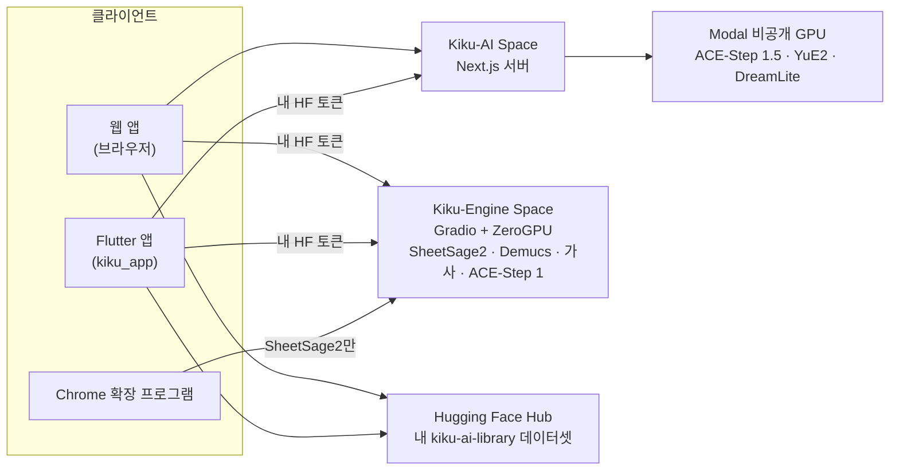

<p align="center">
  <a href="../../README.md">English</a> ·
  <a href="README.zh-CN.md">简体中文</a> ·
  <a href="README.es.md">Español</a> ·
  <a href="README.hi.md">हिन्दी</a> ·
  <a href="README.ar.md">العربية</a> ·
  <a href="README.pt-BR.md">Português</a> ·
  <a href="README.fr.md">Français</a> ·
  <a href="README.ru.md">Русский</a> ·
  <a href="README.ja.md">日本語</a> ·
  <a href="README.de.md">Deutsch</a> ·
  <b>한국어</b>
</p>

<p align="center"></p>

<h1 align="center">Kiku AI</h1>

<p align="center">한 문장으로 노래를 만들고, 내 녹음을 새롭게 바꾸고, 어떤 녹음이든 악보로 만드세요.</p>

<p align="center">
  <a href="https://huggingface.co/spaces/Reubencf/Kiku-AI"><b>웹 앱</b></a> ·
  <a href="#flutter-app"><b>휴대폰 및 Mac 앱</b></a> ·
  <a href="#chrome-extension-youtube-to-score"><b>Chrome 확장 프로그램</b></a>
</p>

> 이 페이지는 [영어 README](../../README.md)를 번역한 것입니다. 영어판이 원본이며 더 최신일 수 있습니다.
> 앱이 영어로 되어 있어서 버튼과 메뉴 이름은 영어 그대로 두었습니다.

Kiku AI는 오픈 모델로 만든 음악 스튜디오입니다. **ACE-Step**과 **YuE2**가 노래를 쓰고 편집하며,
**SheetSage2**가 오디오에서 악보를 쓰고, **Demucs**가 믹스를 악기별 트랙(스템)으로 나눕니다. 세 가지 형태로
제공되며, 모두 같은 엔진과 내 Hugging Face 계정의 같은 라이브러리를 사용합니다.

| | 무엇인가 | 위치 |
| --- | --- | --- |
| **웹 앱** | 전체 스튜디오. Hugging Face Space [Reubencf/Kiku-AI](https://huggingface.co/spaces/Reubencf/Kiku-AI)에서 운영 중 | [`outputs/kiku-ai`](../../outputs/kiku-ai) |
| **Flutter 앱** | Android, iPhone, iPad, Mac용 같은 앱 | [`kiku_app`](../../kiku_app) |
| **Chrome 확장 프로그램** | YouTube to Score: 동영상의 일부를 녹음해 악보로 받기 | [`outputs/youtube-to-score-extension`](../../outputs/youtube-to-score-extension) |
| 엔진 | Gradio ZeroGPU Space와 Modal의 비공개 GPU | [`outputs/kiku-engine-space`](../../outputs/kiku-engine-space), [`outputs/kiku-acestep15-space`](../../outputs/kiku-acestep15-space), [`outputs/kiku-modal`](../../outputs/kiku-modal) |
| 기기 내 실험 | GGUF 형식의 YuE2와 SheetSage2를 Flutter 앱 안에서 실행 | [`flutter_app`](../../flutter_app) |
| 브랜딩 | 로고와 모든 아이콘을 그리는 스크립트 | [`branding`](../../branding) |

## 전체 구조



모든 사용자는 Hugging Face로 로그인합니다. ACE-Step 1.5와 YuE2는 Kiku-AI 서버를 거쳐 Kiku의 비공개
Modal GPU에서 실행됩니다. 채보, 스템 분리, 가사, ACE-Step 1은 Kiku-Engine Space에서 각 사용자 자신의
ZeroGPU 할당량으로 실행됩니다. 노래, 스튜디오 프로젝트, 악보는 각 사용자 계정의 비공개 데이터셋에 저장되므로
브라우저와 휴대폰 사이에서 작업이 이어집니다.

## 웹 앱

[huggingface.co/spaces/Reubencf/Kiku-AI](https://huggingface.co/spaces/Reubencf/Kiku-AI)에서 열 수 있습니다.
홈 페이지, **Generate**(아이디어나 나만의 스타일과 가사로 노래 만들기), **Studio**(선택한 구간의 스타일을
바꾸고, 다시 쓰고, 늘리고, 스템으로 나누거나 YuE2로 커버하고, 악기를 추가할 수 있는 멀티트랙 편집기),
**Score**(재생, 편집, 다운로드할 수 있는 SheetSage2 리드 시트), **Library**가 있습니다.

로컬에서 실행하려면 Node.js 24와 FFmpeg/ffprobe가 필요합니다. `outputs/kiku-ai`에서 `npm ci`를 실행하고,
`env.example`을 `.env.local`로 복사한 뒤 비공개 `SESSION_SECRET`과 API 및 OAuth 설정을 넣고 `npm run dev`를
실행하세요. 인증 정보는 절대 커밋하지 마세요. 자세한 내용:
[outputs/kiku-ai/README.md](../../outputs/kiku-ai/README.md).

<a name="flutter-app"></a>
## Flutter 앱

[`kiku_app`](../../kiku_app)은 Flutter로 만든 **Android, iPhone, iPad, Mac**용 Kiku AI 네이티브 앱입니다.
웹 앱과 같은 다섯 가지 섹션이 있습니다.

- **Home**: 아이디어를 입력하고 **Create**를 누르세요.
- **Generate**: Simple 또는 Custom 모드, ACE-Step 1.5 또는 YuE2, Enhance, 그리고 노래마다 커버 아트.
- **Studio**: 녹음, 믹서, 자르기, 실행 취소, WAV 내보내기를 갖춘 멀티트랙 편집기. AI 작업(Restyle, Rewrite,
  Extend, YuE2 Cover, Demucs 스템, Lyrics, Add instrument)은 켜고 끌 수 있는 테이크로 들어옵니다.
- **Score**: 웹 앱과 똑같이 조판된 SheetSage2 리드 시트로, 녹음을 따라 마디마다 진행합니다. PDF, MIDI,
  MusicXML, ABC로 공유할 수 있습니다.
- **Library**: 웹 앱이 쓰는 것과 같은 비공개 데이터셋이라 노래, 프로젝트, 악보가 휴대폰과 브라우저 사이에서
  이어집니다.

Hugging Face로 로그인하고(PKCE를 쓰는 OAuth, 또는 붙여 넣은 액세스 토큰), 배포된 서비스를 사용자 자신의
토큰으로 직접 호출합니다. 자체 서버는 없습니다.

**Android에서 써 보기**: 가장 최근에 성공한
[Kiku AI app 워크플로 실행](https://github.com/Reubencfernandes/musical/actions/workflows/kiku-app.yml)을 열고
`kiku-ai-android` 아티팩트(디버그 키로 서명한 테스트용 APK)를 다운로드하세요.

**직접 빌드하기**(Flutter 3.44.7):

```sh
cd kiku_app
flutter pub get
flutter run            # Android 휴대폰, iPhone, 시뮬레이터, macOS 중 하나를 선택
```

> [!NOTE]
> 앱은 Kiku-AI 서버에 두 가지가 필요합니다. bearer 토큰 로그인과, OAuth 클라이언트의
> `kikuai://oauth/callback` 리디렉션입니다. 둘 다 이 저장소의 `outputs/kiku-ai`에 있습니다. 배포된 Space가
> 이보다 오래되었다면 `work/deploy_kiku_app.py`로 다시 배포하세요.

요구 사항, 로그인, 라이브러리 구조, 개발 메모, 문제 해결은 **[kiku_app/README.md](../../kiku_app/README.md)**
문서에 있습니다.

<a name="chrome-extension-youtube-to-score"></a>
## Chrome 확장 프로그램: YouTube to Score

YouTube 동영상의 일부를 녹음해 악보로 받거나, 오선보를 읽지 못하는 사람을 위한 알파벳 음이름(C D E…)으로
받으세요. SheetSage2가 멜로디와 코드를 쓰고, 확장 프로그램이 이를 피아노 악보, 리드 시트, 또는 동영상과 함께
재생되는 음이름으로 정리합니다.

<p align="center">
  
  &nbsp;
  
</p>
<p align="center"><sub>왼쪽: 녹음할 구간 고르기. 오른쪽: 조판된 악보가 있는 캡처 페이지(채보 예시).</sub></p>

### 다운로드와 설치

확장 프로그램은 아직 Chrome 웹 스토어에 없어서 직접 Chrome에 추가해야 합니다. 1분 정도 걸립니다.
Chrome 116 이상이 필요하며, Edge, Brave 등 다른 Chromium 브라우저도 같은 방법으로 됩니다.

1. [`extension-latest` 릴리스](https://github.com/Reubencfernandes/musical/releases/tag/extension-latest)에서
   [**`kiku-youtube-to-score.zip`**](https://github.com/Reubencfernandes/musical/releases/download/extension-latest/kiku-youtube-to-score.zip)을
   **다운로드**하세요. 확장 프로그램이 바뀔 때마다 GitHub Actions가 `main`에서 다시 빌드합니다.
2. 계속 보관할 폴더(예: `Documents\YouTube to Score`)에 **압축을 푸세요**. Chrome은 시작할 때마다 이 폴더에서
   확장 프로그램을 불러오므로 나중에 지우지 마세요.
3. **`chrome://extensions`** 페이지를 열고(주소 표시줄에 입력) 오른쪽 위의 **Developer mode**(개발자 모드)를 켜세요.
4. **Load unpacked**(압축 해제된 확장 프로그램 로드)를 누르고 압축을 푼 폴더, 즉 `manifest.json`이 바로 들어
   있는 폴더를 선택하세요.
5. 툴바의 퍼즐 조각 아이콘을 누르고 **YouTube to Score를 고정**해서 버튼이 항상 보이게 하세요.
6. 버튼을 누르고 **Sign in with Hugging Face**를 선택하세요(무료 계정이면 충분합니다). 그러면 채보가 내
   ZeroGPU 할당량으로 실행됩니다. 로그인하지 않으면 공용 익명 할당량을 나눠 쓰게 되며, 몇 개의 클립만에
   소진됩니다.

**업데이트:** 새 ZIP을 다운로드해 같은 폴더에 덮어써서 압축을 풀고, `chrome://extensions`에서 확장 프로그램
카드의 새로고침 화살표를 누르세요. 캡처와 로그인은 그대로 유지됩니다.

**소스에서 쓰기:** 저장소를 클론하고(`git clone https://github.com/Reubencfernandes/musical.git`) 4단계에서
`outputs/youtube-to-score-extension` 폴더를 불러오세요.

### 사용법

1. YouTube나 YouTube Music에서 **노래를 열고** **YouTube to Score** 버튼을 누르세요. 동영상 옆에 사이드
   패널이 열립니다.
2. **구간을 고르세요.** 점선 타임라인의 두 핸들을 끌거나, **Start**와 **End**(분:초)를 입력하거나, **Now**를
   눌러 동영상의 현재 위치를 쓰거나, **Chapter**를 고르세요. 구간은 5초에서 10분까지입니다.
3. **Record를 누르세요.** 동영상이 시작 위치로 이동해 재생되고, 그동안 확장 프로그램이 탭의 소리를 녹음합니다.
   실시간으로 녹음하므로 1분짜리 구간은 1분이 걸립니다. 광고, 일시 정지, 버퍼링은 빠집니다.
   **Stop and keep**은 일찍 끝내고, **Discard**는 버립니다.
4. **악보를 받으세요.** 녹음이 끝나면 캡처 페이지가 열리고 클립을 SheetSage2로 보냅니다. 보통 1분 안에
   끝납니다(Space가 깨어나야 할 때는 더 걸립니다). 결과는 캡처와 함께 저장되므로 Space의 24시간 파일 캐시가
   지나도 남아 있습니다.
5. **읽고, 재생하고, 다운로드하세요.**
   - **Sheet music 또는 Letters**: 악보 위의 전환 스위치입니다. **Letters**는 선율을 마디마다 음이름으로
     쓰고, 위에는 코드, 각 음 아래에는 얼마나 길게 끄는지 보여 주는 선, 위나 아래에는 한 옥타브 높거나 낮음을
     뜻하는 점을 붙입니다. 확장 프로그램은 새 캡처를 위해 이 선택을 기억합니다.
   - **Score settings → Layout**: **Piano**(코드로 만든 왼손 위에 오른손 멜로디) 또는 **Lead sheet**(코드
     기호가 붙은 멜로디). **Key**로 최대 6반음까지 조옮김합니다. 제목과 아티스트는 동영상에서 가져오며 편집할
     수 있습니다.
   - **Play**는 녹음을 따라 마디마다, 음이름에서는 음마다 진행합니다. 아무 마디나 누르면 거기서부터 재생합니다.
     **With video**는 YouTube 동영상을 악보와 맞춰 재생하고, **Hear**로 들을 소리를 고릅니다: **Piano**(동영상
     음소거), **Both**, 또는 **Song**(동영상만, 마디 강조는 계속).
   - **Download**에는 조판된 악보의 PDF와 MusicXML(MuseScore, Finale, Sibelius, Dorico용), 음이름 텍스트,
     그리고 SheetSage2 자체의 MIDI, ABC, PDF가 있습니다. **Print**는 페이지(또는 음이름)만 인쇄하고, **MP3**는
     녹음을 저장합니다.
6. 패널 위쪽 막대의 **Captures**에서 **캡처를 다시 찾으세요**. 옆의 화살표로 크게 열 수도 있습니다. 각 캡처는
   다시 채보하거나 삭제할 수 있습니다.

### 선택 사항: 몇 초 만에 오디오 받기(Windows, yt-dlp)

내 PC에서는 확장 프로그램이 구간을 실시간으로 녹음하는 대신 [yt-dlp](https://github.com/yt-dlp/yt-dlp)로
가져올 수 있습니다. Python, `pip install -U yt-dlp`, ffmpeg을 설치한 다음 확장 프로그램 폴더에서
`powershell -ExecutionPolicy Bypass -File native\install.ps1`을 실행하세요(`chrome://extensions`에 표시되는 내
사본의 ID를 `-ExtensionId <id>`로 넘기세요). 확장 프로그램을 새로고침하면 패널에 **Get audio now**가
나타납니다. 이 도우미는 릴리스 ZIP에 포함되지 않습니다.
[확장 프로그램 README](../../outputs/youtube-to-score-extension/README.md#get-audio-now-optional-yt-dlp-on-your-own-pc)를
참고하세요.

### 문제가 생기면

- *"The Space turned the request away"*: GPU 할당량을 다 썼습니다. Hugging Face로 로그인하거나(위 참고) 나중에
  다시 시도하세요.
- *동영상에서 버튼을 눌러도 아무 일도 없음*: 확장 프로그램을 설치하거나 업데이트한 뒤 YouTube 탭을 한 번
  새로고침하세요.
- *아무것도 녹음되지 않음*: Record를 누른 뒤 동영상이 재생되어야 합니다. 재생이 시작되는지 확인하고 다시
  녹음하세요.
- 사용할 권리가 있는 음악만 녹음하세요. YouTube 콘텐츠를 다운로드하는 것은 YouTube 서비스 약관에 어긋날 수
  있습니다. SheetSage2의 가중치는 CC BY-NC 4.0(비상업적)입니다.

확장 프로그램이 저장하고 보내는 것: [개인정보처리방침](../../outputs/youtube-to-score-extension/PRIVACY.md).
각 파일이 어떻게 동작하는지를 포함한 자세한 내용: [확장 프로그램 README](../../outputs/youtube-to-score-extension/README.md).

## 기기 내 실험(`flutter_app`)

위의 Kiku AI 앱과 별개로, `flutter_app`은 모델을 기기 자체에서 실행하는 방법을 탐구합니다. 기기에서의 생성과
채보, 오디오 편집과 내보내기를 같은 주황색 도트 매트릭스 연주자와 같은 시각 스타일로 제공합니다.
[모바일 실행 가능성 메모](../mobile-inference.md)를 참고하세요.

고정된 버전의 audio.cpp C API를 호출해 YuE2와 SheetSage2 GGUF를 실행하며, 검증된 모델 다운로드, 스타일과
가사 생성, 녹음 채보, 로컬 재생, 파일 내보내기를 지원합니다. [Flutter 설정](../../flutter_app/README.md)과
[Apple 네이티브 빌드 안내](../../flutter_app/native/README.md)를 따르세요. 일반 Flutter 빌드만으로는 오디오
런타임이 포함되지 않으며, 브라우저 빌드는 네이티브 앱 안내를 표시합니다.

현재 한계: 모델 가중치를 사용한 실제 추론과 Apple 기기 빌드는 아직 검증이 필요합니다. 점진적으로 생성되는
오디오와 편집기는 구현되지 않았습니다. Android 네이티브 패키징은 아직 남아 있습니다(통합은 iOS와 macOS를
우선합니다). 휴대폰 성능, 생성 속도, 저사양 휴대폰 지원에 대해서는 아무것도 주장하지 않습니다.

## 배포 아키텍처

ZeroGPU는 Gradio SDK만 지원하므로 추론은 Gradio Space에 두고, 인터페이스는 별도의 CPU Docker Space입니다.
ACE-Step 1.5는 Python 3.11과 Gradio 6이 필요한데 엔진의 환경과 함께 쓸 수 없어서, 같은 엔드포인트 이름을 가진
전용 Space가 있습니다.

| Space | SDK | 담긴 것 |
| --- | --- | --- |
| [Kiku-Engine](https://huggingface.co/spaces/Reubencf/Kiku-Engine) | Gradio + ZeroGPU | SheetSage2, YuE2, ACE-Step, Demucs, OAuth 클라이언트 |
| [Kiku-ACE-Step-15](https://huggingface.co/spaces/Reubencf/Kiku-ACE-Step-15) | Gradio 6 + ZeroGPU | ACE-Step 1.5(turbo, base, 1.7B 플래너)와 Demucs |
| [Kiku-AI](https://huggingface.co/spaces/Reubencf/Kiku-AI) | Docker (CPU) | Next.js 인터페이스와 서버 |
| [Score-Studio-API](https://huggingface.co/spaces/Reubencf/Score-Studio-API) | Gradio + ZeroGPU | 처음 만든 채보 API, 지금도 확장 프로그램의 기본값 |

소스: `outputs/kiku-engine-space`, `outputs/kiku-acestep15-space`, `outputs/kiku-ai`. 배포는
`work/deploy_kiku_spaces.py`와 `work/deploy_kiku_app.py`로 합니다(둘 다 `HF_TOKEN`을 읽습니다). Kiku-AI Space는
배포할 때마다 다시 시작되므로, 그때 실행 중이던 작업은 끝나 버립니다.

ACE-Step 1.5 Modal 백엔드는 사용 중인 `konkanillm` 워크스페이스에 배포되어 있습니다. 소스, 설정 명령, 측정한
콜드/웜 스타트 시간은 [Modal 배포 메모](../../outputs/kiku-modal/README.md)와
[시험 보고서](../../outputs/kiku-modal/TEST_RESULTS.md)에 있습니다. L40S 워커 하나를 쓰며, 비공개 API 접근,
CPU 메모리 스냅샷, 0까지 축소를 지원합니다. 웹 앱은 ACE-Step 1.5의 생성과 계획을 인증된 서버 경로를 통해
Modal로 보냅니다. YuE2는 전용 비공개 Modal L40S 워커(`kiku-yue2`)에서 네이티브 PyTorch 런타임과 CPU 임포트
스냅샷으로 실행됩니다. Generate에서는 Simple과 Custom 모드 모두에서 YuE2나 ACE-Step 1.5를 고를 수 있습니다.
SheetSage2, ACE-Step 1, 단독 스템/가사 작업은 여전히 Hugging Face를 씁니다.

`outputs/score-studio-api`, `outputs/kiku-yue2-space`, `outputs/kiku-acestep-space`는 대체된 단일 모델
Space로, 통합 엔진이 실제로 충분히 쓰일 때까지 남겨 둡니다. `outputs/sheetsage2-space`는 처음의 Gradio
구현입니다. `work`에는 배포와 검증 스크립트가 있습니다. 한 계정에서 ZeroGPU Space를 세 개 이상 호스팅하려면
PRO가 필요합니다.

### 세 모델이 한 Space를 함께 쓰는 방법

세 모델은 서로 충돌하는 버전을 고정합니다. transformers 4.45.2(SheetSage2), 4.50.0(ACE-Step), 4.57.6(YuE2)이라
pip로는 셋을 모두 만족시킬 수 없습니다. YuE2 wheel의 환경을 쓰고 나머지 둘은 그 위에서 실행합니다. `acestep`은
시작할 때 `--no-deps`로 설치하며, 추론에 실제로 필요한 임포트는 `requirements.txt`에 적혀 있습니다.
`torchaudio`와 `torchvision`은 torch 2.10.0과 짝을 이루는 버전으로 고정해야 합니다. 그렇지 않으면 pip가
CUDA 13용 빌드를 가져오고, 이는 CUDA 12용 torch와 함께 불러올 수 없습니다.

각 모델은 임포트할 때가 아니라 처음 쓸 때 불러옵니다. YuE2는 생성되는 동안 저수준 CUDA 초기화까지 진행하는데,
ZeroGPU는 `@spaces.GPU` 함수 밖에서 이를 거부하기 때문입니다. 또한 SheetSage2는 불러올 때 LoRA 어댑터를
병합하고 CPU float32만 받으므로, GPU로 옮기는 도중에 형식을 변환합니다.

### 선율 유지하기

YuE2는 소리가 아니라 악보를 바탕으로 선율을 유지합니다. SheetSage2가 한 구간의 멜로디, 코드, 마디줄을 읽고,
사용자가 그 악보를 편집할 수 있으며, YuE2가 이를 연주합니다(노래로든 악기로든 커버). 결과물은 마디마다 녹음
자체의 마디줄에 맞춰 시간이 늘거나 줄어들어, 프로젝트의 나머지 부분과 맞춰진 상태를 유지합니다.

엔진에는 남겨 둔 보컬 아래에 밴드를 만드는 엔드포인트(`/accompany`와 `/band_score`)도 있습니다. Demucs로 어떤
반주에서든 목소리를 분리하고, 박자 격자와 마디별 코드를 측정한 뒤, ACE-Step이나 YuE2가 그에 맞춰 밴드를
연주하게 하고 목소리 아래에 믹스합니다. 스튜디오에서는 더 이상 이 기능을 제공하지 않지만 엔드포인트는 남아
있습니다.

## 개발

| 부분 | 점검 | 실행 |
| --- | --- | --- |
| 웹 앱(`outputs/kiku-ai`) | `npm run typecheck` | `npm ci` 다음 `npm run dev` |
| Flutter 앱(`kiku_app`) | `flutter analyze`, `flutter test` | `flutter pub get` 다음 `flutter run` |
| 기기 내 실험(`flutter_app`) | `flutter analyze`, `flutter test` | [해당 README](../../flutter_app/README.md) 참고 |
| 확장 프로그램 | 압축 해제 상태로 불러오기 | [해당 README](../../outputs/youtube-to-score-extension/README.md) 참고 |

두 Flutter 프로젝트 모두 Flutter 3.44.7 / Dart 3.12.2로 검증했습니다. iPhone 빌드에는 macOS, Xcode, 그리고
내 계정에 맞게 설정한 서명이 필요합니다.

GitHub Actions:

- [`kiku-app.yml`](../../.github/workflows/kiku-app.yml): `kiku_app/`이 바뀔 때 분석기와 테스트(libFLAC과 비교하는
  FLAC 검사 포함), Android APK 아티팩트, iOS와 macOS 빌드를 실행합니다.
- [`extension.yml`](../../.github/workflows/extension.yml): 확장 프로그램이 바뀔 때 manifest를 검사하고 ZIP을
  만들며, `main`에서는 `extension-latest` 릴리스를 업데이트합니다.

`work`의 개발 스크립트에는 아직 Windows 전용 경로가 남아 있을 수 있으니 쓰기 전에 확인하세요. 인증 정보, 빌드
캐시, 비공개 테스트 녹음은 저장소에 넣지 않습니다.

## 로고

듣고 있는 K는 휘어진 수신부, 휩쓸리듯 뻗은 두 개의 소리 리본, 열린 가운데의 점으로 이루어져 있습니다. 앱 안에서는
주황색으로 단독으로 쓰이고, 앱 아이콘에서는 따뜻한 차콜 색 위에 놓입니다. 리본은 처음 나타날 때 펼쳐지고, 그 뒤
5초마다 지나가는 신호에 잠깐 반응합니다. 동작 줄이기 설정에서는 로고가 움직이지 않습니다.
[`branding/generate.py`](../../branding/generate.py)는 React, Flutter, 확장 프로그램 아이콘, 모든 런처 아이콘이
같은 벡터 도형을 쓰게 합니다.

<p align="center"> &nbsp; </p>

## 라이선스와 크레딧

모델 가중치는 따로 다운로드되며 각자의 라이선스를 따릅니다. 이 저장소는 그 라이선스를 바꾸지 않습니다.
YuE2, SheetSage2, DreamLite-base는 CC BY-NC 4.0(비상업적)이고, ACE-Step은 Apache 2.0, Demucs는 MIT입니다.
사운드폰트 출처는 `outputs/kiku-ai/public/soundfonts/ATTRIBUTION.md`, 글꼴 고지는
`outputs/kiku-ai/public/fonts/README.md`에 있으며, 함께 들어 있는 abcjs의 고지는 그 사본과 함께 있습니다.

Kiku AI의 예전 이름은 Score Studio였고, 기보는 지금도 모드 중 하나입니다. 이 저장소의 이름은 `musical`입니다.
원래 프로젝트 폴더: `E:\ScoreStudio`.
