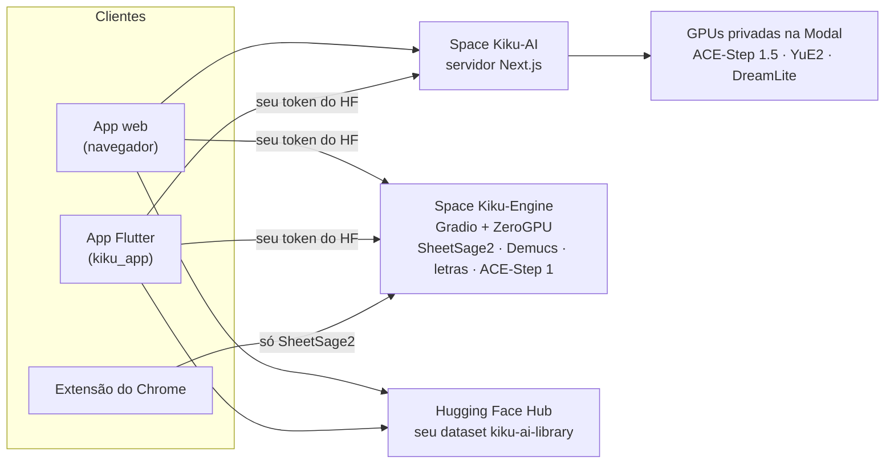

<p align="center">
  <a href="../../README.md">English</a> ·
  <a href="README.zh-CN.md">简体中文</a> ·
  <a href="README.es.md">Español</a> ·
  <a href="README.hi.md">हिन्दी</a> ·
  <a href="README.ar.md">العربية</a> ·
  <b>Português</b> ·
  <a href="README.fr.md">Français</a> ·
  <a href="README.ru.md">Русский</a> ·
  <a href="README.ja.md">日本語</a> ·
  <a href="README.de.md">Deutsch</a> ·
  <a href="README.ko.md">한국어</a>
</p>

<p align="center"></p>

<h1 align="center">Kiku AI</h1>

<p align="center">Escreva músicas a partir de uma frase, transforme suas próprias gravações e converta qualquer gravação em partitura.</p>

<p align="center">
  <a href="https://huggingface.co/spaces/Reubencf/Kiku-AI"><b>App web</b></a> ·
  <a href="#flutter-app"><b>App para celular e Mac</b></a> ·
  <a href="#chrome-extension-youtube-to-score"><b>Extensão do Chrome</b></a>
</p>

> Esta página é uma tradução do [README em inglês](../../README.md), que é a versão de referência e pode
> estar mais atualizada. Os apps estão em inglês, por isso os nomes de botões e menus ficaram em inglês.

Kiku AI é um estúdio de música construído sobre modelos abertos: **ACE-Step** e **YuE2** escrevem e editam
músicas, **SheetSage2** escreve partituras a partir do áudio e **Demucs** separa uma mixagem em faixas
(stems). Ele vem em três formas que compartilham os mesmos motores e uma única biblioteca na sua conta do
Hugging Face:

| | O que é | Onde |
| --- | --- | --- |
| **App web** | O estúdio completo, no ar no Space do Hugging Face [Reubencf/Kiku-AI](https://huggingface.co/spaces/Reubencf/Kiku-AI) | [`outputs/kiku-ai`](../../outputs/kiku-ai) |
| **App Flutter** | O mesmo app para Android, iPhone, iPad e Mac | [`kiku_app`](../../kiku_app) |
| **Extensão do Chrome** | YouTube to Score: grave parte de um vídeo e receba a partitura | [`outputs/youtube-to-score-extension`](../../outputs/youtube-to-score-extension) |
| Motores | Spaces Gradio com ZeroGPU e GPUs privadas na Modal | [`outputs/kiku-engine-space`](../../outputs/kiku-engine-space), [`outputs/kiku-acestep15-space`](../../outputs/kiku-acestep15-space), [`outputs/kiku-modal`](../../outputs/kiku-modal) |
| Experimento no dispositivo | YuE2 e SheetSage2 em GGUF, rodando dentro de um app Flutter | [`flutter_app`](../../flutter_app) |
| Marca | O logotipo e o script que desenha todos os ícones | [`branding`](../../branding) |

## Como tudo se encaixa



Todo mundo entra com o Hugging Face. ACE-Step 1.5 e YuE2 rodam nas GPUs privadas do Kiku na Modal, por
meio do servidor do Kiku-AI. Transcrição, faixas, letras e ACE-Step 1 rodam no Space Kiku-Engine usando a
cota de ZeroGPU de cada usuário. Músicas, projetos do estúdio e partituras ficam salvos em um dataset
privado na conta de cada usuário, então o trabalho acompanha você do navegador para o celular.

## App web

Abra em [huggingface.co/spaces/Reubencf/Kiku-AI](https://huggingface.co/spaces/Reubencf/Kiku-AI). Ele tem
uma página inicial, **Generate** (músicas a partir de uma ideia ou do seu próprio estilo e letra),
**Studio** (um editor multipista em que trechos selecionados podem mudar de estilo, ser reescritos,
estendidos, separados em faixas ou regravados como cover pelo YuE2, e onde é possível adicionar
instrumentos), **Score** (partituras de melodia e acordes do SheetSage2 que você pode tocar, editar e
baixar) e **Library**.

Para rodar localmente, você precisa de Node.js 24 e FFmpeg/ffprobe. Em `outputs/kiku-ai`, rode `npm ci`,
copie `env.example` para `.env.local`, defina um `SESSION_SECRET` privado e as configurações de API e
OAuth, e então rode `npm run dev`. Nunca faça commit de credenciais. Detalhes:
[outputs/kiku-ai/README.md](../../outputs/kiku-ai/README.md).

<a name="flutter-app"></a>
## App Flutter

[`kiku_app`](../../kiku_app) é o Kiku AI como app nativo para **Android, iPhone, iPad e Mac**, escrito em
Flutter. Ele tem as mesmas cinco seções do app web:

- **Home**: digite uma ideia e toque em **Create**.
- **Generate**: modo Simple ou Custom, ACE-Step 1.5 ou YuE2, Enhance e capa para cada música.
- **Studio**: um editor multipista com gravação, mixer, corte, desfazer e exportação em WAV. As ações de
  IA (Restyle, Rewrite, Extend, YuE2 Cover, faixas do Demucs, Lyrics, Add instrument) chegam como takes
  que você pode ligar e desligar.
- **Score**: partituras do SheetSage2, com a mesma diagramação do app web, que acompanham a gravação
  compasso a compasso. Compartilhe em PDF, MIDI, MusicXML ou ABC.
- **Library**: o mesmo dataset privado que o app web usa, então músicas, projetos e partituras passam do
  celular para o navegador.

Ele entra com o Hugging Face (OAuth com PKCE, ou um token de acesso colado) e chama os serviços publicados
diretamente com o token do próprio usuário. Não tem servidor próprio.

**Teste no Android**: abra a execução bem-sucedida mais recente do
[fluxo de trabalho do app Kiku AI](https://github.com/Reubencfernandes/musical/actions/workflows/kiku-app.yml)
e baixe o artefato `kiku-ai-android` (um APK de teste assinado com uma chave de depuração).

**Compile você mesmo** com o Flutter 3.44.7:

```sh
cd kiku_app
flutter pub get
flutter run            # escolha um celular Android, um iPhone, um simulador ou o macOS
```

> [!NOTE]
> O app precisa de duas coisas do servidor do Kiku-AI: login com token bearer e o redirecionamento
> `kikuai://oauth/callback` no cliente OAuth dele. Os dois estão em `outputs/kiku-ai` neste repositório.
> Se o Space publicado for anterior a eles, publique-o de novo com `work/deploy_kiku_app.py`.

Requisitos, login, a estrutura da biblioteca, notas de desenvolvimento e solução de problemas estão em
**[kiku_app/README.md](../../kiku_app/README.md)**.

<a name="chrome-extension-youtube-to-score"></a>
## Extensão do Chrome: YouTube to Score

Grave parte de um vídeo do YouTube e receba de volta a partitura, ou as notas em letras (C D E…) para
quem não lê pauta: o SheetSage2 escreve a melodia e os acordes, e a extensão os organiza como partitura de
piano, partitura de melodia e acordes (lead sheet) ou letras que tocam junto com o vídeo.

<p align="center">
  
  &nbsp;
  
</p>
<p align="center"><sub>Esquerda: escolhendo o trecho a gravar. Direita: a página da captura com a partitura diagramada (transcrição de exemplo).</sub></p>

### Baixar e instalar

A extensão ainda não está na Chrome Web Store, então você mesmo a adiciona ao Chrome. Leva cerca de um
minuto. Você precisa do Chrome 116 ou mais recente; Edge, Brave e outros navegadores Chromium funcionam do
mesmo jeito.

1. **Baixe** [**`kiku-youtube-to-score.zip`**](https://github.com/Reubencfernandes/musical/releases/download/extension-latest/kiku-youtube-to-score.zip)
   da [versão `extension-latest`](https://github.com/Reubencfernandes/musical/releases/tag/extension-latest).
   O GitHub Actions a recompila a partir da `main` sempre que a extensão muda.
2. **Descompacte** em uma pasta que você vai manter, como `Documents\YouTube to Score`. O Chrome carrega a
   extensão dessa pasta toda vez que inicia, então não a apague depois.
3. Abra **`chrome://extensions`** (digite na barra de endereço) e ative o **Developer mode** (modo de
   desenvolvedor, no canto superior direito).
4. Clique em **Load unpacked** (carregar sem compactação) e escolha a pasta descompactada: a que tem o
   `manifest.json` direto dentro dela.
5. Clique no ícone de peça de quebra-cabeça da barra de ferramentas e **fixe o YouTube to Score**, para que
   o botão dele fique sempre à vista.
6. Clique no botão e em **Sign in with Hugging Face** (uma conta gratuita serve). Assim as transcrições
   usam a sua própria cota de ZeroGPU; sem login, elas dividem uma cota anônima que acaba depois de
   alguns clipes.

**Para atualizar:** baixe o ZIP novo, descompacte por cima da mesma pasta e clique na seta de recarregar
no cartão da extensão em `chrome://extensions`. Suas capturas e seu login são mantidos.

**A partir do código-fonte:** clone o repositório
(`git clone https://github.com/Reubencfernandes/musical.git`) e carregue a pasta
`outputs/youtube-to-score-extension` no passo 4.

### Como usar

1. **Abra uma música** no YouTube ou no YouTube Music e clique no botão **YouTube to Score**. Um painel
   lateral se abre ao lado do vídeo.
2. **Escolha o trecho.** Arraste as duas alças na linha do tempo pontilhada, digite **Start** e **End**
   (minutos:segundos), aperte **Now** para usar o ponto em que o vídeo está ou escolha um **Chapter**. Um
   trecho tem de 5 segundos a 10 minutos.
3. **Aperte Record.** O vídeo pula para o início e toca enquanto a extensão grava o som da aba. A gravação
   é em tempo real, então um trecho de um minuto leva um minuto; anúncios, pausas e carregamentos ficam de
   fora. **Stop and keep** termina antes, **Discard** descarta.
4. **Receba a partitura.** Quando a gravação termina, a página da captura se abre e envia o clipe ao
   SheetSage2. Costuma levar menos de um minuto (mais quando o Space precisa acordar). O resultado é salvo
   com a captura, então continua lá depois que o cache de arquivos de 24 horas do Space expira.
5. **Leia, toque e baixe.**
   - **Sheet music ou Letters**: a chave acima da partitura. **Letters** escreve a melodia com os nomes
     das notas compasso a compasso, com os acordes em cima, uma linha embaixo de cada nota mostrando
     quanto tempo segurá-la e um ponto acima ou abaixo para uma oitava mais aguda ou mais grave. A
     extensão lembra a sua escolha para as próximas capturas.
   - **Score settings → Layout**: **Piano** (a melodia na mão direita sobre uma mão esquerda feita com os
     acordes) ou **Lead sheet** (melodia com cifras). **Key** transpõe até seis semitons; título e artista
     vêm do vídeo e podem ser editados.
   - **Play** acompanha a gravação compasso a compasso, e nas letras nota a nota; clique em qualquer
     compasso para tocar a partir dali. **With video** toca o vídeo do YouTube junto com a partitura, e
     **Hear** escolhe o que você ouve: **Piano** (vídeo sem som), **Both**, ou **Song** (só o vídeo, com
     os compassos acendendo mesmo assim).
   - **Download** tem a partitura diagramada em PDF e MusicXML (para MuseScore, Finale, Sibelius ou
     Dorico), as notas em letras como texto, e o MIDI, o ABC e o PDF do próprio SheetSage2. **Print**
     imprime só as páginas (ou as letras), e **MP3** salva a gravação.
6. **Encontre as capturas de novo** em **Captures**, na barra superior do painel, ou abra uma em tamanho
   cheio pela seta ao lado dela. Cada uma pode ser transcrita de novo ou apagada.

### Opcional: áudio em segundos (Windows, yt-dlp)

No seu próprio PC, a extensão pode buscar o trecho com o [yt-dlp](https://github.com/yt-dlp/yt-dlp) em
vez de gravá-lo em tempo real. Instale Python, `pip install -U yt-dlp` e ffmpeg, e então rode
`powershell -ExecutionPolicy Bypass -File native\install.ps1` a partir da pasta da extensão (passe
`-ExtensionId <id>` com o ID que `chrome://extensions` mostra para a sua cópia). Recarregue a extensão e o
painel vai mostrar **Get audio now**. Esse auxiliar fica fora do ZIP da versão; veja o
[README da extensão](../../outputs/youtube-to-score-extension/README.md#get-audio-now-optional-yt-dlp-on-your-own-pc).

### Se algo der errado

- *"The Space turned the request away"*: a cota de GPU acabou. Entre com o Hugging Face (veja acima) ou
  tente mais tarde.
- *O botão não faz nada em um vídeo*: recarregue a aba do YouTube uma vez depois de instalar ou atualizar
  a extensão.
- *Nada foi gravado*: o vídeo precisa tocar depois que você aperta Record. Confira se ele começa a tocar e
  grave de novo.
- Grave só músicas que você tem direito de usar; baixar conteúdo do YouTube pode violar os Termos de
  Serviço do YouTube. Os pesos do SheetSage2 são CC BY-NC 4.0 (não comercial).

O que a extensão guarda e envia: [política de privacidade](../../outputs/youtube-to-score-extension/PRIVACY.md).
Mais detalhes, incluindo como cada arquivo funciona: [README da extensão](../../outputs/youtube-to-score-extension/README.md).

## Experimento no dispositivo (`flutter_app`)

Separado do app Kiku AI acima, o `flutter_app` explora rodar os modelos no próprio dispositivo: geração e
transcrição no aparelho, edição e exportação de áudio, com os mesmos músicos laranja em matriz de pontos e
o mesmo estilo visual. Veja as [notas de viabilidade no celular](../mobile-inference.md).

Ele chama a API em C fixada do audio.cpp para executar YuE2 e SheetSage2 em GGUF, com downloads de
modelos verificados, geração de estilo e letra, transcrição de gravações, reprodução local e exportação de
arquivos. Siga a [configuração do Flutter](../../flutter_app/README.md) e as
[instruções de compilação nativa para Apple](../../flutter_app/native/README.md); uma compilação comum do
Flutter, sozinha, não inclui o runtime de áudio, e as versões para navegador mostram um aviso de app
nativo.

Limites atuais: a inferência real com os pesos dos modelos e as compilações para aparelhos Apple ainda
precisam ser validadas; o áudio gerado de forma incremental e o editor não estão implementados; o
empacotamento nativo para Android está pendente (a integração prioriza iOS e macOS). Não se afirma nada
sobre desempenho em celulares, velocidade de geração ou suporte a celulares de entrada.

## Arquitetura publicada

O ZeroGPU só aceita o SDK do Gradio, então a inferência fica em Spaces Gradio e a interface é um Space
Docker separado, em CPU. O ACE-Step 1.5 precisa de Python 3.11 e Gradio 6, que não podem dividir o
ambiente do motor, então ele tem o próprio Space, com os mesmos nomes de endpoint:

| Space | SDK | Contém |
| --- | --- | --- |
| [Kiku-Engine](https://huggingface.co/spaces/Reubencf/Kiku-Engine) | Gradio + ZeroGPU | SheetSage2, YuE2, ACE-Step, Demucs e o cliente OAuth |
| [Kiku-ACE-Step-15](https://huggingface.co/spaces/Reubencf/Kiku-ACE-Step-15) | Gradio 6 + ZeroGPU | ACE-Step 1.5 (turbo, base e o planejador de 1.7B) e Demucs |
| [Kiku-AI](https://huggingface.co/spaces/Reubencf/Kiku-AI) | Docker (CPU) | A interface e o servidor em Next.js |
| [Score-Studio-API](https://huggingface.co/spaces/Reubencf/Score-Studio-API) | Gradio + ZeroGPU | A API de transcrição original, ainda a padrão da extensão |

Código-fonte: `outputs/kiku-engine-space`, `outputs/kiku-acestep15-space` e `outputs/kiku-ai`. Publique
com `work/deploy_kiku_spaces.py` e `work/deploy_kiku_app.py` (os dois leem `HF_TOKEN`). Cada publicação
do Space Kiku-AI o reinicia, o que encerra qualquer tarefa em andamento naquele momento.

O backend do ACE-Step 1.5 na Modal está publicado no workspace ativo `konkanillm`. O código, os comandos
de configuração e os tempos medidos a frio e a quente estão
[nas notas de publicação na Modal](../../outputs/kiku-modal/README.md) e
[no relatório de teste](../../outputs/kiku-modal/TEST_RESULTS.md). Ele usa um worker L40S com acesso
privado à API, snapshots de memória da CPU e escala até zero. O app web envia a geração e o planejamento
do ACE-Step 1.5 para a Modal por rotas autenticadas do servidor. O YuE2 roda no próprio worker L40S
privado na Modal (`kiku-yue2`), com o runtime nativo do PyTorch e snapshots de importação na CPU. O
Generate permite escolher YuE2 ou ACE-Step 1.5 tanto no modo Simple quanto no Custom. SheetSage2,
ACE-Step 1 e as tarefas avulsas de faixas e letras continuam usando o Hugging Face.

`outputs/score-studio-api`, `outputs/kiku-yue2-space` e `outputs/kiku-acestep-space` são os Spaces
antigos de um modelo só, mantidos até o motor unificado ser bem testado na prática.
`outputs/sheetsage2-space` é a implementação original em Gradio. `work` guarda scripts de publicação e
verificação. Hospedar mais de dois Spaces com ZeroGPU em uma conta exige PRO.

### Como três modelos dividem um Space

Eles fixam versões conflitantes — transformers 4.45.2 (SheetSage2), 4.50.0 (ACE-Step) e 4.57.6 (YuE2) —,
então o pip não consegue atender aos três. O ambiente do wheel do YuE2 vence e os outros dois rodam sobre
ele; o `acestep` é instalado com `--no-deps` na inicialização, e as importações que ele realmente usa na
inferência estão em `requirements.txt`. `torchaudio` e `torchvision` precisam continuar fixados no par do
torch 2.10.0, senão o pip pega builds para CUDA 13 que não carregam com o torch de CUDA 12.

Cada modelo é carregado no primeiro uso, não na importação: o YuE2 chega à inicialização de baixo nível do
CUDA ao ser construído, o que o ZeroGPU recusa fora de uma função `@spaces.GPU`. O SheetSage2 ainda
mescla adaptadores LoRA durante o carregamento e só aceita float32 na CPU, então é convertido no caminho
para a GPU.

### Manter uma melodia

O YuE2 mantém uma melodia trabalhando a partir de uma partitura, não do som: o SheetSage2 lê a melodia, os
acordes e as barras de compasso de um trecho, o usuário pode editar essa partitura, e o YuE2 a executa (um
cover, cantado ou num instrumento). O resultado é ajustado no tempo compasso a compasso às barras de
compasso da própria gravação, então fica sincronizado com o resto do projeto.

O motor também tem endpoints que montam uma banda sob uma voz mantida (`/accompany` e `/band_score`):
eles separam a voz de qualquer acompanhamento com o Demucs, medem a grade de pulsos e os acordes de cada
compasso, e fazem o ACE-Step ou o YuE2 tocar uma banda sobre isso antes de mixá-la sob a voz. O estúdio
não oferece mais esse recurso, mas os endpoints continuam lá.

## Desenvolvimento

| Parte | Verificar | Rodar |
| --- | --- | --- |
| App web (`outputs/kiku-ai`) | `npm run typecheck` | `npm ci`, depois `npm run dev` |
| App Flutter (`kiku_app`) | `flutter analyze`, `flutter test` | `flutter pub get`, depois `flutter run` |
| Experimento no dispositivo (`flutter_app`) | `flutter analyze`, `flutter test` | veja [o README dele](../../flutter_app/README.md) |
| Extensão | carregue sem compactação | veja [o README dela](../../outputs/youtube-to-score-extension/README.md) |

Os dois projetos Flutter estão validados com Flutter 3.44.7 / Dart 3.12.2. Compilações para iPhone
precisam de macOS, Xcode e assinatura configurada para a sua conta.

GitHub Actions:

- [`kiku-app.yml`](../../.github/workflows/kiku-app.yml), com mudanças em `kiku_app/`: analisador e testes
  (incluindo uma verificação de FLAC contra a libFLAC), um artefato APK para Android e compilações para
  iOS e macOS.
- [`extension.yml`](../../.github/workflows/extension.yml), com mudanças na extensão: verifica o manifest,
  empacota o ZIP e, na `main`, atualiza a versão `extension-latest`.

Os scripts de desenvolvimento em `work` ainda podem ter caminhos específicos do Windows, então revise-os
antes de usar. Credenciais, caches de compilação e gravações de teste privadas ficam fora do repositório.

## O logotipo

O K que escuta combina um receptor curvo, duas fitas de som em varredura e um ponto no centro aberto. Ele
aparece sozinho em laranja dentro dos apps e sobre um carvão quente nos ícones dos apps. As fitas se
desdobram na entrada e depois respondem rapidamente a um sinal que passa a cada cinco segundos; as
configurações de movimento reduzido mantêm o logotipo parado.
[`branding/generate.py`](../../branding/generate.py) compartilha a geometria vetorial entre React,
Flutter, os ícones da extensão e todos os ícones de inicialização.

<p align="center"> &nbsp; </p>

## Licenças e créditos

Os pesos dos modelos são baixados separadamente e mantêm suas próprias licenças; este repositório não os
relicencia. YuE2, SheetSage2 e DreamLite-base são CC BY-NC 4.0 (não comercial); ACE-Step é Apache 2.0 e
Demucs é MIT. A atribuição dos soundfonts está em `outputs/kiku-ai/public/soundfonts/ATTRIBUTION.md`, os
avisos das fontes tipográficas em `outputs/kiku-ai/public/fonts/README.md`, e os avisos do abcjs
acompanham as cópias dele.

O Kiku AI se chamava Score Studio; a notação continua sendo um dos modos dele. Este repositório se chama
`musical`. Pasta original do projeto: `E:\ScoreStudio`.
