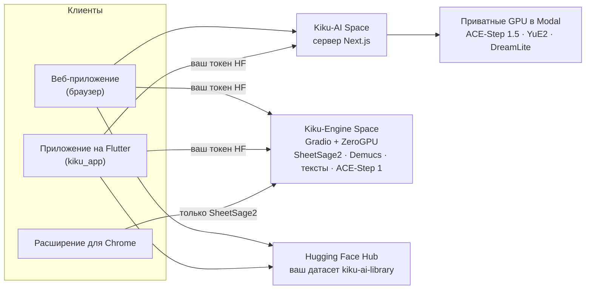

<p align="center">
  <a href="../../README.md">English</a> ·
  <a href="README.zh-CN.md">简体中文</a> ·
  <a href="README.es.md">Español</a> ·
  <a href="README.hi.md">हिन्दी</a> ·
  <a href="README.ar.md">العربية</a> ·
  <a href="README.pt-BR.md">Português</a> ·
  <a href="README.fr.md">Français</a> ·
  <b>Русский</b> ·
  <a href="README.ja.md">日本語</a> ·
  <a href="README.de.md">Deutsch</a> ·
  <a href="README.ko.md">한국어</a>
</p>

<p align="center"></p>

<h1 align="center">Kiku AI</h1>

<p align="center">Пишите песни по одной фразе, переделывайте свои записи и превращайте любую запись в ноты.</p>

<p align="center">
  <a href="https://huggingface.co/spaces/Reubencf/Kiku-AI"><b>Веб-приложение</b></a> ·
  <a href="#flutter-app"><b>Приложение для телефона и Mac</b></a> ·
  <a href="#chrome-extension-youtube-to-score"><b>Расширение для Chrome</b></a>
</p>

> Эта страница — перевод [README на английском](../../README.md). Основной является английская версия, и
> она может быть новее. Приложения на английском, поэтому названия кнопок и меню оставлены по-английски.

Kiku AI — музыкальная студия на открытых моделях: **ACE-Step** и **YuE2** пишут и редактируют песни,
**SheetSage2** записывает ноты по звуку, а **Demucs** разделяет микс на отдельные дорожки (стемы). Она
есть в трёх видах, которые используют одни и те же движки и одну библиотеку в вашем аккаунте Hugging Face:

| | Что это | Где |
| --- | --- | --- |
| **Веб-приложение** | Полная студия, работает в Hugging Face Space [Reubencf/Kiku-AI](https://huggingface.co/spaces/Reubencf/Kiku-AI) | [`outputs/kiku-ai`](../../outputs/kiku-ai) |
| **Приложение на Flutter** | То же приложение для Android, iPhone, iPad и Mac | [`kiku_app`](../../kiku_app) |
| **Расширение для Chrome** | YouTube to Score: запишите часть видео и получите ноты | [`outputs/youtube-to-score-extension`](../../outputs/youtube-to-score-extension) |
| Движки | Gradio Spaces на ZeroGPU и приватные GPU в Modal | [`outputs/kiku-engine-space`](../../outputs/kiku-engine-space), [`outputs/kiku-acestep15-space`](../../outputs/kiku-acestep15-space), [`outputs/kiku-modal`](../../outputs/kiku-modal) |
| Эксперимент на устройстве | YuE2 и SheetSage2 в формате GGUF внутри приложения на Flutter | [`flutter_app`](../../flutter_app) |
| Фирменный стиль | Логотип и скрипт, который рисует все иконки | [`branding`](../../branding) |

## Как всё связано



Все входят через Hugging Face. ACE-Step 1.5 и YuE2 работают на приватных GPU Kiku в Modal через сервер
Kiku-AI. Транскрипция, стемы, тексты песен и ACE-Step 1 работают в Kiku-Engine Space за счёт квоты
ZeroGPU самого пользователя. Песни, проекты студии и ноты сохраняются в приватный датасет в аккаунте
каждого пользователя, поэтому работа переходит между браузером и телефоном.

## Веб-приложение

Откройте его на [huggingface.co/spaces/Reubencf/Kiku-AI](https://huggingface.co/spaces/Reubencf/Kiku-AI).
В нём есть главная страница, **Generate** (песни по идее или по вашему собственному стилю и тексту),
**Studio** (многодорожечный редактор, где выделенный фрагмент можно перевести в другой стиль, переписать,
продлить, разделить на стемы или перепеть с YuE2, а также добавить инструменты), **Score** (ноты мелодии
с аккордами от SheetSage2, которые можно проиграть, отредактировать и скачать) и **Library**.

Для локального запуска нужны Node.js 24 и FFmpeg/ffprobe. В `outputs/kiku-ai` выполните `npm ci`,
скопируйте `env.example` в `.env.local`, задайте приватный `SESSION_SECRET` и настройки API и OAuth, затем
запустите `npm run dev`. Никогда не коммитьте учётные данные. Подробности:
[outputs/kiku-ai/README.md](../../outputs/kiku-ai/README.md).

<a name="flutter-app"></a>
## Приложение на Flutter

[`kiku_app`](../../kiku_app) — это Kiku AI в виде нативного приложения для **Android, iPhone, iPad и Mac**,
написанного на Flutter. В нём те же пять разделов, что и в веб-приложении:

- **Home**: введите идею и нажмите **Create**.
- **Generate**: режим Simple или Custom, ACE-Step 1.5 или YuE2, Enhance и обложка для каждой песни.
- **Studio**: многодорожечный редактор с записью, микшером, разрезанием, отменой и экспортом в WAV.
  Действия ИИ (Restyle, Rewrite, Extend, YuE2 Cover, стемы Demucs, Lyrics, Add instrument) приходят как
  дубли, которые можно включать и выключать.
- **Score**: ноты SheetSage2, свёрстанные так же, как в веб-приложении, которые следуют за записью такт за
  тактом. Делитесь ими в PDF, MIDI, MusicXML или ABC.
- **Library**: тот же приватный датасет, что и у веб-приложения, поэтому песни, проекты и ноты переходят
  между телефоном и браузером.

Вход — через Hugging Face (OAuth с PKCE или вставленный токен доступа); приложение вызывает развёрнутые
сервисы напрямую с токеном самого пользователя. Собственного сервера у него нет.

**Попробуйте на Android**: откройте последний успешный запуск
[workflow приложения Kiku AI](https://github.com/Reubencfernandes/musical/actions/workflows/kiku-app.yml)
и скачайте артефакт `kiku-ai-android` (тестовый APK, подписанный отладочным ключом).

**Соберите сами** с Flutter 3.44.7:

```sh
cd kiku_app
flutter pub get
flutter run            # выберите телефон на Android, iPhone, симулятор или macOS
```

> [!NOTE]
> Приложению нужны от сервера Kiku-AI две вещи: вход по bearer-токену и перенаправление
> `kikuai://oauth/callback` в его OAuth-клиенте. Оба есть в `outputs/kiku-ai` в этом репозитории. Если
> развёрнутый Space старше их, разверните его заново с помощью `work/deploy_kiku_app.py`.

Требования, вход, устройство библиотеки, заметки для разработчиков и решение проблем — в
**[kiku_app/README.md](../../kiku_app/README.md)**.

<a name="chrome-extension-youtube-to-score"></a>
## Расширение для Chrome: YouTube to Score

Запишите часть видео на YouTube и получите её в виде нот или буквенных названий нот (C D E…) для тех, кто
не читает нотный стан: SheetSage2 записывает мелодию и аккорды, а расширение оформляет их как партию
фортепиано, лид-шит (мелодия с аккордами) или буквы, которые звучат вместе с видео.

<p align="center">
  
  &nbsp;
  
</p>
<p align="center"><sub>Слева: выбор части для записи. Справа: страница записи со свёрстанными нотами (пример транскрипции).</sub></p>

### Скачивание и установка

Расширения пока нет в Chrome Web Store, поэтому его нужно добавить в Chrome самостоятельно. Это занимает
около минуты. Нужен Chrome 116 или новее; в Edge, Brave и других браузерах на Chromium всё работает так же.

1. **Скачайте** [**`kiku-youtube-to-score.zip`**](https://github.com/Reubencfernandes/musical/releases/download/extension-latest/kiku-youtube-to-score.zip)
   из [релиза `extension-latest`](https://github.com/Reubencfernandes/musical/releases/tag/extension-latest).
   GitHub Actions пересобирает его из `main` при каждом изменении расширения.
2. **Распакуйте** в папку, которую будете хранить, например `Documents\YouTube to Score`. Chrome загружает
   расширение из этой папки при каждом запуске, так что потом её не удаляйте.
3. Откройте **`chrome://extensions`** (введите в адресную строку) и включите **Developer mode** (режим
   разработчика, справа вверху).
4. Нажмите **Load unpacked** (загрузить распакованное) и выберите распакованную папку: ту, в которой прямо
   лежит `manifest.json`.
5. Нажмите на значок пазла на панели инструментов и **закрепите YouTube to Score**, чтобы его кнопка была
   всегда на виду.
6. Нажмите кнопку и **Sign in with Hugging Face** (подойдёт бесплатный аккаунт). Тогда транскрипции идут
   за счёт вашей собственной квоты ZeroGPU; без входа они делят анонимную квоту, которая заканчивается через
   несколько фрагментов.

**Обновление:** скачайте новый ZIP, распакуйте его поверх той же папки, затем нажмите стрелку
перезагрузки на карточке расширения в `chrome://extensions`. Ваши записи и вход сохраняются.

**Из исходников:** клонируйте репозиторий
(`git clone https://github.com/Reubencfernandes/musical.git`) и на шаге 4 загрузите папку
`outputs/youtube-to-score-extension`.

### Как пользоваться

1. **Откройте песню** на YouTube или YouTube Music и нажмите кнопку **YouTube to Score**. Рядом с видео
   откроется боковая панель.
2. **Выберите часть.** Перетащите два маркера на точечной шкале времени, введите **Start** и **End**
   (минуты:секунды), нажмите **Now**, чтобы взять текущее место видео, или выберите **Chapter**. Часть
   длится от 5 секунд до 10 минут.
3. **Нажмите Record.** Видео перескакивает к началу и играет, пока расширение записывает звук вкладки.
   Запись идёт в реальном времени, поэтому минутная часть записывается минуту; реклама, паузы и
   буферизация пропускаются. **Stop and keep** заканчивает раньше, **Discard** удаляет запись.
4. **Получите ноты.** Когда запись закончится, откроется страница записи и отправит фрагмент в SheetSage2.
   Обычно это занимает меньше минуты (дольше, если Space нужно проснуться). Результат сохраняется вместе с
   записью, поэтому переживает 24-часовой файловый кэш Space.
5. **Читайте, играйте и скачивайте.**
   - **Sheet music или Letters**: переключатель над нотами. **Letters** записывает мелодию названиями нот
     такт за тактом: аккорды сверху, черта под каждой нотой показывает, сколько её держать, а точка сверху
     или снизу — октаву выше или ниже. Расширение запоминает ваш выбор для новых записей.
   - **Score settings → Layout**: **Piano** (мелодия в правой руке над левой рукой, построенной из
     аккордов) или **Lead sheet** (мелодия с буквенными обозначениями аккордов). **Key** транспонирует до
     шести полутонов; название и исполнитель берутся из видео, их можно изменить.
   - **Play** следует за записью такт за тактом, а в буквах — нота за нотой; нажмите на любой такт, чтобы
     играть с него. **With video** проигрывает видео YouTube в такт с нотами, а **Hear** выбирает, что
     вы слышите: **Piano** (видео без звука), **Both** или **Song** (только видео, такты всё равно
     подсвечиваются).
   - **Download** даёт свёрстанные ноты в PDF и MusicXML (для MuseScore, Finale, Sibelius или Dorico),
     буквенные ноты текстом, а также собственные MIDI, ABC и PDF от SheetSage2. **Print** печатает только
     страницы (или буквы), а **MP3** сохраняет запись.
6. **Находите записи снова** через **Captures** в верхней строке панели или откройте любую в полном
   размере стрелкой рядом с ней. Каждую можно транскрибировать заново или удалить.

### Необязательно: звук за секунды (Windows, yt-dlp)

На вашем собственном ПК расширение может получить часть через [yt-dlp](https://github.com/yt-dlp/yt-dlp),
а не записывать её в реальном времени. Установите Python, `pip install -U yt-dlp` и ffmpeg, затем
выполните `powershell -ExecutionPolicy Bypass -File native\install.ps1` из папки расширения (передайте
`-ExtensionId <id>` с ID, который `chrome://extensions` показывает для вашей копии). Перезагрузите
расширение — в панели появится **Get audio now**. Этого помощника нет в ZIP релиза; см.
[README расширения](../../outputs/youtube-to-score-extension/README.md#get-audio-now-optional-yt-dlp-on-your-own-pc).

### Если что-то пошло не так

- *"The Space turned the request away"*: квота GPU исчерпана. Войдите через Hugging Face (см. выше) или
  попробуйте позже.
- *Кнопка ничего не делает на видео*: после установки или обновления расширения один раз перезагрузите
  вкладку YouTube.
- *Ничего не записалось*: после нажатия Record видео должно играть. Убедитесь, что оно запустилось, и
  запишите снова.
- Записывайте только ту музыку, на использование которой у вас есть права; скачивание контента с YouTube
  может нарушать Условия использования YouTube. Веса SheetSage2 распространяются по лицензии
  CC BY-NC 4.0 (некоммерческая).

Что расширение хранит и отправляет: [политика конфиденциальности](../../outputs/youtube-to-score-extension/PRIVACY.md).
Подробнее, в том числе о том, как работает каждый файл: [README расширения](../../outputs/youtube-to-score-extension/README.md).

## Эксперимент на устройстве (`flutter_app`)

В отличие от приложения Kiku AI выше, `flutter_app` исследует запуск моделей прямо на устройстве:
генерация и транскрипция на устройстве, редактирование и экспорт звука, с теми же оранжевыми музыкантами
из точечной матрицы и тем же визуальным стилем. См.
[заметки о возможности работы на телефоне](../mobile-inference.md).

Он вызывает закреплённый C API audio.cpp для запуска YuE2 и SheetSage2 в формате GGUF, с проверенной
загрузкой моделей, генерацией стиля и текста, транскрипцией записей, локальным воспроизведением и экспортом
файлов. Следуйте [настройке Flutter](../../flutter_app/README.md) и
[инструкциям по нативной сборке для Apple](../../flutter_app/native/README.md); обычная сборка Flutter не
включает звуковую среду выполнения, а браузерные сборки показывают уведомление о нативном приложении.

Текущие ограничения: реальный инференс с весами моделей и сборки для устройств Apple ещё нужно проверить;
постепенно генерируемый звук и редактор не реализованы; нативная упаковка для Android пока не сделана
(интеграция в первую очередь нацелена на iOS и macOS). Никаких заявлений о производительности на
телефоне, скорости генерации или поддержке слабых телефонов не делается.

## Развёрнутая архитектура

ZeroGPU поддерживает только Gradio SDK, поэтому инференс живёт в Gradio Spaces, а интерфейс — отдельный
Docker Space на CPU. ACE-Step 1.5 нужны Python 3.11 и Gradio 6, которые не уживаются со стеком движка,
поэтому у него свой Space с теми же именами эндпоинтов:

| Space | SDK | Что внутри |
| --- | --- | --- |
| [Kiku-Engine](https://huggingface.co/spaces/Reubencf/Kiku-Engine) | Gradio + ZeroGPU | SheetSage2, YuE2, ACE-Step, Demucs и OAuth-клиент |
| [Kiku-ACE-Step-15](https://huggingface.co/spaces/Reubencf/Kiku-ACE-Step-15) | Gradio 6 + ZeroGPU | ACE-Step 1.5 (turbo, base и планировщик на 1.7B) и Demucs |
| [Kiku-AI](https://huggingface.co/spaces/Reubencf/Kiku-AI) | Docker (CPU) | Интерфейс и сервер на Next.js |
| [Score-Studio-API](https://huggingface.co/spaces/Reubencf/Score-Studio-API) | Gradio + ZeroGPU | Исходный API транскрипции, по-прежнему используемый расширением по умолчанию |

Исходники: `outputs/kiku-engine-space`, `outputs/kiku-acestep15-space` и `outputs/kiku-ai`. Развёртывание —
через `work/deploy_kiku_spaces.py` и `work/deploy_kiku_app.py` (оба читают `HF_TOKEN`). Каждое
развёртывание Kiku-AI Space перезапускает его, и любая задача, выполнявшаяся в этот момент, обрывается.

Бэкенд ACE-Step 1.5 в Modal развёрнут в активном рабочем пространстве `konkanillm`. Исходники, команды
настройки и замеренное время холодного и тёплого старта — в
[заметках о развёртывании в Modal](../../outputs/kiku-modal/README.md) и
[отчёте об испытаниях](../../outputs/kiku-modal/TEST_RESULTS.md). Он использует один воркер L40S с
приватным доступом к API, снимками памяти CPU и масштабированием до нуля. Веб-приложение направляет
генерацию и планирование ACE-Step 1.5 в Modal через аутентифицированные серверные маршруты. YuE2 работает
на собственном приватном воркере L40S в Modal (`kiku-yue2`) с нативной средой PyTorch и снимками импорта на
CPU. В Generate можно выбрать YuE2 или ACE-Step 1.5 как в режиме Simple, так и в Custom. SheetSage2,
ACE-Step 1 и отдельные задачи по стемам и текстам по-прежнему используют Hugging Face.

`outputs/score-studio-api`, `outputs/kiku-yue2-space` и `outputs/kiku-acestep-space` — устаревшие
Spaces с одной моделью, которые хранятся, пока объединённый движок как следует не поработает.
`outputs/sheetsage2-space` — исходная реализация на Gradio. В `work` лежат скрипты развёртывания и
проверки. Чтобы держать на одном аккаунте больше двух ZeroGPU Spaces, нужен PRO.

### Как три модели делят один Space

Они закрепляют несовместимые версии — transformers 4.45.2 (SheetSage2), 4.50.0 (ACE-Step) и 4.57.6 (YuE2),
поэтому pip не может удовлетворить все три. Побеждает стек из wheel YuE2, а две другие модели работают
поверх него; `acestep` устанавливается с `--no-deps` при запуске, а импорты, реально нужные ему для
инференса, перечислены в `requirements.txt`. `torchaudio` и `torchvision` должны оставаться закреплёнными
на паре к torch 2.10.0, иначе pip возьмёт сборки под CUDA 13, которые не загружаются с torch под CUDA 12.

Каждая модель загружается при первом использовании, а не при импорте: YuE2 при создании доходит до
низкоуровневой инициализации CUDA, а ZeroGPU запрещает её вне функции `@spaces.GPU`. Кроме того,
SheetSage2 при загрузке объединяет адаптеры LoRA и принимает только float32 на CPU, поэтому тип
приводится по пути на GPU.

### Сохранение мелодии

YuE2 сохраняет мелодию, работая по нотам, а не по звуку: SheetSage2 считывает мелодию, аккорды и тактовые
черты фрагмента, пользователь может отредактировать эти ноты, а YuE2 исполняет их (кавер — голосом или на
инструменте). Результат растягивается во времени такт за тактом по тактовым чертам самой записи, поэтому
остаётся синхронным с остальным проектом.

У движка также есть эндпоинты, которые строят группу под сохранённый вокал (`/accompany` и `/band_score`):
они отделяют голос от любого аккомпанемента с помощью Demucs, измеряют сетку долей и аккорды каждого такта
и заставляют ACE-Step или YuE2 сыграть по ним партию группы, а затем сводят её под голос. Студия больше
этого не предлагает, но эндпоинты остались.

## Разработка

| Часть | Проверка | Запуск |
| --- | --- | --- |
| Веб-приложение (`outputs/kiku-ai`) | `npm run typecheck` | `npm ci`, затем `npm run dev` |
| Приложение на Flutter (`kiku_app`) | `flutter analyze`, `flutter test` | `flutter pub get`, затем `flutter run` |
| Эксперимент на устройстве (`flutter_app`) | `flutter analyze`, `flutter test` | см. [его README](../../flutter_app/README.md) |
| Расширение | загрузить распакованным | см. [его README](../../outputs/youtube-to-score-extension/README.md) |

Оба проекта на Flutter проверены с Flutter 3.44.7 / Dart 3.12.2. Для сборок под iPhone нужны macOS, Xcode
и подпись, настроенная для вашего аккаунта.

GitHub Actions:

- [`kiku-app.yml`](../../.github/workflows/kiku-app.yml), при изменениях в `kiku_app/`: анализатор и тесты
  (включая проверку FLAC против libFLAC), артефакт APK для Android и сборки для iOS и macOS.
- [`extension.yml`](../../.github/workflows/extension.yml), при изменениях расширения: проверяет manifest,
  упаковывает ZIP и в `main` обновляет релиз `extension-latest`.

В скриптах разработки в `work` ещё могут быть пути, специфичные для Windows, поэтому просмотрите их перед
использованием. Учётные данные, кэши сборки и приватные тестовые записи в репозиторий не попадают.

## Логотип

Слушающая K объединяет изогнутый приёмник, две развевающиеся звуковые ленты и точку в открытом центре.
Внутри приложений она стоит одна, оранжевая, а на иконках приложений лежит на тёплом угольном фоне. Ленты
разворачиваются при появлении, а затем каждые пять секунд ненадолго отзываются на проходящий сигнал; при
настройках уменьшенного движения логотип остаётся неподвижным.
[`branding/generate.py`](../../branding/generate.py) использует одну и ту же векторную геометрию для React,
Flutter, иконок расширения и всех иконок запуска.

<p align="center"> &nbsp; </p>

## Лицензии и благодарности

Веса моделей скачиваются отдельно и сохраняют собственные лицензии; этот репозиторий их не
перелицензирует. YuE2, SheetSage2 и DreamLite-base распространяются по CC BY-NC 4.0 (некоммерческая);
ACE-Step — по Apache 2.0, Demucs — по MIT. Указание авторства саундфонтов — в
`outputs/kiku-ai/public/soundfonts/ATTRIBUTION.md`, сведения о шрифтах — в
`outputs/kiku-ai/public/fonts/README.md`, а уведомления о прилагаемой abcjs идут вместе с её копиями.

Раньше Kiku AI назывался Score Studio; нотная запись остаётся одним из его режимов. Этот репозиторий
называется `musical`. Исходная папка проекта: `E:\ScoreStudio`.
