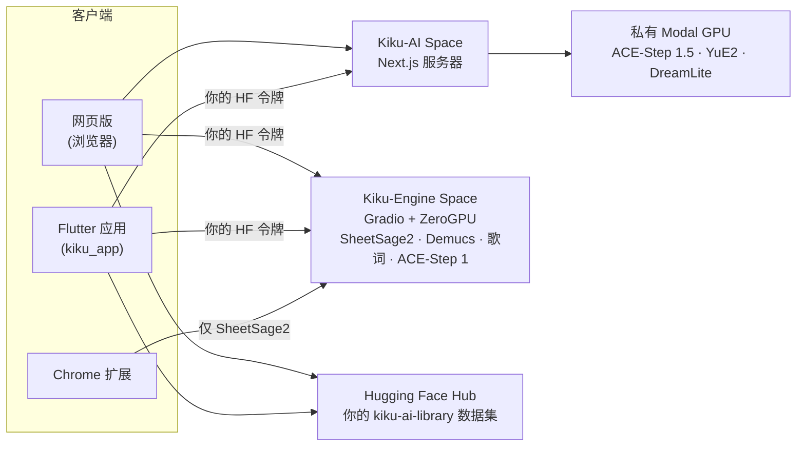

<p align="center">
  <a href="../../README.md">English</a> ·
  <b>简体中文</b> ·
  <a href="README.es.md">Español</a> ·
  <a href="README.hi.md">हिन्दी</a> ·
  <a href="README.ar.md">العربية</a> ·
  <a href="README.pt-BR.md">Português</a> ·
  <a href="README.fr.md">Français</a> ·
  <a href="README.ru.md">Русский</a> ·
  <a href="README.ja.md">日本語</a> ·
  <a href="README.de.md">Deutsch</a> ·
  <a href="README.ko.md">한국어</a>
</p>

<p align="center"></p>

<h1 align="center">Kiku AI</h1>

<p align="center">一句话写出一首歌，重塑你自己的录音，把任何录音变成乐谱。</p>

<p align="center">
  <a href="https://huggingface.co/spaces/Reubencf/Kiku-AI"><b>网页版</b></a> ·
  <a href="#flutter-app"><b>手机和 Mac 应用</b></a> ·
  <a href="#chrome-extension-youtube-to-score"><b>Chrome 扩展</b></a>
</p>

> 本页译自[英文 README](../../README.md)。以英文版为准，英文版可能更新。应用界面是英文的，所以按钮和菜单名称保留英文。

Kiku AI 是一个基于开放模型的音乐工作室：**ACE-Step** 和 **YuE2** 负责写歌和改歌，**SheetSage2**
从音频写出乐谱，**Demucs** 把混音拆分成分轨。它有三种形式，共用同一套引擎，以及你 Hugging Face
账户中的同一个曲库：

| | 是什么 | 位置 |
| --- | --- | --- |
| **网页版** | 完整的工作室，运行在 Hugging Face Space [Reubencf/Kiku-AI](https://huggingface.co/spaces/Reubencf/Kiku-AI) 上 | [`outputs/kiku-ai`](../../outputs/kiku-ai) |
| **Flutter 应用** | 同一个应用，适用于 Android、iPhone、iPad 和 Mac | [`kiku_app`](../../kiku_app) |
| **Chrome 扩展** | YouTube to Score：录下视频的一段，得到乐谱 | [`outputs/youtube-to-score-extension`](../../outputs/youtube-to-score-extension) |
| 引擎 | Gradio ZeroGPU Space 和私有 Modal GPU | [`outputs/kiku-engine-space`](../../outputs/kiku-engine-space)、[`outputs/kiku-acestep15-space`](../../outputs/kiku-acestep15-space)、[`outputs/kiku-modal`](../../outputs/kiku-modal) |
| 端侧实验 | 以 GGUF 形式在 Flutter 应用内运行 YuE2 和 SheetSage2 | [`flutter_app`](../../flutter_app) |
| 品牌 | 标志，以及绘制所有图标的脚本 | [`branding`](../../branding) |

## 整体结构



所有人都用 Hugging Face 登录。ACE-Step 1.5 和 YuE2 通过 Kiku-AI 服务器在 Kiku 的私有 Modal GPU 上运行。
转录、分轨、歌词和 ACE-Step 1 在 Kiku-Engine Space 上运行，消耗每位用户自己的 ZeroGPU 额度。歌曲、
工作室项目和乐谱保存在每位用户自己账户中的私有数据集里，所以作品可以在浏览器和手机之间同步。

## 网页版

在 [huggingface.co/spaces/Reubencf/Kiku-AI](https://huggingface.co/spaces/Reubencf/Kiku-AI) 打开。
它包括主页、**Generate**（根据一个想法，或根据你自己的风格和歌词生成歌曲）、**Studio**（多轨编辑器，
可以对选区换风格、改写、延长、拆分为分轨或用 YuE2 翻唱，还可以添加乐器）、**Score**（可播放、编辑和
下载的 SheetSage2 旋律和弦谱）以及 **Library**。

要在本地运行，你需要 Node.js 24 和 FFmpeg/ffprobe。在 `outputs/kiku-ai` 中运行 `npm ci`，把
`env.example` 复制为 `.env.local`，设置私密的 `SESSION_SECRET` 以及 API 和 OAuth 设置，然后运行
`npm run dev`。切勿提交凭据。详情见 [outputs/kiku-ai/README.md](../../outputs/kiku-ai/README.md)。

<a name="flutter-app"></a>
## Flutter 应用

[`kiku_app`](../../kiku_app) 是用 Flutter 编写的 Kiku AI 原生应用，适用于 **Android、iPhone、iPad 和
Mac**。它和网页版一样有五个部分：

- **Home**：输入一个想法，点 **Create**。
- **Generate**：Simple 或 Custom 模式，ACE-Step 1.5 或 YuE2，Enhance，并为每首歌生成封面。
- **Studio**：多轨编辑器，带录音、混音台、切分、撤销和 WAV 导出。AI 操作（Restyle、Rewrite、Extend、
  YuE2 Cover、Demucs 分轨、Lyrics、Add instrument）会以可开关的 take（版本）形式出现。
- **Score**：SheetSage2 旋律和弦谱，排版与网页版相同，播放时逐小节跟随录音。可以以 PDF、MIDI、
  MusicXML 或 ABC 格式分享。
- **Library**：与网页版相同的私有数据集，所以歌曲、项目和乐谱可以在手机和浏览器之间同步。

它通过 Hugging Face 登录（带 PKCE 的 OAuth，或粘贴访问令牌），并用用户自己的令牌直接调用已部署的
服务。它没有自己的服务器。

**在 Android 上试用**：打开最近一次成功的
[Kiku AI app 工作流运行](https://github.com/Reubencfernandes/musical/actions/workflows/kiku-app.yml)，
下载 `kiku-ai-android` 制品（用调试密钥签名的测试 APK）。

**自己构建**，使用 Flutter 3.44.7：

```sh
cd kiku_app
flutter pub get
flutter run            # 选择 Android 手机、iPhone、模拟器或 macOS
```

> [!NOTE]
> 应用需要 Kiku-AI 服务器提供两样东西：bearer 令牌登录，以及其 OAuth 客户端中的
> `kikuai://oauth/callback` 重定向。两者都在本仓库的 `outputs/kiku-ai` 中。如果已部署的 Space
> 早于它们，请用 `work/deploy_kiku_app.py` 重新部署。

系统要求、登录、曲库结构、开发说明和故障排查见 **[kiku_app/README.md](../../kiku_app/README.md)**。

<a name="chrome-extension-youtube-to-score"></a>
## Chrome 扩展：YouTube to Score

录下 YouTube 视频的一段，得到乐谱，或者给不识五线谱的人看的字母音名（C D E…）：SheetSage2 写出旋律
和和弦，扩展把它们排成钢琴谱、旋律和弦谱或字母谱，并可以随视频一起播放。

<p align="center">
  
  &nbsp;
  
</p>
<p align="center"><sub>左：选择要录制的片段。右：带排版乐谱的录制页面（转录示例）。</sub></p>

### 下载和安装

该扩展尚未上架 Chrome 网上应用店，所以需要你自己把它添加到 Chrome，大约一分钟。你需要 Chrome 116 或
更新版本；Edge、Brave 及其他 Chromium 浏览器的操作相同。

1. **下载** [**`kiku-youtube-to-score.zip`**](https://github.com/Reubencfernandes/musical/releases/download/extension-latest/kiku-youtube-to-score.zip)，
   来自 [`extension-latest` 发布](https://github.com/Reubencfernandes/musical/releases/tag/extension-latest)。
   每当扩展有改动，GitHub Actions 都会从 `main` 重新构建它。
2. **解压**到一个你会保留的文件夹，例如 `Documents\YouTube to Score`。Chrome 每次启动都会从这个文件夹
   加载扩展，所以之后不要删除它。
3. 打开 **`chrome://extensions`**（在地址栏输入），打开右上角的 **Developer mode**（开发者模式）。
4. 点击 **Load unpacked**（加载已解压的扩展程序），选择解压后的文件夹：直接包含 `manifest.json` 的那个。
5. 点击工具栏中的拼图图标，**固定 YouTube to Score**，让它的按钮一直可见。
6. 点击按钮，**Sign in with Hugging Face**（免费账户即可）。之后转录会使用你自己的 ZeroGPU 额度；未登录
   时会共用一个匿名额度，几段之后就会用完。

**更新**：下载新的 ZIP，解压覆盖到同一个文件夹，然后在 `chrome://extensions` 中点击该扩展卡片上的
刷新箭头。你的录制和登录都会保留。

**改用源码**：克隆仓库（`git clone https://github.com/Reubencfernandes/musical.git`），在第 4 步加载
`outputs/youtube-to-score-extension` 文件夹。

### 使用方法

1. **打开一首歌**：在 YouTube 或 YouTube Music 上打开，点击 **YouTube to Score** 按钮。视频旁边会打开
   一个侧边栏。
2. **选择片段**。拖动点状时间轴上的两个手柄，输入 **Start** 和 **End**（分:秒），按 **Now** 使用视频
   当前位置，或选择一个 **Chapter**。片段长度为 5 秒到 10 分钟。
3. **按 Record**。视频跳到起点并开始播放，扩展同时录下标签页的声音。录制是实时的，所以一分钟的片段要
   录一分钟；广告、暂停和缓冲会被去掉。**Stop and keep** 提前结束，**Discard** 丢弃。
4. **获取乐谱**。录制结束后，录制页面会打开，并把片段发送给 SheetSage2。通常不到一分钟（Space 需要唤醒
   时会更久）。结果和录制一起保存，所以在 Space 的 24 小时文件缓存过期后依然保留。
5. **阅读、播放和下载。**
   - **Sheet music 或 Letters**：乐谱上方的切换开关。**Letters** 把曲调逐小节写成音名，上方是和弦，每个
     音下面的横线表示要持续多久，上方或下方的点表示高八度或低八度。扩展会为新的录制记住你的选择。
   - **Score settings → Layout**：**Piano**（右手是旋律，左手由和弦构成）或 **Lead sheet**（旋律加
     和弦记号）。**Key** 最多移调六个半音；标题和艺人取自视频，可以编辑。
   - **Play** 逐小节跟随录音，在字母谱中则逐音跟随；点击任意小节即可从那里播放。**With video** 让
     YouTube 视频与乐谱同步播放，**Hear** 选择你听到的声音：**Piano**（视频静音）、**Both**，或
     **Song**（只有视频，小节仍会高亮）。
   - **Download** 提供排版好的乐谱 PDF 和 MusicXML（用于 MuseScore、Finale、Sibelius 或 Dorico）、
     字母谱文本，以及 SheetSage2 自己的 MIDI、ABC 和 PDF。**Print** 只打印乐谱页面（或字母谱），
     **MP3** 保存录音。
6. **再次找到录制**：用侧边栏顶栏的 **Captures**，或点击旁边的箭头全尺寸打开。每段都可以重新转录或删除。

### 可选：几秒内获取音频（Windows，yt-dlp）

在你自己的电脑上，扩展可以用 [yt-dlp](https://github.com/yt-dlp/yt-dlp) 获取片段，而不必实时录制。
安装 Python、`pip install -U yt-dlp` 和 ffmpeg，然后在扩展文件夹中运行
`powershell -ExecutionPolicy Bypass -File native\install.ps1`（用 `-ExtensionId <id>` 传入
`chrome://extensions` 为你的副本显示的 ID）。重新加载扩展后，侧边栏会显示 **Get audio now**。
发布的 ZIP 不包含这个辅助程序；见
[扩展 README](../../outputs/youtube-to-score-extension/README.md#get-audio-now-optional-yt-dlp-on-your-own-pc)。

### 遇到问题时

- *"The Space turned the request away"*：GPU 额度已用完。用 Hugging Face 登录（见上文）或稍后再试。
- *在视频上点按钮没有反应*：安装或更新扩展后，重新加载一次 YouTube 标签页。
- *什么也没录到*：按下 Record 后视频必须播放。确认视频开始播放，然后重新录制。
- 只录制你有权使用的音乐；下载 YouTube 内容可能违反 YouTube 服务条款。SheetSage2 的权重采用
  CC BY-NC 4.0（非商业）许可。

扩展存储和发送哪些内容：[隐私政策](../../outputs/youtube-to-score-extension/PRIVACY.md)。
更多细节，包括每个文件的作用：[扩展 README](../../outputs/youtube-to-score-extension/README.md)。

## 端侧实验（`flutter_app`）

`flutter_app` 独立于上面的 Kiku AI 应用，探索在设备本身上运行模型：端侧生成和转录、音频编辑和导出，
并沿用同样的橙色点阵乐手和视觉风格。见[移动端可行性说明](../mobile-inference.md)。

它调用固定版本的 audio.cpp C API 执行 YuE2 和 SheetSage2 GGUF，带有经过校验的模型下载、风格和歌词生成、
录音转录、本地播放和文件导出。请按照 [Flutter 设置](../../flutter_app/README.md)和
[Apple 原生构建说明](../../flutter_app/native/README.md)操作；普通的 Flutter 构建不会打包音频运行时，
浏览器构建会显示原生应用提示。

目前的限制：带模型权重的实际推理和 Apple 设备构建仍需验证；增量生成音频和编辑器尚未实现；Android 原生
打包尚待完成（集成优先考虑 iOS 和 macOS）。不声称任何手机性能、生成速度或低端手机支持。

## 部署架构

ZeroGPU 只支持 Gradio SDK，所以推理放在 Gradio Space 中，界面是单独的 CPU Docker Space。ACE-Step 1.5
需要 Python 3.11 和 Gradio 6，无法与引擎共用技术栈，所以它有自己的 Space，端点名称相同：

| Space | SDK | 包含 |
| --- | --- | --- |
| [Kiku-Engine](https://huggingface.co/spaces/Reubencf/Kiku-Engine) | Gradio + ZeroGPU | SheetSage2、YuE2、ACE-Step、Demucs 和 OAuth 客户端 |
| [Kiku-ACE-Step-15](https://huggingface.co/spaces/Reubencf/Kiku-ACE-Step-15) | Gradio 6 + ZeroGPU | ACE-Step 1.5（turbo、base 和 1.7B 规划器）和 Demucs |
| [Kiku-AI](https://huggingface.co/spaces/Reubencf/Kiku-AI) | Docker (CPU) | Next.js 界面和服务器 |
| [Score-Studio-API](https://huggingface.co/spaces/Reubencf/Score-Studio-API) | Gradio + ZeroGPU | 最初的转录 API，仍是扩展的默认选项 |

源码：`outputs/kiku-engine-space`、`outputs/kiku-acestep15-space` 和 `outputs/kiku-ai`。用
`work/deploy_kiku_spaces.py` 和 `work/deploy_kiku_app.py` 部署（两者都读取 `HF_TOKEN`）。每次部署
Kiku-AI Space 都会重启它，当时正在运行的任务会因此终止。

ACE-Step 1.5 的 Modal 后端部署在活跃的 `konkanillm` 工作区中。源码、设置命令以及实测的冷启动和热启动
耗时见 [Modal 部署说明](../../outputs/kiku-modal/README.md)和
[试运行报告](../../outputs/kiku-modal/TEST_RESULTS.md)。它使用一个 L40S worker，带私有 API 访问、CPU
内存快照和缩容至零。网页版通过经过身份验证的服务器路由，把 ACE-Step 1.5 的生成和规划交给 Modal。
YuE2 在它自己的私有 Modal L40S worker（`kiku-yue2`）上运行，使用原生 PyTorch 运行时和 CPU 导入快照。
Generate 在 Simple 和 Custom 模式下都可以选择 YuE2 或 ACE-Step 1.5。SheetSage2、ACE-Step 1 以及单独的
分轨和歌词任务仍使用 Hugging Face。

`outputs/score-studio-api`、`outputs/kiku-yue2-space` 和 `outputs/kiku-acestep-space` 是已被取代的
单模型 Space，保留到合并后的引擎真正经过实际使用为止。`outputs/sheetsage2-space` 是最初的 Gradio
实现。`work` 存放部署和验证脚本。在一个账户上托管两个以上的 ZeroGPU Space 需要 PRO。

### 三个模型如何共用一个 Space

它们固定了相互冲突的版本——transformers 4.45.2（SheetSage2）、4.50.0（ACE-Step）和 4.57.6（YuE2）
——所以 pip 无法同时满足三者。以 YuE2 wheel 的技术栈为准，另外两个在它上面运行；`acestep` 在启动时用
`--no-deps` 安装，它实际推理用到的导入列在 `requirements.txt` 中。`torchaudio` 和 `torchvision` 必须
固定为与 torch 2.10.0 配套的版本，否则 pip 会选用 CUDA 13 的构建，而它们无法与 CUDA 12 的 torch 一起加载。

每个模型在首次使用时才加载，而不是在导入时：YuE2 在构造时会进行底层 CUDA 初始化，而 ZeroGPU 不允许在
`@spaces.GPU` 函数之外这样做。SheetSage2 还会在加载时合并 LoRA 适配器，并且只接受 CPU float32，所以在
移到 GPU 的途中进行类型转换。

### 保留曲调

YuE2 保留曲调的方法是依据乐谱，而不是声音：SheetSage2 读出一段的旋律、和弦和小节线，用户可以编辑这份
乐谱，然后由 YuE2 演奏（翻唱，可以演唱，也可以用乐器）。渲染结果会逐小节做时间伸缩，对齐到录音自己的
小节线上，所以与项目的其余部分保持同步。

引擎还有为保留的人声配上乐队的端点（`/accompany` 和 `/band_score`）：它们用 Demucs 从任何伴奏中提取
人声，测量节拍网格和每小节的和弦，让 ACE-Step 或 YuE2 据此演奏乐队部分，再混到人声下面。工作室已不再
提供这一功能，但端点仍然保留。

## 开发

| 部分 | 检查 | 运行 |
| --- | --- | --- |
| 网页版（`outputs/kiku-ai`） | `npm run typecheck` | `npm ci`，然后 `npm run dev` |
| Flutter 应用（`kiku_app`） | `flutter analyze`、`flutter test` | `flutter pub get`，然后 `flutter run` |
| 端侧实验（`flutter_app`） | `flutter analyze`、`flutter test` | 见[它的 README](../../flutter_app/README.md) |
| 扩展 | 以未打包方式加载 | 见[它的 README](../../outputs/youtube-to-score-extension/README.md) |

两个 Flutter 项目都已用 Flutter 3.44.7 / Dart 3.12.2 验证。iPhone 构建需要 macOS、Xcode，以及为你的
账户设置好的签名。

GitHub Actions：

- [`kiku-app.yml`](../../.github/workflows/kiku-app.yml)，在 `kiku_app/` 有改动时运行：分析器和测试
  （包括针对 libFLAC 的 FLAC 检查）、Android APK 制品，以及 iOS 和 macOS 构建。
- [`extension.yml`](../../.github/workflows/extension.yml)，在扩展有改动时运行：检查 manifest，打包
  ZIP，并在 `main` 上更新 `extension-latest` 发布。

`work` 中的开发脚本可能仍包含 Windows 专用路径，使用前请先检查。凭据、构建缓存和私人测试录音都不放在
仓库中。

## 标志

聆听的 K 由一个弯曲的接收器、两条扫出的声音飘带和开口中心的一个点组成。在应用内它以橙色单独出现，在
应用图标上则放在暖炭灰色背景上。飘带在进入时展开，之后每五秒对一个传来的信号短暂回应；减少动态效果的
设置会让标志保持静止。[`branding/generate.py`](../../branding/generate.py) 让 React、Flutter、扩展图标和
每个启动器图标共用同一套矢量几何。

<p align="center"> &nbsp; </p>

## 许可证和致谢

模型权重需单独下载，并保留各自的许可证；本仓库不会对它们重新授权。YuE2、SheetSage2 和 DreamLite-base
采用 CC BY-NC 4.0（非商业）；ACE-Step 采用 Apache 2.0，Demucs 采用 MIT。音色库署名见
`outputs/kiku-ai/public/soundfonts/ATTRIBUTION.md`，字体声明见 `outputs/kiku-ai/public/fonts/README.md`，
随附的 abcjs 声明与其副本一同分发。

Kiku AI 以前叫 Score Studio；记谱仍是它的模式之一。本仓库名为 `musical`。原始项目文件夹：`E:\ScoreStudio`。
