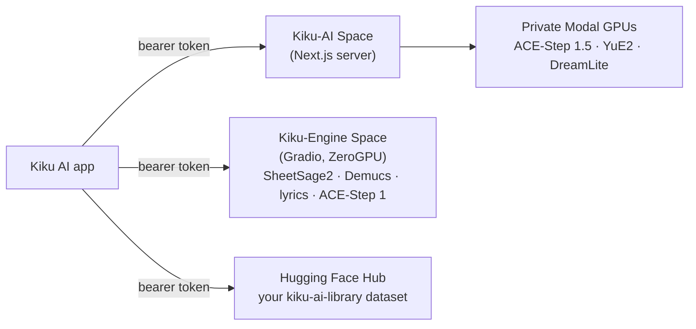

<p align="center"></p>

<h1 align="center">Kiku AI for Android, iPhone and Mac</h1>

<p align="center">Write songs from a sentence, reshape your own recordings in a multitrack studio,
and turn any recording into sheet music, on your phone.</p>

This is the Flutter version of the [Kiku AI web app](https://huggingface.co/spaces/Reubencf/Kiku-AI).
It has the same five sections, uses the same engines and saves to the same library in your Hugging Face
account, so a song made on the phone opens in the browser and the other way round.

- [What it does](#what-it-does)
- [Try it](#try-it)
- [Build and run](#build-and-run)
- [Signing in](#signing-in)
- [How it connects](#how-it-connects)
- [Your library](#your-library)
- [Settings](#settings)
- [Audio on the device](#audio-on-the-device)
- [Development](#development)
- [Troubleshooting](#troubleshooting)
- [Limits](#limits)
- [Licences](#licences)

## What it does

| Section | What you can do |
| --- | --- |
| **Home** | Type an idea and tap **Create** to start the song in Generate. Shortcuts to the other sections and your recent songs. |
| **Generate** | **Simple**: a one-line idea, and ACE-Step's planner writes the style and lyrics. **Custom**: your own style and lyrics, with section tags and **Enhance**. Choose ACE-Step 1.5 or YuE2, instrumental or not, and the length. Each song shows its place in the queue and its progress, gets DreamLite cover art, and can be renamed, shared, opened in the studio or deleted. |
| **Studio** | A small multitrack editor. Import or record audio, set mute, solo, volume and pan per track, split clips, undo and redo, and export the mix as WAV. Select a clip, or long-press and drag across one, then choose **Restyle**, **Rewrite**, **Extend**, **Cover** (YuE2), **Stems** (Demucs) or **Lyrics**. With nothing selected, choose **Add instrument** (drums, bass, keys, guitar, strings, synth or full band), **Instrumental** or **Song**. Results arrive as takes under their source, and you can switch each take on or off. |
| **Score** | Choose or record a recording (5 seconds to 10 minutes) and SheetSage2 writes a lead sheet. It is engraved with abcjs and the web app's own layout code. The current bar follows the recording as it plays; tap a bar to jump there. Share the PDF, MIDI, MusicXML, ABC or every file. |
| **Library** | Your songs, studio projects and scores, kept in the private dataset `<you>/kiku-ai-library` that the web app uses. |

The bottom player, light and dark themes, the Supreme and Bespoke Stencil fonts, the orange
dot-matrix musicians and the Kiku mark all match the web app.

## Try it

**Android.** Every change to `kiku_app/` builds a test APK:

1. Open the [Kiku AI app workflow](https://github.com/Reubencfernandes/musical/actions/workflows/kiku-app.yml)
   (you need to be signed in to GitHub) and pick the latest successful run.
2. Download the **`kiku-ai-android`** artifact, unzip it and copy `kiku-ai.apk` to the phone.
3. Open it and allow installing from this source when Android asks.

The test APK is signed with the CI runner's throwaway debug key, which changes on every run, so
uninstall the previous test build before installing a newer one. GitHub keeps artifacts for 90 days.

**iPhone, iPad and Mac.** There are no signed builds yet; build from source (below).

## Build and run

### Requirements

| | |
| --- | --- |
| Flutter | 3.44.7 stable with Dart 3.12 (the versions CI uses; `pubspec.yaml` needs Dart 3.12.2 or later) |
| Android | Android SDK and JDK 17; Flutter's default minimum Android version |
| iPhone and iPad | A Mac with Xcode, iOS 15 or later, and an Apple developer team to sign with |
| Mac | Xcode, macOS 10.15 or later |
| Account | A [Hugging Face](https://huggingface.co/join) account (free works) |

### Run it

```sh
git clone https://github.com/Reubencfernandes/musical.git
cd musical/kiku_app
flutter pub get
flutter devices          # list phones, simulators and macOS
flutter run -d <device>
```

### Release builds

```sh
flutter build apk --release      # build/app/outputs/flutter-apk/app-release.apk
flutter build ios --release      # then sign and install from Xcode
flutter build macos --release    # build/macos/Build/Products/Release/kiku_ai.app
```

- **Android** release builds are signed with the debug key, which is fine for testing. Add your
  own `signingConfig` in `android/app/build.gradle.kts` before publishing to a store.
- **iOS**: open `ios/Runner.xcworkspace`, choose your team under *Runner → Signing &
  Capabilities*, and change the bundle identifier (`com.reubencf.kikuAi`) if it is not your team's.
- **macOS** runs sandboxed. It is allowed network access, the microphone and files you pick.

The app asks for the microphone only when you record (Android `RECORD_AUDIO`, the iOS and macOS
`NSMicrophoneUsageDescription`). It also needs network access.

## Signing in

The sign-in screen offers two ways in:

- **Sign in with Hugging Face** opens Hugging Face in the system's secure sign-in sheet and comes
  back through `kikuai://oauth/callback`. This is the authorization-code flow with PKCE, using the
  web app's public OAuth client (`https://reubencf-kiku-ai.hf.space/oauth/client`). It asks for
  the same scopes as the web app: your profile, and permission to keep your music in a private
  dataset. These sign-ins last about eight hours.
- **Use an access token instead** works everywhere. Create a token at
  [huggingface.co/settings/tokens](https://huggingface.co/settings/tokens) and paste it. A
  **write** token lets the app save to your library; a read token works but saves nothing.

Tokens are kept in the device's secure storage (Keychain or Android Keystore). If the device
refuses, the app says so and keeps you signed in until it closes. When a sign-in lapses, the app
shows the sign-in screen and keeps your studio project and unsaved songs for when you sign back
in. Signing in as a different account clears them.

> [!IMPORTANT]
> Hugging Face only returns to the app if the Kiku AI server lists `kikuai://oauth/callback` in
> its OAuth client document, and generation only works if the server accepts the app's bearer
> token. Both are in this repository's web app (`outputs/kiku-ai`). If the deployed Space
> predates them, redeploy it with `work/deploy_kiku_app.py`. Until then, token sign-in still
> works for Score, Stems, Lyrics and the library.

## How it connects

The app has no server of its own. It calls the deployed services directly, from your own
connection and with your own Hugging Face token:



| What | Where it runs | Whose GPU time |
| --- | --- | --- |
| Generate with ACE-Step 1.5 or YuE2, the Simple-mode planner, Enhance, cover art; studio Restyle, Rewrite, Extend, Add instrument, Instrumental and Song with those models; Cover | Kiku AI server (`https://reubencf-kiku-ai.hf.space`), which runs the job on Modal | Kiku's |
| Score (SheetSage2), Stems (Demucs), Lyrics, and anything run with ACE-Step 1 | Kiku Engine (`https://reubencf-kiku-engine.hf.space`) | Your Hugging Face ZeroGPU allowance |
| Library | Hugging Face Hub | none |

The server checks the bearer token with Hugging Face (`whoami-v2`) and keeps the answer for five
minutes. A Modal job lives on the server, not in the app's connection, so when a mobile network
drops the stream the app reconnects and carries on from the last event it saw. Stopping a job in
the app stops it on the GPU too.

## Your library

The first save creates a private dataset, `<your username>/kiku-ai-library`, in your own
account. It is laid out exactly like the web app's:

```
songs/<id>.json        song details (title, style, lyrics, model, seed, cover)
songs/<id>.flac        its audio (the web app saves .mp3; the JSON's "audio" field names the file)
songs/<id>.webp        its cover art
projects/<id>/project.json        a studio project
projects/<id>/audio/<buffer>.wav  its audio, uploaded once per buffer
scores/<id>.json       a transcription, with its bar timing
scores/<id>.flac       its recording (.mp3 when the original was an MP3)
```

Saving needs write access: approve it when signing in with Hugging Face, or use a write token.
Without it, songs stay on the device, marked unsaved, and are saved once you sign back in with
saving allowed. **Settings → Open your library on Hugging Face** shows the dataset.

## Settings

Open Settings from the gear on wide screens or the account button on phones.

- **Account**: who is signed in, where songs are saved, and **Sign out**.
- **Appearance**: follow the device, or always light or dark.
- **Servers**: the Kiku AI and engine addresses. Enter a Space as `owner/name` or as a full
  `https://` address, for a fork or a local server. **Use the defaults** restores them.
- **Open-source licences**.

## Audio on the device

Studio buffers are 16-bit audio at 44.1 kHz, and the studio plays a rendered mix, so tracks stay
sample-locked. WAV and FLAC are read in Dart. MP3, M4A, OGG and other formats go through
AVFoundation (iOS and macOS) or MediaCodec (Android). Songs and scores are saved as FLAC, using a
Dart encoder that CI checks against the reference `flac` tool, and the web app plays them too.
Studio projects keep a WAV per buffer, exactly like the web studio.

## Development

```sh
flutter analyze
flutter test
```

- **The FLAC reference test** is skipped locally unless you point it at a file made by libFLAC:
  set `KIKU_REFERENCE_FLAC` and `KIKU_REFERENCE_WAV` to a `flac --best` file and its source WAV.
  The test also writes `build/kiku-test.flac`, which CI checks with `flac --test`.
- **Score engraving** uses `assets/score/engrave.js`, compiled from the web app's
  `lib/engrave.ts`. After changing that file, run `npm ci` in `outputs/kiku-ai`, then
  `sh tool/score_assets.sh` from `kiku_app`. Don't edit the generated file.
- **Icons and the logo**: the launcher icons and `lib/ui/logo_pixels.g.dart` come from
  [`branding/generate.py`](../branding/generate.py).
- **Shared formats**: the app mirrors parts of the web app, and the two must stay in step:
  `lib/studio/project.dart` and `outputs/kiku-ai/lib/studio/model.ts` (the project JSON);
  `lib/api/engine.dart` and `lib/jobs.ts` (job names, models and limits); `lib/api/library.dart`
  and `lib/library.ts` (the library layout).
- **CI**: [`.github/workflows/kiku-app.yml`](../.github/workflows/kiku-app.yml) runs on every
  push or pull request that touches `kiku_app/`. It runs the analyzer and the tests (with the
  libFLAC check), builds the Android APK as an artifact, and builds iOS (unsigned) and macOS.

### Layout

```
lib/
  main.dart, services.dart, config.dart
  auth/      Hugging Face sign-in (PKCE or token) and the sign-in screen
  api/       Gradio client, Kiku server client (Modal jobs), job routing, Hub client, library
  audio/     PCM buffers, WAV and FLAC codecs, platform decoding, waveforms
  studio/    project model (same JSON as the web studio), controller, screen, AI sheets
  songs/     Generate: controller, screen, song rows
  score/     Score: controller, screen, abcjs sheet view
  library/, home/, shell/ (navigation, player, settings), ui/ (theme, logo, widgets)
assets/
  score/     abcjs, the web app's engrave.js and the page that draws scores
  performers/, fonts/, kiku-mark.png
test/        codecs, project model, API helpers and widgets
tool/        score_assets.sh
android/, ios/, macos/   platform projects, including the native audio decoders
```

## Troubleshooting

| You see | What to do |
| --- | --- |
| Hugging Face sign-in shows an error about the redirect, or never returns to the app | The deployed Kiku-AI Space is older than the app; redeploy it (see [Signing in](#signing-in)), or use an access token meanwhile. |
| "Your Hugging Face GPU allowance is used up for now" | Score, Stems, Lyrics and ACE-Step 1 use your own ZeroGPU allowance. It resets 24 hours after your first use; PRO accounts get more. |
| "The engine is waking up" | The Space was asleep. Wait a minute and try again. |
| "Kiku restarted while this was running" | The Kiku-AI Space restarted (a redeploy does this) and the job was lost. Run it again. |
| "Allow Kiku AI to save to your Hugging Face account" | Sign out, sign in again and approve saving, or use a write token. |
| "Select at least 3 seconds" or "… minutes or less at a time" | Studio jobs take 3 seconds to 4 minutes of audio; see [Limits](#limits). |

## Limits

- Audio sent from the studio is 3 seconds to 4 minutes. Stems take up to 6 minutes, and covers
  and lyrics up to 5. ACE-Step 1.5 rewrites 3 to 90 seconds at a time. Transcription takes 5
  seconds to 10 minutes.
- Sheet music is drawn on Android, iOS and macOS. Anywhere else the score is shown as ABC text.
- The studio has no clip dragging or trimming yet. Split, delete, undo, takes and the mixer are
  there.
- A generation runs only while the app is open. Closing the app stops following it, and the
  server cancels a Modal job nobody follows after two minutes.

## Licences

The app's code is part of this repository. The models it calls have their own licences:
YuE2, SheetSage2 and DreamLite-base are CC BY-NC 4.0 (non-commercial); ACE-Step is Apache 2.0;
Demucs is MIT. The bundled abcjs is MIT (`assets/score/LICENSE.abcjs.md`). Supreme and Bespoke
Stencil are by Indian Type Foundry, via Fontshare.
